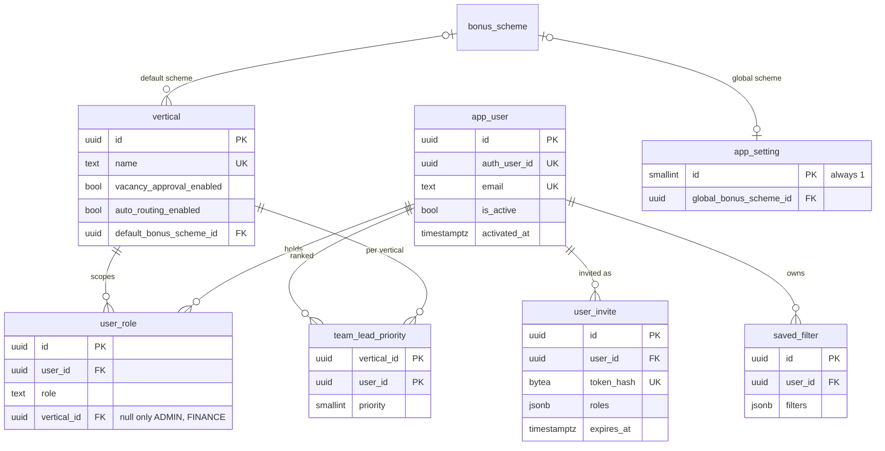
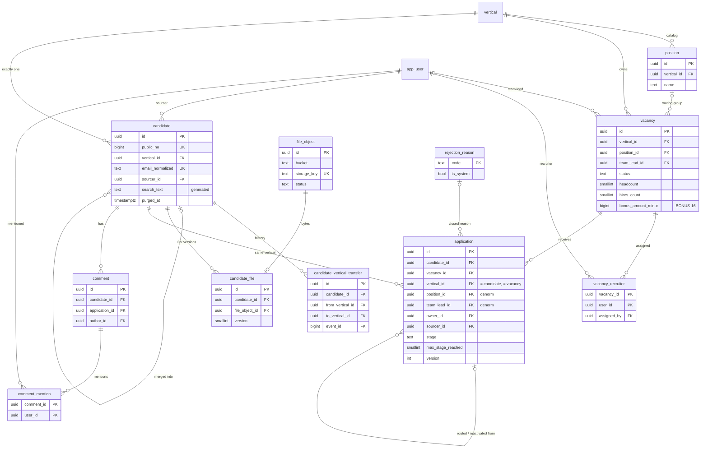
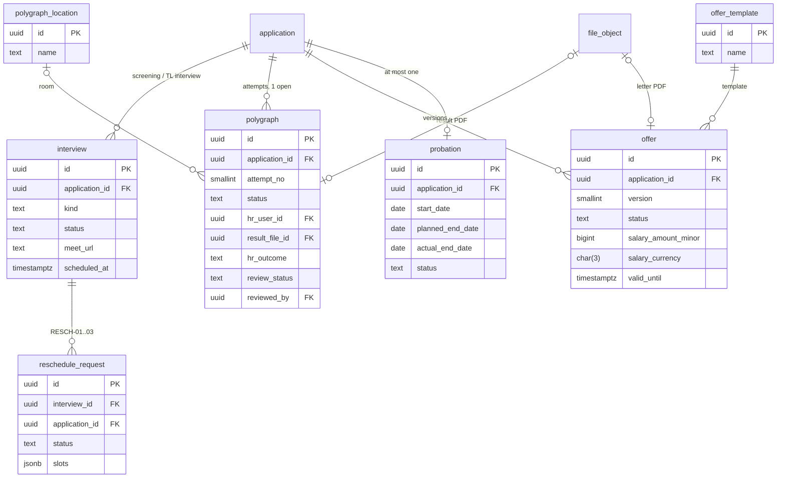
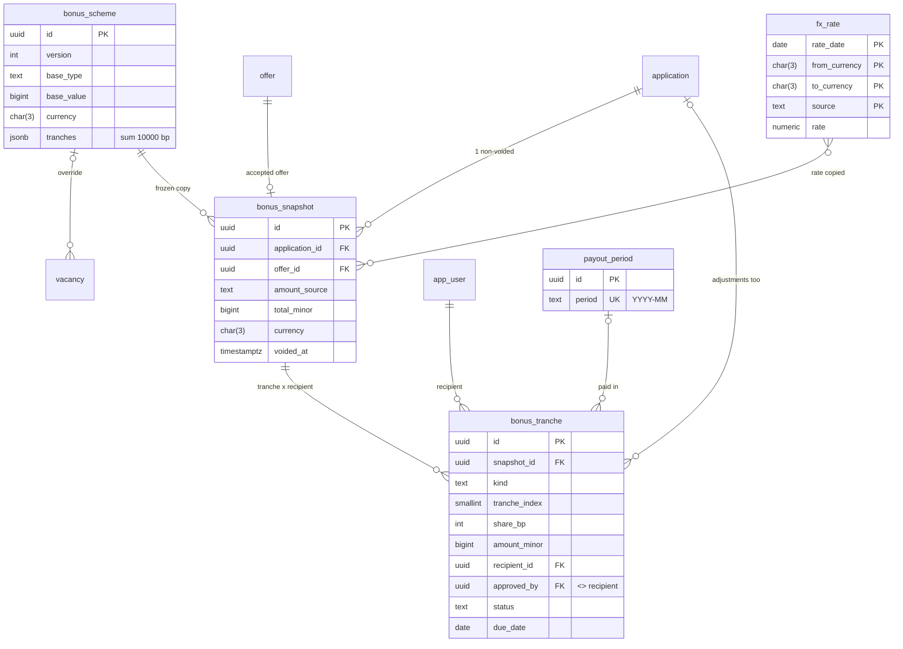
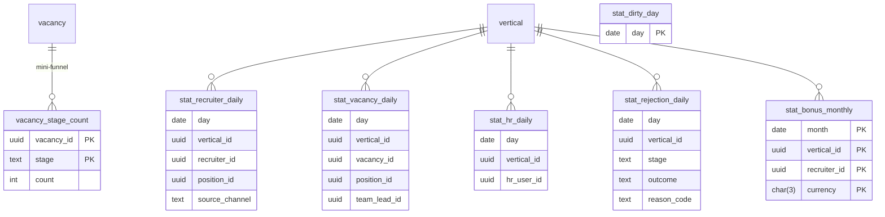

# ERD — PostgreSQL 16 schema design (Phase 0)

Owner: `database-engineer`. Sources: PRD v1.1 (incl. BONUS-16), owner decisions 2026-10-31, `architecture.md` §4/§9, `authz-matrix.md` §3, `pipeline-state-machine.md`, ADR-002/003/004/005/007/008, `perf/plan.md` §3/§6/§8.1, `security/threat-model.md` (DG-xx).
Status: design only. Drizzle schema (`server/db/schema.ts`) and migrations are written in Phase 1+, table by table with their feature phase.
Precedence: owner decisions → architect docs → perf plan. Every conflict is listed in §6. Security requirements are in §7. `⚠ OPEN` = PRD gap, waiting for the owner (§8).

---

## 0. Conventions

| Topic | Rule |
|---|---|
| Schema / roles | All tables in schema `app`, not exposed via PostgREST. Roles (DG-17/22): `app_migrator` (owner, DDL, CI from `main` only), `app_rw` (runtime DML, `BYPASSRLS`, not owner, not a member of `app_purge`), `app_purge` (owner of `app.purge_candidate`, no login from the app). RLS enabled on every table, no policies for `anon`/`authenticated` (deny-all, ADR-002). Grants: §3.9 |
| Supabase objects | `storage.objects`: **zero** policies for `anon`/`authenticated` (DG-03), access only via the service role after an app authz check. `realtime.messages`: one `SELECT` policy via a `SECURITY DEFINER` helper with fixed `search_path`, **no `INSERT` policy** for clients (DG-11). `app_rw` gets `SELECT` on `auth.sessions` for the per-request session check (DG-05) |
| Keys | Entity tables: `id uuid DEFAULT gen_random_uuid()`. High-volume append tables (`entity_event`, `audit_log`, `change_feed`, `job_run`, `stat_*`, `purge_log`): `id bigint GENERATED ALWAYS AS IDENTITY`. Join tables: composite PK |
| FKs | `ON DELETE RESTRICT`, no cascades: nothing business is hard-deleted (ARCH-05). Composite FKs pin denormalised `vertical_id` columns (§3.6). FK columns are indexed only where a query needs one (§5), because parents are never deleted |
| Time | `timestamptz` (UTC) for instants. `date` for Kyiv calendar dates (probation, offer start, `due_date`, stats `day`, FX date, consent, leave date). Kyiv dates are computed in the app from the injected clock (`@date-fns/tz`), never `now()::date` in SQL |
| Clock | Business timestamps (`occurred_at`, `stage_entered_at`, `sent_at`, …) and `created_at` are written by services from `ctx.clock` (fixed clock in tests and screenshots). `DEFAULT now()` is only a fallback |
| Money | `<x>_minor bigint` + `<x>_currency char(3)`; CHECK currency `~ '^[A-Z]{3}$'`; pair CHECK "both null or both set". The allowed currency list lives in Zod (⚠ OPEN Q-51) |
| Ratios | Integer basis points (`*_bp int`, 10000 = 100 % or ×1). An FX rate is `numeric(20,10)` (a rate, not money) |
| Rich text | ProseMirror JSON in `jsonb` columns named `*_doc`, validated by a strict Zod node/mark allowlist and rendered only through React (DG-13). No stored HTML |
| Enums | `text` + named CHECK (`<table>_<col>_chk`). No pg enums (reasons below) |
| Soft delete **[sd]** | `deleted_at timestamptz null`, `deleted_by uuid null FK app_user`, `delete_reason text null`; CHECK `<t>_soft_delete_chk`: `(deleted_at IS NULL) = (deleted_by IS NULL)` and `deleted_at IS NULL OR delete_reason IS NOT NULL OR purged_at IS NOT NULL` (where `purged_at` exists). Tables: `vacancy`, `candidate`, `application`, `candidate_file`, `comment`. Reference data uses `is_active`. Join and config rows are hard-deleted with an `entity_event` + `audit_log` row (history lives there) |
| **[ts]** | `created_at timestamptz NN DEFAULT now()`, `updated_at timestamptz NN DEFAULT now()` (set by the repository on every update) |
| **[by]** | `created_by uuid FK app_user` (null = system/seed) |
| Error mapping | Named constraints and indexes map to API codes (architecture §5): `23505` on `application_active_in_group_uq` → `ACTIVE_APPLICATION_IN_GROUP`; trigger `RAISE … ERRCODE 'P0001', MESSAGE '<CODE>'` → 409 `<CODE>` |
| Extensions | `pg_trgm` only |

### Why `text` + CHECK instead of pg enums
- ROLE-04: `user_role.role` must accept `custom:*` codes later; the architect fixed `text` (ADR-002). Notification `channel` must stay open for Telegram (architecture §6). One rule for all enums keeps Drizzle and Zod uniform.
- A CHECK list changes in a reversible migration (`DROP/ADD CONSTRAINT … NOT VALID` + `VALIDATE`, no long lock). Pg enum values can't be removed, and a value added with `ALTER TYPE … ADD VALUE` can't be used in the same transaction.
- Ordering doesn't come from enum order. Stage ordering = `application.max_stage_reached smallint` + immutable `app.stage_rank(text)` (NEW 1 · IN_WORK 2 · SUBMITTED_TO_TL 3 · TL_INTERVIEW 4 · POLYGRAPH 5 · OFFER 6 · PROBATION 7 · PROBATION_PASSED 8; terminal ✖ stages = 0).
- Drizzle `text({ enum: [...] })` gives the same TS literal unions. The storage overhead is negligible at PERF-01 volumes.

### Named predicates (repositories use them verbatim, so the planner matches the partial indexes)
| Name | SQL |
|---|---|
| `ACTIVE_STAGES` | `('NEW','IN_WORK','SUBMITTED_TO_TL','TL_INTERVIEW','POLYGRAPH','OFFER','PROBATION')` |
| `ARCHIVE_STAGES` | `('REJECTED','WITHDRAWN','PROBATION_FAILED')` |
| `OPEN_POLYGRAPH` | `('UNASSIGNED','ASSIGNED','SCHEDULED','PENDING_REVIEW')` |
| **ACTIVE** (application) | `deleted_at IS NULL AND stage IN ACTIVE_STAGES` |
| **LIVE** | `deleted_at IS NULL` |

---

## 1. Diagrams

Key columns only. Full columns are in §2.

### 1.1 Identity, authz, settings


### 1.2 Vacancies, candidates, applications


### 1.3 Pipeline sub-objects


### 1.4 Bonuses


### 1.5 Events, audit, notifications, jobs, security

```mermaid
erDiagram
    entity_event ||--o| entity_event_pii : "purgeable PII"
    app_user |o--o{ entity_event : "actor"
    app_user |o--o{ audit_log : "actor"
    app_user ||--o{ notification : "recipient"
    notification |o--o{ notification_delivery : "external channels"
    app_user ||--o{ notification_pref : "overrides"
    vertical |o--o{ change_feed : "topic vertical"
    candidate ||--o{ purge_log : "purged stub"
    entity_event {
        bigint id PK
        timestamptz occurred_at
        text type
        uuid vertical_id FK
        uuid vacancy_id FK
        uuid candidate_id FK
        uuid application_id FK
        jsonb payload "no PII"
        text sensitivity
    }
    entity_event_pii {
        bigint event_id PK
        jsonb data
    }
    audit_log {
        bigint id PK
        text action
        uuid candidate_id FK
        jsonb before
        jsonb after
    }
    purge_log {
        bigint id PK
        uuid candidate_id FK
        timestamptz purged_at
    }
    notification {
        uuid id PK
        uuid user_id FK
        text type
        text dedupe_key UK
        timestamptz read_at
    }
    notification_delivery {
        uuid id PK
        text channel
        text recipient_kind
        text status
        timestamptz next_attempt_at
        text dedupe_key UK
    }
    notification_pref {
        uuid user_id PK
        text type PK
        text channel PK
        bool enabled
    }
    change_feed {
        bigint id PK
        text entity_type
        uuid entity_id
        uuid mutation_id
    }
    job_run {
        bigint id PK
        text job_name
        text run_key
        text status
    }
    rate_limit_bucket {
        text key PK
        timestamptz window_start PK
        int count
    }
```


### 1.6 Statistics aggregates


---

## 2. Tables (47)

NN = NOT NULL. Defaults left blank = none.

### 2.1 Identity, authz, settings (7)

#### `vertical`
| Column | Type | Null | Default | Notes |
|---|---|---|---|---|
| id | uuid | NN | gen_random_uuid() | |
| name | text | NN | | Ukrainian display name |
| vacancy_approval_enabled | boolean | NN | false | D2 |
| auto_routing_enabled | boolean | NN | true | ROUTE-09 |
| default_bonus_scheme_id | uuid | null | | FK `bonus_scheme`, BONUS-01 |
| [ts] | | | | |
- UQ `lower(name)`. **No `is_active`, no deactivation, no soft delete** (owner 2026-10-31). No polygraph-review flag: Head HR review is mandatory everywhere (owner 2026-10-31).

#### `app_user`
| Column | Type | Null | Default | Notes |
|---|---|---|---|---|
| id | uuid | NN | gen_random_uuid() | |
| auth_user_id | uuid | null | | Supabase `auth.users.id`, set on invite acceptance. No cross-schema FK (the Docker perf DB uses an auth stub) |
| email | text | NN | | CHECK `email = lower(email)` |
| full_name | text | NN | | |
| is_active | boolean | NN | true | false = deactivated (ROLE-05) |
| activated_at | timestamptz | null | | first invite acceptance; null = «Запрошено» |
| deactivated_at / deactivated_by | timestamptz / uuid | null | | FK `app_user` |
| timezone | text | NN | 'Europe/Kyiv' | Q-40 |
| last_login_at | timestamptz | null | | |
| [ts], [by] | | | | |
- UQ `email`, UQ `auth_user_id`. CHECK `is_active = (deactivated_at IS NULL)`. Users are never deleted or purged (ADR-003 actor names). MFA factors (Admin, Finance) live in Supabase Auth; no app column.
- The row is created at invite time, so the invite email is a normal `USER` delivery and the users list shows invited people.

#### `user_role`
| Column | Type | Null | Default | Notes |
|---|---|---|---|---|
| id | uuid | NN | gen_random_uuid() | surrogate: a PK can't include the nullable `vertical_id` |
| user_id | uuid | NN | | FK `app_user` |
| role | text | NN | | built-in code or `custom:<code>` (ROLE-04) |
| vertical_id | uuid | null | | FK `vertical` |
| created_at, [by] | | | | |
- UQ `user_role_uq UNIQUE NULLS NOT DISTINCT (user_id, role, vertical_id)` (IDX-45).
- CHECK `user_role_scope_chk`: `ADMIN`/`FINANCE` ⇒ `vertical_id IS NULL`; other built-ins ⇒ NOT NULL; anything else must match `^custom:[a-z0-9_]+$` (custom role scope is validated in the app against `role_definition.is_global`, later).
- Revoking = hard delete + `entity_event user.role_removed` + audit.

#### `user_invite`
| Column | Type | Null | Default | Notes |
|---|---|---|---|---|
| id | uuid | NN | gen_random_uuid() | |
| user_id | uuid | NN | | FK `app_user` (invitee) |
| token_hash | bytea | NN | | SHA-256 of a 256-bit random token; the plain token exists only in the email (DG-07) |
| roles | jsonb | NN | | `[{role, verticalId}]` to grant on acceptance; CHECK array, length ≥ 1 |
| status | text | NN | 'PENDING' | `PENDING`, `ACCEPTED`, `REVOKED`. "Expired" is derived (`PENDING AND expires_at < now`) |
| sent_at | timestamptz | NN | | |
| expires_at | timestamptz | NN | | CHECK `expires_at = sent_at + interval '72 hours'` (ROLE-05) |
| resend_count | smallint | NN | 0 | resend rotates `token_hash`, `sent_at` and `expires_at` on the same row, so the old link dies |
| invited_by | uuid | NN | | FK `app_user` |
| accepted_at | timestamptz | null | | |
| revoked_at / revoked_by | timestamptz / uuid | null | | |
| created_at | timestamptz | NN | now() | |
- UQ `token_hash`; partial UQ `(user_id) WHERE status = 'PENDING'`. CHECK status ↔ timestamps.
- Atomic consume (DG-07): `UPDATE … SET status='ACCEPTED', accepted_at=$now WHERE token_hash=$h AND status='PENDING' AND expires_at > $now RETURNING …`; 0 rows ⇒ «Запрошення недійсне».

#### `team_lead_priority`
| Column | Type | Null | Default | Notes |
|---|---|---|---|---|
| vertical_id | uuid | NN | | FK |
| user_id | uuid | NN | | FK; the TL role is checked in the app |
| priority | smallint | NN | | CHECK ≥ 0; 0 = highest (ROUTE-01). Not unique: equal priorities are allowed (D5 tie-break) |
| updated_at, updated_by | | NN / null | now() | |
- PK `(vertical_id, user_id)` (IDX-46). Hard delete. ⚠ OPEN Q-93: default for a TL without a row.

#### `app_setting` (single row)
| Column | Type | Null | Default | Notes |
|---|---|---|---|---|
| id | smallint | NN | 1 | PK, CHECK `id = 1` |
| offer_validity_days | smallint | NN | 5 | D11, CHECK > 0 |
| routing_rejection_cooldown_days | smallint | NN | 180 | D6 |
| sourcing_ownership_window_days | smallint | NN | 180 | D8 |
| global_bonus_scheme_id | uuid | null | | FK `bonus_scheme` (BONUS-01) |
| retention_rejected_months | smallint | null | | ARCH-04 proposals; null = off (O-16) |
| updated_at, updated_by | | | | |
- A typed single row, not key/value, so it gets CHECKs and a real FK for the global scheme. Changes are audited and emit `entity_event` (`subject_type='app_setting'`).

#### `saved_filter`
| Column | Type | Null | Default | Notes |
|---|---|---|---|---|
| id | uuid | NN | gen_random_uuid() | |
| user_id | uuid | NN | | FK |
| screen | text | NN | 'DASHBOARD' | CHECK `('DASHBOARD')` — UI-01 only; widened when other screens get saved filters |
| name | text | NN | | |
| filters | jsonb | NN | | ids/enums only, validated by the shared Zod filter schema |
| [ts] | | | | |
- UQ `(user_id, screen, lower(name))`. Hard delete.

### 2.2 Vacancies, candidates, applications (11)

#### `position`
| Column | Type | Null | Default | Notes |
|---|---|---|---|---|
| id | uuid | NN | gen_random_uuid() | |
| vertical_id | uuid | NN | | FK; position × vertical = routing group |
| name | text | NN | | |
| is_active | boolean | NN | true | deactivate instead of delete (vacancies reference it) |
| [ts], [by] | | | | |
- UQ `(vertical_id, lower(name))`; UQ `(id, vertical_id)` (target of composite FKs, §3.6).

#### `vacancy`
| Column | Type | Null | Default | Notes |
|---|---|---|---|---|
| id | uuid | NN | gen_random_uuid() | |
| vertical_id | uuid | NN | | FK |
| position_id | uuid | null | | composite FK `(position_id, vertical_id)` → `position(id, vertical_id)`; T01 guard "vacancy has position" |
| title | text | NN | | trigram-searchable |
| team_lead_id | uuid | null | | FK `app_user`; null = recruiter-initiated (VAC-03) |
| status | text | NN | 'OPEN' | `DRAFT`, `OPEN`, `ON_HOLD`, `FILLED`, `CANCELLED` |
| headcount | smallint | NN | 1 | CHECK ≥ 1 |
| hires_count | smallint | NN | 0 | denorm counter (ADR-008), CHECK ≥ 0 |
| seniority | text | null | | ⚠ OPEN value list |
| work_format | text | null | | `REMOTE`, `OFFICE`, `HYBRID` |
| employment_type | text | null | | ⚠ OPEN value list |
| location | text | null | | |
| salary_min_minor / salary_max_minor | bigint | null | | CHECK min ≤ max, ≥ 0 |
| salary_currency | char(3) | null | | NN iff a salary bound is set |
| description_doc / requirements_doc | jsonb | null | | rich text (DG-13) |
| priority_flag | text | NN | 'NORMAL' | `NORMAL`, `URGENT` |
| priority_override | smallint | null | | ROUTE-01 Admin override, CHECK ≥ 0 |
| probation_days | smallint | NN | 90 | CHECK 1..90 (PROB-02) |
| bonus_scheme_id | uuid | null | | FK, Admin override (BONUS-01) |
| bonus_amount_minor | bigint | null | | BONUS-16 recruiter reward, CHECK ≥ 0 (⚠ OPEN: is 0 allowed) |
| bonus_currency | char(3) | null | | pair with the amount |
| bonus_amount_changed_at | timestamptz | null | | last change of the amount; history is in `entity_event` (§3.3) |
| source | text | NN | 'APP' | `APP`, `TELEGRAM_BOT` (VAC-06) |
| cloned_from_vacancy_id | uuid | null | | FK self (VAC-05) |
| opened_at | timestamptz | null | | first time `OPEN` (days open, time-to-fill) |
| closed_at | timestamptz | null | | Closed tab ordering (ARCH-02) |
| [ts], [by], [sd] | | | | `created_by` NN |
- UQ `(id, vertical_id)` (composite FK target). CHECK `vacancy_closed_chk`: `(closed_at IS NOT NULL) = (status IN ('FILLED','CANCELLED'))`. CHECK `status = 'DRAFT' OR opened_at IS NOT NULL`.

#### `vacancy_recruiter`
| Column | Type | Null | Default | Notes |
|---|---|---|---|---|
| vacancy_id | uuid | NN | | FK |
| user_id | uuid | NN | | FK |
| assigned_at | timestamptz | NN | | |
| assigned_by | uuid | NN | | FK `app_user`; the Head Recruiter (or Admin) who assigned, or `= user_id` for a self-assignment (owner 2026-10-31) |
- PK `(vacancy_id, user_id)` + index `(user_id, vacancy_id)` (IDX-29). Hard delete + `vacancy.recruiter_unassigned` event.

#### `candidate`
| Column | Type | Null | Default | Notes |
|---|---|---|---|---|
| id | uuid | NN | gen_random_uuid() | |
| public_no | bigint | NN | identity | «Кандидат #1234» label, survives purge |
| vertical_id | uuid | NN | | FK; **exactly one vertical** (owner 2026-10-31); changed only by a transfer (§3.6) |
| full_name | text | null | | NN unless purged |
| email / email_normalized | text | null | | normalized = lower + trim (app) |
| phone / phone_e164 | text | null | | E.164 via libphonenumber (app) |
| telegram / telegram_normalized | text | null | | lower, without `@` |
| linkedin_url / linkedin_normalized | text | null | | CHECK `linkedin_url ~ '^https://'` (DG-13 scheme allowlist) |
| portfolio_urls | text[] | NN | '{}' | `https:` only, checked by Zod |
| location, current_company, current_title | text | null | | |
| expected_salary_minor / expected_salary_currency | bigint / char(3) | null | | money pair |
| summary_doc | jsonb | null | | rich text |
| tags | text[] | NN | '{}' | |
| source_channel | text | null | | `LINKEDIN`, `DJINNI`, `TELEGRAM`, `REFERRAL`, `OTHER` (⚠ OPEN: the PRD list ends with "…") |
| consent_given_on | date | null | | CAND-01 checkbox + date (⚠ OPEN Q-85 / O-16 renewal) |
| former_employee | boolean | NN | false | CAND-05; editable only by HREC/HHR/Admin (DG-19, service) |
| former_employee_left_on | date | null | | BONUS-11 needs it (⚠ OPEN Q-47: mandatory?) |
| referrer_user_id | uuid | null | | FK `app_user`, self-referral (BONUS-05); HREC/HHR/Admin only (DG-19) |
| sourcer_id | uuid | NN | | FK, BONUS-04/05 (may be a Head Recruiter) |
| owner_id | uuid | null | | FK `app_user`; candidate-level owner: candidate `own` scope, new owner chosen in the transfer dialog (CAND-06) |
| sourcer_since | timestamptz | NN | | restarts on 180-day re-engagement (D8) |
| last_activity_at | timestamptz | NN | | denorm; pipeline actions only (DG-19) |
| merged_into_id | uuid | null | | FK self (CAND-02 merge); CHECK `<> id` |
| search_text | text | NN | generated | see below |
| purged_at / purged_by | timestamptz / uuid | null | | ARCH-04 |
| [ts], [by], [sd] | | | | |
- `search_text` = `GENERATED ALWAYS AS (translate(lower(coalesce(full_name,'') ‖ ' ' ‖ coalesce(email_normalized,'') ‖ ' ' ‖ coalesce(regexp_replace(phone_e164,'\D','','g'),'') ‖ ' ' ‖ coalesce(telegram_normalized,'')), 'ʼ’`', '''''''')) STORED`. It uses only immutable operations (`‖`, `lower`, `translate`, `regexp_replace`); `concat_ws` isn't immutable, so it isn't used.
- **Dedupe keys are company-wide, not per vertical** (owner 2026-10-31). ⚠ OWNER Q-46 (block vs warn; recommendation: block exact matches): **block ⇒ partial UNIQUE** (DG-19 race-proof sourcing credit), **warn ⇒ the same indexes non-unique**. Indexes on each of `email_normalized`, `phone_e164`, `telegram_normalized`, `linkedin_normalized` `WHERE deleted_at IS NULL AND purged_at IS NULL` (IDX-18..21). No `vertical_id` in these indexes.
- CHECK `candidate_name_chk`: `purged_at IS NOT NULL OR full_name IS NOT NULL`. CHECK `candidate_purged_pii_null_chk`: `purged_at IS NULL OR num_nonnulls(full_name, email, email_normalized, phone, phone_e164, telegram, telegram_normalized, linkedin_url, linkedin_normalized, location, current_company, current_title, expected_salary_minor, summary_doc, former_employee_left_on) = 0`. CHECK each normalized key is null when its raw value is null. CHECK `former_employee OR former_employee_left_on IS NULL`.
- Merge (⚠ OPEN Q-46): the loser gets `merged_into_id` + soft delete (which frees its dedupe keys). Its events stay on its id; the winner's timeline reads `candidate_id = ANY(winner + merged ids)`.

#### `candidate_vertical_transfer` (append-only history, owner 2026-10-31)
| Column | Type | Null | Default | Notes |
|---|---|---|---|---|
| id | uuid | NN | gen_random_uuid() | |
| candidate_id | uuid | NN | | FK |
| from_vertical_id / to_vertical_id | uuid | NN | | FK `vertical`; CHECK `from <> to` |
| transferred_by | uuid | NN | | FK `app_user` (Admin, Head Recruiter or Head HR — service authz) |
| transferred_at | timestamptz | NN | | |
| event_id | bigint | NN | | FK `entity_event` (`candidate.vertical_transferred`), UQ; reason in `entity_event_pii` |
- Same append-only treatment as `entity_event` (REVOKE UPDATE/DELETE/TRUNCATE + trigger). No PII; kept on purge.

#### `candidate_file`
| Column | Type | Null | Default | Notes |
|---|---|---|---|---|
| id | uuid | NN | gen_random_uuid() | |
| candidate_id | uuid | NN | | FK |
| file_object_id | uuid | NN | | FK, UQ |
| kind | text | NN | | `CV`, `ATTACHMENT` |
| version | smallint | NN | | CV versions are kept (CAND-01) |
| created_at, [by], [sd] | | | | |
- UQ `(candidate_id, kind, version)`.

#### `file_object` (ADR-005, DG-12)
| Column | Type | Null | Default | Notes |
|---|---|---|---|---|
| id | uuid | NN | gen_random_uuid() | |
| bucket | text | NN | | `cv`, `polygraph`, `offer`, `attachment` |
| storage_key | text | NN | | `{vertical_id}/{id}`, UQ, no user-controlled segments |
| vertical_id | uuid | NN | | FK (vertical at upload time; the key stays fixed after a transfer) |
| owner_type / owner_id | text / uuid | NN | | parent for the authz check on URL issue: `candidate`, `polygraph`, `offer` (polymorphic, no FK) |
| status | text | NN | 'PENDING' | `PENDING`, `READY`, `REJECTED`, `PURGED` |
| original_filename | text | null | | PII → nulled on purge |
| mime_type | text | NN | | |
| size_bytes | bigint | NN | | real size from Storage metadata at `complete` |
| sha256 | bytea | null | | nulled on purge |
| etag | text | null | | recorded at `complete`, re-checked on URL issue (DG-12); nulled on purge |
| scan_status | text | NN | 'NOT_SCANNED' | Phase 7 antivirus |
| uploaded_by | uuid | null | | FK; `complete` is accepted only from this user (DG-12). Null = server-generated offer letter |
| created_at | timestamptz | NN | now() | |
| completed_at | timestamptz | null | | |
| purged_at / storage_deleted_at | timestamptz | null | | the storage object is removed after commit; the job retries until `storage_deleted_at` is set |
- CHECK `file_object_size_chk`: `cv` ≤ 10 MiB, `polygraph` ≤ 15 MiB, `offer` ≤ 5 MiB, `attachment` ≤ 10 MiB. CHECK `file_object_mime_chk`: `polygraph`/`offer` ⇒ `application/pdf`; `cv` ⇒ pdf/msword/docx; `attachment` ⇒ also png/jpeg. CHECK `READY ⇒ completed_at`; `PURGED ⇒ original_filename, sha256, etag IS NULL AND purged_at IS NOT NULL`; `bucket <> 'offer' ⇒ uploaded_by IS NOT NULL`.

#### `application`
| Column | Type | Null | Default | Notes |
|---|---|---|---|---|
| id | uuid | NN | gen_random_uuid() | |
| candidate_id | uuid | NN | | FK; vertical must equal the candidate's (§3.6 trigger) |
| vacancy_id | uuid | NN | | composite FK `(vacancy_id, vertical_id)` → `vacancy(id, vertical_id)` |
| vertical_id | uuid | NN | | = vacancy vertical (FK) = candidate vertical at creation (trigger) |
| position_id | uuid | null | | composite FK `(position_id, vertical_id)` → `position(id, vertical_id)`; routing group |
| team_lead_id | uuid | null | | denorm from vacancy (`sub` scope) |
| stage | text | NN | 'NEW' | 11 stages (state machine §1) |
| max_stage_reached | smallint | NN | 1 | ordinal 1..8; CHECK `max_stage_reached BETWEEN 1 AND 8 AND max_stage_reached >= app.stage_rank(stage)` |
| version | int | NN | 1 | optimistic lock (G3) |
| owner_id | uuid | NN | | FK, tranche 2 (BONUS-04); may be a Head Recruiter |
| sourcer_id | uuid | NN | | FK, tranche 1; never changed by reassignment |
| source_type | text | NN | | `DIRECT`, `POSITION`, `ROUTED` |
| tl_decision | text | null | | `PENDING`, `ACCEPTED` |
| tl_decided_at | timestamptz | null | | STAT-05 response time |
| routed | boolean | NN | false | closed as REJECTED and routed on (ROUTE-03) |
| routed_from_application_id | uuid | null | | FK self |
| reactivated_from_application_id | uuid | null | | FK self (ARCH-01) |
| closed_reason_code | text | null | | FK `rejection_reason(code)` |
| closed_at / closed_by | timestamptz / uuid | null | | archive "when / by whom" (ARCH-01) |
| submitted_at | timestamptz | null | | time-to-submit |
| stage_entered_at | timestamptz | NN | | board ordering, time-in-stage |
| last_activity_at | timestamptz | NN | | |
| [ts], [by], [sd] | | | | |
- UQ `(id, vertical_id)` (target for bonus composite FKs). CHECK `application_stage_chk` (11 values). CHECK `application_closed_chk`: `(closed_at IS NULL) = (stage IN ACTIVE_STAGES)`. CHECK `stage <> 'REJECTED' OR closed_reason_code IS NOT NULL`. CHECK `NOT routed OR stage = 'REJECTED'`. CHECK `(source_type = 'ROUTED') = (routed_from_application_id IS NOT NULL)`. CHECK `tl_decision IS NULL OR max_stage_reached >= 3`.
- ROUTE-06 partial unique index: §3.4.

#### `comment`
| Column | Type | Null | Default | Notes |
|---|---|---|---|---|
| id | uuid | NN | gen_random_uuid() | |
| candidate_id | uuid | NN | | FK (CAND-04) |
| application_id | uuid | null | | FK, optional context |
| author_id | uuid | NN | | FK |
| body_doc | jsonb | null | | rich text; null only after purge |
| created_at | timestamptz | NN | now() | |
| purged_at | timestamptz | null | | |
| [sd] | | | | |
- CHECK `body_doc IS NOT NULL OR purged_at IS NOT NULL`. ⚠ OPEN: vacancy-level comments; editing comments.

#### `comment_mention`
| Column | Type | Null | Default | Notes |
|---|---|---|---|---|
| comment_id | uuid | NN | | FK |
| user_id | uuid | NN | | FK |
| created_at | timestamptz | NN | now() | |
- PK `(comment_id, user_id)`.

#### `rejection_reason` (§6.4)
| Column | Type | Null | Default | Notes |
|---|---|---|---|---|
| code | text | NN | | PK, CHECK `^[A-Z][A-Z0-9_]*$`, immutable (stats and events store the code) |
| label_uk | text | NN | | |
| requires_comment | boolean | NN | false | `OTHER` = true |
| is_system | boolean | NN | false | the 8 PRD codes; can't be deactivated (Q-69) |
| is_active | boolean | NN | true | |
| sort_order | smallint | NN | 0 | |
| [ts] | | | | |
- CHECK `NOT is_system OR is_active`. Used reasons can't be deleted (FK RESTRICT).

### 2.3 Pipeline sub-objects (7)

#### `interview`
| Column | Type | Null | Default | Notes |
|---|---|---|---|---|
| id | uuid | NN | gen_random_uuid() | |
| application_id | uuid | NN | | FK |
| kind | text | NN | | `SCREENING`, `TL_INTERVIEW` |
| status | text | NN | 'SCHEDULED' | `SCHEDULED`, `RESCHEDULE_PENDING`, `COMPLETED`, `NO_SHOW_CANDIDATE`, `NO_SHOW_TL`, `CANCELLED` |
| meet_url | text | NN | | CHECK `~ '^https://meet\.google\.com/[a-z]{3}-[a-z]{4}-[a-z]{3}$'` (PIPE-04 backstop) |
| scheduled_at | timestamptz | NN | | |
| interviewer_id | uuid | null | | FK; NN for `TL_INTERVIEW` |
| result | text | null | | `PASS`, `REJECT` |
| completed_at / cancelled_at | timestamptz | null | | |
| [ts], [by] | | | | |
- CHECK `result IS NULL OR (kind = 'TL_INTERVIEW' AND status = 'COMPLETED')`; `status = 'COMPLETED' ⇒ completed_at`. **No free-text columns**: screening notes, TL summary and feedback go to `entity_event_pii` (state machine §2), so purge covers them (T-D11). ⚠ OPEN Q-95: duration.
- Partial UQ: one open interview per application (N08).

#### `reschedule_request`
| Column | Type | Null | Default | Notes |
|---|---|---|---|---|
| id | uuid | NN | gen_random_uuid() | |
| interview_id | uuid | NN | | FK |
| application_id | uuid | NN | | denorm, RESCH-03 count per application |
| requested_by | uuid | NN | | FK (TL) |
| status | text | NN | 'PENDING_RECRUITER' | `PENDING_RECRUITER`, `PENDING_TL`, `CONFIRMED`, `CANCELLED` |
| slots | jsonb | NN | | `[{startsAt}]`, CHECK array length 1..3 |
| counter_slots | jsonb | null | | same CHECK; NN when `PENDING_TL` |
| confirmed_slot_at | timestamptz | null | | NN when `CONFIRMED` |
| answered_by / answered_at | uuid / timestamptz | null | | |
| [ts] | | | | |
- Partial UQ `(interview_id) WHERE status IN ('PENDING_RECRUITER','PENDING_TL')`. Comments → `entity_event_pii`.

#### `polygraph` (one row per attempt, owner 2026-10-31)
| Column | Type | Null | Default | Notes |
|---|---|---|---|---|
| id | uuid | NN | gen_random_uuid() | |
| application_id | uuid | NN | | FK |
| attempt_no | smallint | NN | | 1, 2, … per application; CHECK ≥ 1. A retake = new row |
| status | text | NN | 'UNASSIGNED' | `UNASSIGNED`, `ASSIGNED`, `SCHEDULED`, `PENDING_REVIEW`, `PASSED`, `FAILED`, `NOT_CONFIRMED`, `CANCELLED` |
| hr_user_id | uuid | null | | FK (POLY-01) |
| location_id | uuid | null | | FK `polygraph_location` |
| address | text | null | | free address alternative (POLY-02) |
| scheduled_at | timestamptz | null | | |
| result_file_id | uuid | null | | FK `file_object` (bucket `polygraph`) |
| hr_outcome | text | null | | `PASS`, `FAIL` (HR result) |
| result_recorded_at / result_recorded_by | | null | | |
| review_status | text | null | | `PENDING`, `CONFIRMED`, `NOT_CONFIRMED` — mandatory Head HR review |
| reviewed_by / reviewed_at | uuid / timestamptz | null | | |
| review_comment | text | null | | Head HR comment (owner requirement); nulled on purge |
| cancelled_at | timestamptz | null | | |
| [ts] | | | | |
- Lifecycle: `UNASSIGNED → ASSIGNED → SCHEDULED → PENDING_REVIEW` (HR outcome + PDF) → review `CONFIRMED` ⇒ `PASSED`/`FAILED` (= `hr_outcome`) or `NOT_CONFIRMED` ⇒ `NOT_CONFIRMED`; any open status → `CANCELLED`. A retake (new attempt) follows only `NOT_CONFIRMED`; a confirmed `FAILED` closes the application (`REJECTED`, reason `POLYGRAPH_FAILED`). Retake limit ⚠ OPEN Q-136.
- CHECK `polygraph_assignee_chk`: status ∉ (`UNASSIGNED`, `CANCELLED`) ⇒ `hr_user_id` NN. CHECK `polygraph_place_time_chk` (POLY-02): status ∈ (`SCHEDULED`, `PENDING_REVIEW`, `PASSED`, `FAILED`, `NOT_CONFIRMED`) ⇒ `scheduled_at` NN and `num_nonnulls(location_id, address) = 1`. CHECK `polygraph_pdf_required_chk` (POLY-03): status ∈ (`PENDING_REVIEW`, `PASSED`, `FAILED`, `NOT_CONFIRMED`) ⇒ `result_file_id`, `hr_outcome`, `result_recorded_at` NN. CHECK `polygraph_review_chk`: `(status = 'PENDING_REVIEW') = (review_status = 'PENDING')`; `PASSED`/`FAILED` ⇒ `review_status = 'CONFIRMED'` and `hr_outcome` = `PASS`/`FAIL`; `NOT_CONFIRMED` ⇒ `review_status = 'NOT_CONFIRMED'`; `review_status` ∈ (`CONFIRMED`, `NOT_CONFIRMED`) ⇒ `reviewed_by`, `reviewed_at` NN.
- UQ `(application_id, attempt_no)`; partial UQ `polygraph_one_open_attempt_uq (application_id) WHERE status IN OPEN_POLYGRAPH`.
- Trigger `polygraph_closed_immutable`: `UPDATE`/`DELETE` of a row whose `OLD.status` ∈ (`PASSED`, `FAILED`, `NOT_CONFIRMED`, `CANCELLED`) raises `POLYGRAPH_ATTEMPT_CLOSED`. Only `app_purge` may null `review_comment`. A move-back OFFER → POLYGRAPH therefore opens a new attempt (§6 C24).
- "The result file is a READY PDF" is a cross-table rule → service guard (T13) + the bucket MIME CHECK on `file_object`. PIPE-03 force move ≥ OFFER requires a `PASSED` attempt (service).

#### `polygraph_location`
| Column | Type | Null | Default | Notes |
|---|---|---|---|---|
| id | uuid | NN | gen_random_uuid() | |
| name | text | NN | | |
| address | text | NN | | |
| is_active | boolean | NN | true | |
| sort_order | smallint | NN | 0 | |
| [ts] | | | | |
- UQ `lower(name)`. ⚠ OPEN: global or per vertical.

#### `offer` (versioned, OFFER-04)
| Column | Type | Null | Default | Notes |
|---|---|---|---|---|
| id | uuid | NN | gen_random_uuid() | |
| application_id | uuid | NN | | FK |
| version | smallint | NN | | CHECK ≥ 1 |
| status | text | NN | 'DRAFT' | `DRAFT`, `SENT`, `ACCEPTED`, `DECLINED`, `EXPIRED`, `SUPERSEDED` |
| salary_amount_minor | bigint | null | | CHECK > 0; null only after purge |
| salary_currency | char(3) | NN | | |
| gross_net | text | NN | | `GROSS`, `NET` |
| pay_period | text | NN | | `MONTH`, `YEAR` (⚠ OPEN Q-51: hourly) |
| start_date | date | NN | | proposed start (Kyiv) |
| confirmed_start_date | date | null | | on acceptance |
| probation_days | smallint | NN | | CHECK 1..90; ≤ the vacancy value is a service guard (T15) |
| additional_terms | text | null | | renders into the PDF; nulled on purge |
| template_id | uuid | NN | | FK `offer_template` |
| letter_file_id | uuid | null | | FK `file_object` (bucket `offer`) |
| sent_at / sent_by | | null | | |
| valid_until | timestamptz | null | | `sent_at + offer_validity_days` (D11) |
| email_status | text | NN | 'NOT_SENT' | `NOT_SENT`, `PENDING`, `SENT`, `DELIVERED`, `FAILED`, `BOUNCED` — denorm of the delivery row (§4) |
| accepted_at / declined_at / expired_at / superseded_at | timestamptz | null | | |
| decline_reason_code | text | null | | FK `rejection_reason` |
| outcome_recorded_by | uuid | null | | |
| purged_at | timestamptz | null | | |
| [ts], [by] | | | | |
- CHECK `salary_amount_minor IS NOT NULL OR purged_at IS NOT NULL`. CHECK status ∈ (`SENT`, `ACCEPTED`, `DECLINED`, `EXPIRED`) ⇒ `sent_at`, `valid_until`, `letter_file_id` NN and `valid_until > sent_at`. CHECK `ACCEPTED ⇒ confirmed_start_date, accepted_at`; `DECLINED ⇒ declined_at, decline_reason_code`; `EXPIRED ⇒ expired_at`.
- UQ `(application_id, version)`; partial UQ: one `ACCEPTED` per application (state machine §9); partial UQ: one `DRAFT`/`SENT` per application (T15 supersedes the previous one).

#### `offer_template`
| Column | Type | Null | Default | Notes |
|---|---|---|---|---|
| id | uuid | NN | gen_random_uuid() | |
| name | text | NN | | |
| body_doc | jsonb | NN | | rich text with merge-field nodes (OFFER-02) |
| version | int | NN | 1 | +1 per edit; each offer keeps its rendered PDF, so no history table |
| is_active | boolean | NN | true | |
| [ts], [by], updated_by | | | | |
- UQ `lower(name)`. ⚠ OPEN: global or per vertical.

#### `probation`
| Column | Type | Null | Default | Notes |
|---|---|---|---|---|
| id | uuid | NN | gen_random_uuid() | |
| application_id | uuid | NN | | FK, **UQ** (DG-18) |
| start_date | date | NN | | Kyiv; immutable after insert |
| probation_days | smallint | NN | | CHECK 1..90; immutable after insert |
| planned_end_date | date | NN | | never later (PROB-05) |
| actual_end_date | date | null | | set on pass/fail |
| status | text | NN | 'ACTIVE' | `ACTIVE`, `PASSED`, `FAILED` |
| fail_reason_code | text | null | | FK `rejection_reason` (⚠ OPEN T22: coded vs free text) |
| closed_at / closed_by | | null | | |
| [ts], [by] | | | | |
- CHECK `probation_max_90_chk`: `planned_end_date > start_date AND planned_end_date <= start_date + 90`. CHECK `probation_actual_le_planned_chk`: `actual_end_date IS NULL OR actual_end_date BETWEEN start_date AND planned_end_date`. CHECK `(status = 'ACTIVE') = (actual_end_date IS NULL)` and `(status = 'ACTIVE') = (closed_at IS NULL)`.
- No equality CHECK `planned_end_date = start_date + probation_days`: day counting is ⚠ OPEN (Q-58, start + N vs start + N − 1). Trigger: §3.2.

### 2.4 Bonuses (5)

#### `bonus_scheme`
| Column | Type | Null | Default | Notes |
|---|---|---|---|---|
| id | uuid | NN | gen_random_uuid() | |
| name | text | NN | | |
| version | int | NN | 1 | +1 per edit; copied into snapshots |
| base_type | text | NN | | `FIXED`, `PERCENT_OF_MONTHLY_SALARY`, `PERCENT_OF_ANNUAL_SALARY` |
| base_value | bigint | NN | | FIXED: minor units; PERCENT: bp; CHECK > 0 |
| currency | char(3) | NN | | scheme currency (BONUS-03) |
| tranches | jsonb | NN | | `[{index, trigger:{kind, days?}, percentBp}]`; CHECK `app.bonus_tranches_valid(tranches)` (§3.5) |
| clawback_policy | text | NN | 'NONE' | `NONE`, `FULL_IF_LEFT_WITHIN_N_DAYS`, `PRORATED` (D9) |
| clawback_days | smallint | null | | NN iff `FULL_IF_LEFT_WITHIN_N_DAYS`, CHECK > 0 |
| min_days_for_tranche1 | smallint | null | | CHECK > 0 (BONUS-09) |
| urgent_multiplier_bp | int | NN | 10000 | CHECK > 0 |
| is_active | boolean | NN | true | |
| [ts], [by], updated_by | | | | |
- UQ `lower(name)`. No soft delete (deactivate; snapshots keep a frozen copy).

#### `bonus_snapshot` (BONUS-02, frozen at T17; insert-only, DG-19)
| Column | Type | Null | Default | Notes |
|---|---|---|---|---|
| id | uuid | NN | gen_random_uuid() | |
| application_id | uuid | NN | | composite FK `(application_id, vertical_id)` → `application(id, vertical_id)` |
| offer_id | uuid | NN | | FK (accepted offer; the salary stays there and is not copied) |
| vertical_id | uuid | NN | | denorm (scope), pinned by the composite FK |
| scheme_id / scheme_version | uuid / int | NN | | |
| scheme_json | jsonb | NN | | frozen `BonusSchemeSnapshot`; CHECK `app.bonus_tranches_valid(scheme_json->'tranches')` |
| amount_source | text | null | | `VACANCY_AMOUNT`, `SCHEME` (BONUS-16); null when blocked |
| vacancy_amount_minor / vacancy_amount_currency | bigint / char(3) | null | | NN iff `VACANCY_AMOUNT` |
| fx_rate | numeric(20,10) | null | | BONUS-03 rate used |
| fx_from / fx_to | char(3) | null | | |
| fx_rate_date | date | null | | |
| fx_source | text | null | | |
| base_minor | bigint | null | | |
| multiplier_bp | int | null | | urgent multiplier used (⚠ OPEN Q-111 for the vacancy amount) |
| total_minor | bigint | null | | CHECK ≥ 0 |
| currency | char(3) | NN | | |
| blocked_reason | text | null | | `REHIRE_WITHIN_12_MONTHS` (BONUS-11) |
| voided_at / voided_by | | null | | move-back OFFER → POLYGRAPH (state machine §4) |
| created_at | timestamptz | NN | now() | |
- CHECK `(blocked_reason IS NULL) = (amount_source IS NOT NULL AND base_minor IS NOT NULL AND total_minor IS NOT NULL)`. CHECK `amount_source = 'VACANCY_AMOUNT' ⇒ vacancy_amount_* NN AND fx_rate IS NULL`. CHECK: the fx columns are all-or-none.
- `REVOKE UPDATE, DELETE` from `app_rw`; `GRANT UPDATE (voided_at, voided_by)` only (column-level grant), so voiding is possible and amounts are not.
- Partial UQ `(application_id) WHERE voided_at IS NULL`.

#### `bonus_tranche`
| Column | Type | Null | Default | Notes |
|---|---|---|---|---|
| id | uuid | NN | gen_random_uuid() | |
| kind | text | NN | | `TRANCHE`, `ADJUSTMENT` (BONUS-12) |
| snapshot_id | uuid | null | | FK; NN for `TRANCHE` |
| application_id | uuid | null | | composite FK `(application_id, vertical_id)` → `application(id, vertical_id)`; NN for `TRANCHE` (⚠ OPEN: are adjustments tied to an application?) |
| vertical_id | uuid | NN | | denorm (scope) |
| tranche_index | smallint | null | | NN for `TRANCHE` |
| trigger_kind / trigger_days | text / smallint | null | | `PROBATION_STARTED`, `PROBATION_PASSED`, `DAYS_AFTER_START`; days NN iff `DAYS_AFTER_START` |
| tranche_percent_bp | int | null | | tranche share of the total (from the scheme) |
| share_bp | int | null | | the recipient's share of this tranche, CHECK 1..10000 (split, BONUS-05) |
| amount_minor | bigint | NN | | `TRANCHE` ≥ 0; `ADJUSTMENT` signed, ≠ 0 |
| currency | char(3) | NN | | = snapshot currency (§3.5 trigger) |
| recipient_id | uuid | NN | | FK `app_user`; may be a Head Recruiter (owner 2026-10-31) |
| status | text | NN | | 8 states (§9.3) |
| status_before_hold | text | null | | `PLANNED`, `ELIGIBLE`, `APPROVED` |
| hold_reason | text | null | | `SELF_REFERRAL`, `MANUAL` |
| due_date | date | null | | expected date (Kyiv), only moves earlier (BONUS-10) |
| eligible_at | timestamptz | null | | |
| approved_at / approved_by | timestamptz / uuid | null | | CHECK `approved_by <> recipient_id` |
| paid_at / paid_by | timestamptz / uuid | null | | CHECK `paid_by <> recipient_id` (SoD, owner 2026-10-31) |
| payout_period_id | uuid | null | | FK |
| cancelled_at | timestamptz | null | | |
| cancel_reason | text | null | | `PROBATION_FAILED`, `LEFT_WITHIN_MIN_DAYS`, `APPLICATION_CLOSED`, `SNAPSHOT_VOIDED` |
| clawback_amount_minor | bigint | null | | CHECK 1..amount_minor |
| clawback_settled_at | timestamptz | null | | |
| clawback_payout_period_id | uuid | null | | FK; period it was deducted in |
| superseded_at | timestamptz | null | | a split rewrite (T28) replaces non-paid rows |
| [ts], [by] | | | | `created_by` NN for `ADJUSTMENT` |
- CHECK `bonus_tranche_kind_chk`: `TRANCHE` ⇒ snapshot/application/index/trigger/percent/share NN and amount ≥ 0; `ADJUSTMENT` ⇒ those null, amount ≠ 0, `created_by` NN. CHECK `bonus_tranche_sod_chk` (§3.7): `approved_by <> recipient_id`, `paid_by <> recipient_id`, `kind <> 'ADJUSTMENT' OR created_by <> recipient_id`. CHECK `(status = 'ON_HOLD') = (status_before_hold IS NOT NULL)`. CHECK status ∈ (`PAID`, `CLAWBACK_PENDING`, `CLAWED_BACK`) ⇒ `paid_at`, `paid_by`, `payout_period_id` NN; `APPROVED ⇒ approved_at, approved_by`; `CANCELLED ⇒ cancelled_at, cancel_reason`; `CLAWBACK_*` ⇒ `clawback_amount_minor` NN; `CLAWED_BACK ⇒ clawback_settled_at`.
- Deferred split/total trigger: §3.5.

#### `payout_period`
| Column | Type | Null | Default | Notes |
|---|---|---|---|---|
| id | uuid | NN | gen_random_uuid() | |
| period | text | NN | | UQ, CHECK `~ '^\d{4}-(0[1-9]\|1[0-2])$'` |
| created_at, [by] | | | | |

#### `fx_rate` (BONUS-03)
| Column | Type | Null | Default | Notes |
|---|---|---|---|---|
| rate_date | date | NN | | Kyiv date |
| from_currency / to_currency | char(3) | NN | | CHECK `from <> to` |
| rate | numeric(20,10) | NN | | CHECK > 0 |
| source | text | NN | | no value CHECK until ⚠ OPEN Q-74 (NBU / manual) |
| created_at, [by] | | | | writes audited (T-D10) |
- PK `(rate_date, from_currency, to_currency, source)`.

### 2.5 Events, audit, notifications, jobs, security (10)

#### `entity_event` (ADR-003, append-only)
| Column | Type | Null | Default | Notes |
|---|---|---|---|---|
| id | bigint | NN | identity | monotonic tiebreak |
| occurred_at | timestamptz | NN | | injected clock |
| actor_id | uuid | null | | FK `app_user` |
| actor_kind | text | NN | | `USER`, `SYSTEM`, `ADMIN_FORCE` |
| type | text | NN | | CHECK `~ '^[a-z_]+\.[a-z_]+$'` (catalog ADR-003 + `candidate.vertical_transferred`) |
| vertical_id, vacancy_id, candidate_id, application_id | uuid | null | | FK correlation columns |
| subject_type / subject_id | text | NN | | the changed row; `subject_id` is text (uuid or code) |
| payload | jsonb | NN | '{}' | CHECK object with key `v`; no PII or free text (`.strict()` Zod per type, P3-09) |
| sensitivity | text | NN | 'GENERAL' | `GENERAL`, `SALARY`, `POLYGRAPH`, `BONUS` |
| request_id | uuid | null | | correlates with `audit_log` |
- CHECK `(actor_kind = 'SYSTEM') = (actor_id IS NULL)`. Immutability: §3.1.

#### `entity_event_pii`
| Column | Type | Null | Default | Notes |
|---|---|---|---|---|
| event_id | bigint | NN | | PK, FK `entity_event` |
| data | jsonb | NN | | PII diffs + free text (notes, feedback, reasons' comments, TL summary); CHECK object |
- `UPDATE` always raises; `DELETE` only by `app_purge` (§3.1, §3.8).

#### `audit_log` (append-only, DG-17)
| Column | Type | Null | Default | Notes |
|---|---|---|---|---|
| id | bigint | NN | identity | |
| occurred_at | timestamptz | NN | | |
| actor_id | uuid | null | | FK |
| actor_kind | text | NN | | `USER`, `SYSTEM`, `ADMIN_FORCE` |
| action | text | NN | | e.g. `application.transition`, `auth.login_succeeded`, `auth.login_failed`, `file.url_issued`, `export.created`, `offer.salary_viewed` (DG-21) |
| result | text | NN | 'SUCCESS' | `SUCCESS`, `DENIED` (security events, STORY-AUD-1, DG-21) |
| entity_type / entity_id | text | null | | |
| candidate_id | uuid | null | | FK; set for **every** row about a candidate or anything under it (application, interview, polygraph, offer, comment, file) so purge can null every related diff (DG-20) |
| before / after | jsonb | null | | row diff (may hold PII) |
| details | jsonb | null | | login method, failure reason (no PII) |
| ip | inet | null | | |
| user_agent | text | null | | |
| request_id | uuid | null | | |
- Login history (STORY-AUD-3) = `audit_log` rows with `action LIKE 'auth.%'`; no separate table. Immutability: §3.1.

#### `purge_log` (DG-20, no PII)
| Column | Type | Null | Default | Notes |
|---|---|---|---|---|
| id | bigint | NN | identity | |
| candidate_id | uuid | NN | | FK, UQ (the stub stays) |
| public_no | bigint | NN | | |
| purged_at | timestamptz | NN | | |
| purged_by | uuid | NN | | FK `app_user` |
| request_id | uuid | null | | |
| counts | jsonb | NN | | rows touched per table (no values) |
| storage_keys_deleted | int | NN | 0 | |
- Insert only by `app.purge_candidate` (`app_purge`); `app_rw` has `SELECT`. Append-only trigger.
- **Re-applied after every backup restore** (T-D12): `app.reapply_purges(ledger jsonb)` calls the purge for every listed `candidate_id` whose `purged_at IS NULL`. The ledger source is the off-site copy (devops exports each new `purge_log` row after commit), because a restored DB doesn't contain purges made after the backup.

#### `notification` (in-app)
| Column | Type | Null | Default | Notes |
|---|---|---|---|---|
| id | uuid | NN | gen_random_uuid() | |
| user_id | uuid | NN | | FK |
| type | text | NN | | catalog code |
| entity_type / entity_id | text / uuid | NN | | |
| params | jsonb | NN | '{}' | ids/enums/dates only |
| dedupe_key | text | null | | UQ (ADR-004) |
| read_at | timestamptz | null | | |
| created_at | timestamptz | NN | | |

#### `notification_pref`
| Column | Type | Null | Default | Notes |
|---|---|---|---|---|
| user_id | uuid | NN | | FK |
| type | text | NN | | |
| channel | text | NN | | `IN_APP`, `EMAIL`, more later (no CHECK by design, architecture §6) |
| enabled | boolean | NN | | override of the catalog default |
| updated_at | timestamptz | NN | now() | |
- PK `(user_id, type, channel)`. Override rows only.

#### `notification_delivery` (outbox)
| Column | Type | Null | Default | Notes |
|---|---|---|---|---|
| id | uuid | NN | gen_random_uuid() | |
| notification_id | uuid | null | | FK (null for candidate emails) |
| type | text | NN | | |
| channel | text | NN | | |
| recipient_kind | text | NN | | `USER`, `CANDIDATE` |
| recipient_user_id / recipient_candidate_id | uuid | null | | exactly one per kind; the candidate address is resolved at send time and never stored |
| entity_type / entity_id | text / uuid | NN | | |
| params | jsonb | NN | '{}' | |
| status | text | NN | 'PENDING' | `PENDING`, `RETRY`, `SENT`, `DELIVERED`, `FAILED`, `BOUNCED`, `CANCELLED` |
| attempts | smallint | NN | 0 | CHECK 0..8 |
| next_attempt_at | timestamptz | null | | NN when `PENDING`/`RETRY` |
| provider_message_id | text | null | | UQ, Resend webhook lookup (`svix-id` dedupe is in the handler, DG-04) |
| last_error_code | text | null | | |
| dedupe_key | text | null | | UQ |
| created_at, sent_at, updated_at | | | | |
- CHECK `notification_delivery_recipient_chk` (kind ↔ id columns).

#### `change_feed` (ADR-007, DG-11)
| Column | Type | Null | Default | Notes |
|---|---|---|---|---|
| id | bigint | NN | identity | |
| created_at | timestamptz | NN | now() | |
| entity_type / entity_id | text / uuid | NN | | opaque ids only |
| vertical_id | uuid | null | | topic `vertical:{id}` |
| user_id | uuid | null | | topic `user:{id}` |
| kind | text | NN | | |
| mutation_id | uuid | null | | per-tab mutation id for echo suppression; **no actor column** (DG-11) |
- CHECK `num_nonnulls(vertical_id, user_id) = 1`. An `AFTER INSERT` trigger (`SECURITY DEFINER`, fixed `search_path`) → `realtime.send(…, private := true)`; the Docker perf DB uses a stub function. Rows are deleted after 24 h (technical table, not business data).

#### `job_run` (ADR-004)
| Column | Type | Null | Default | Notes |
|---|---|---|---|---|
| id | bigint | NN | identity | |
| job_name / run_key | text | NN | | UQ pair (IDX-50) |
| status | text | NN | 'RUNNING' | `RUNNING`, `SUCCEEDED`, `FAILED` |
| lease_until | timestamptz | NN | | |
| attempt | smallint | NN | 1 | |
| started_at | timestamptz | NN | | |
| finished_at | timestamptz | null | | |
| stats | jsonb | NN | '{}' | counts only |
| error_code | text | null | | |

#### `rate_limit_bucket` (DG-09, `UNLOGGED`)
| Column | Type | Null | Default | Notes |
|---|---|---|---|---|
| key | text | NN | | e.g. `auth:<hmac(ip)>`, `dedupe_hidden:<user_id>`; never a raw email or IP |
| window_start | timestamptz | NN | | fixed window |
| count | int | NN | 0 | `INSERT … ON CONFLICT DO UPDATE SET count = count + 1 RETURNING count` |
- PK `(key, window_start)`. `UNLOGGED`: losing counters on a crash is acceptable, and it saves WAL. Old windows are deleted daily (cleanup job, devops).

### 2.6 Statistics aggregates (7) — ADR-008

Every metric column is `int NN DEFAULT 0` (counts) or `bigint NN DEFAULT 0` (`*_sum_s`), paired with `*_n int`. `day`/`month` = Kyiv calendar date. Grain columns are nullable where a dimension can be absent, so each grain uses `UNIQUE NULLS NOT DISTINCT` (named `<table>_grain_uq`, the `ON CONFLICT` target) plus a surrogate `id bigint identity` PK. No PII in any aggregate.

| Table | Grain (unique) | Metrics |
|---|---|---|
| `vacancy_stage_count` | PK `(vacancy_id, stage)` | `count int NN 0`, CHECK ≥ 0; stage CHECK 11 values. Non-deleted applications currently in the stage |
| `stat_recruiter_daily` | `(vertical_id, day, recruiter_id, position_id, source_channel)` | `candidates_sourced, added_to_vacancy, submitted, tl_accepted, tl_declined, interviews_held, no_show_candidate, no_show_tl, polygraph_pass, polygraph_fail, offers_sent, offers_accepted, hires, probation_passed, probation_failed`; `time_to_submit_*`, `time_to_interview_*` (STAT-03; not in the ADR-008 list — §6 C19), `time_to_offer_*` |
| `stat_vacancy_daily` | `(vertical_id, day, vacancy_id, position_id, team_lead_id)` | `entered_<stage>` × 8 (NEW…PROBATION_PASSED), `tl_accepted, tl_declined, tl_response_*, reschedule_requests, no_show_tl, tl_interviews_held, offers_sent`, `time_in_<stage>_*` × 7 active stages, `time_to_fill_*` |
| `stat_hr_daily` | `(vertical_id, day, hr_user_id)` | `polygraphs_assigned, polygraphs_scheduled, polygraph_results_pass, polygraph_results_fail, polygraph_reviews_confirmed, polygraph_reviews_not_confirmed, polygraph_retakes, offers_drafted, offers_sent, offers_accepted, offers_declined, offers_expired, first_days_confirmed, probations_passed, probations_failed`. `hr_user_id` = the HR on the attempt; review metrics credit the reviewer |
| `stat_rejection_daily` | `(vertical_id, day, recruiter_id, team_lead_id, position_id, stage, outcome, reason_code)` | `count` (C20). `stage` = stage when closed; `outcome` = `REJECTED`, `WITHDRAWN`, `PROBATION_FAILED`; `reason_code` FK, null for withdrawals |
| `stat_bonus_monthly` | PK `(vertical_id, month, recruiter_id, currency)`; CHECK `extract(day from month) = 1` | `<status>_minor bigint` + `<status>_n int` for `planned, eligible, approved, paid, clawed_back` (⚠ OPEN: ON_HOLD/CANCELLED) |
| `stat_dirty_day` | PK `day` | `first_marked_at timestamptz NN`. Force moves, move-backs, restores, merges, transfers and purges mark the day; `stats-reconcile` recomputes it and deletes the row |

- `recruiter_id` = the credited owner/sourcer per metric (ADR-008). `stat_vacancy_daily.team_lead_id` is null for recruiter-initiated vacancies. A vertical transfer doesn't rewrite history: past rows stay in the vertical where the events happened.
- Writes: `INSERT … ON CONFLICT ON CONSTRAINT <table>_grain_uq DO UPDATE SET m = m + EXCLUDED.m` in the business transaction; lock order = table, then grain ascending.

---

## 3. Integrity rules in the DB

### 3.1 Append-only tables (HIST-03, AUD, DG-17)
```sql
REVOKE UPDATE, DELETE, TRUNCATE ON app.entity_event, app.entity_event_pii, app.audit_log,
  app.candidate_vertical_transfer, app.purge_log FROM app_rw;
CREATE FUNCTION app.raise_append_only() RETURNS trigger LANGUAGE plpgsql AS $$
BEGIN RAISE EXCEPTION USING ERRCODE = 'P0001', MESSAGE = 'APPEND_ONLY', DETAIL = TG_TABLE_NAME; END $$;
CREATE TRIGGER entity_event_append_only BEFORE UPDATE OR DELETE ON app.entity_event
  FOR EACH ROW EXECUTE FUNCTION app.raise_append_only();
CREATE TRIGGER entity_event_no_truncate BEFORE TRUNCATE ON app.entity_event
  FOR EACH STATEMENT EXECUTE FUNCTION app.raise_append_only();
```
| Table | UPDATE | DELETE / TRUNCATE | Purge path |
|---|---|---|---|
| `entity_event`, `candidate_vertical_transfer`, `purge_log` | trigger raises (any role, incl. owner) | trigger raises | never touched (no PII) |
| `entity_event_pii` | trigger raises | raises unless `current_user = 'app_purge'` (DELETE granted to `app_purge` only) | rows of the purged candidate deleted |
| `audit_log` | raises unless `current_user = 'app_purge'` **and** only `before`/`after` change, to NULL (`GRANT UPDATE (before, after)` to `app_purge` only) | raises (⚠ OPEN Q-39 / O-12 retention) | `before`/`after` nulled for `candidate_id = X` |
- `app_rw` is neither the owner nor a member of `app_purge` (DG-17). Disabling a trigger needs the owner (`app_migrator`), which only runs reviewed migrations from `main` (DG-22).
- Integration tests (STORY-HIST-03-1, P3-09): `UPDATE`/`DELETE` as `app_rw` fail on both the privilege and the trigger.

### 3.2 PROB-05 — the probation end date never moves later (DG-18)
```sql
CREATE FUNCTION app.probation_guard() RETURNS trigger LANGUAGE plpgsql AS $$
BEGIN
  IF TG_OP = 'DELETE' OR OLD.status <> 'ACTIVE' THEN
    RAISE EXCEPTION USING ERRCODE = 'P0001', MESSAGE = 'PROBATION_IMMUTABLE';
  END IF;
  IF NEW.start_date <> OLD.start_date
     OR NEW.probation_days <> OLD.probation_days
     OR NEW.planned_end_date > OLD.planned_end_date THEN
    RAISE EXCEPTION USING ERRCODE = 'P0001', MESSAGE = 'PROBATION_EXTENSION_FORBIDDEN';
  END IF;
  RETURN NEW;
END $$;
CREATE TRIGGER probation_no_extension BEFORE UPDATE OR DELETE ON app.probation
  FOR EACH ROW EXECUTE FUNCTION app.probation_guard();
```
- `start_date` and `probation_days` are frozen once the row exists (DG-18). `planned_end_date` may only move earlier (`probation.shortened`, early pass PROB-03). A closed probation is frozen. UQ `probation(application_id)` blocks a second probation; force moves into or out of PROBATION are refused by the service with `PROBATION_IMMUTABLE` (DG-18).
- Plus CHECKs `probation_max_90_chk` and `probation_actual_le_planned_chk`. The service maps both codes to 409 (architecture §4).
- ⚠ OPEN: correcting a wrongly confirmed start date (blocked); fail after the planned end (Q-59) — the CHECK forces `actual_end_date ≤ planned_end_date`, so T22 must clamp to `least(today, planned_end_date)`.

### 3.3 BONUS-16 — history of the vacancy reward amount
- **No separate history table** (architecture §8.2, ADR-003). History = append-only `entity_event` rows `type = 'vacancy.bonus_amount_changed'` with `vacancy_id` set, `sensitivity = 'BONUS'` and payload `{v:1, old:{amountMinor,currency}|null, new:{…}|null}`. The mandatory reason goes to `entity_event_pii`; actor and time are event columns.
- Current value: `vacancy.bonus_amount_minor` + `bonus_currency` (pair CHECK) + `bonus_amount_changed_at` (cache for list display).
- Enforcement: the service takes `SELECT … FOR UPDATE` on the vacancy (serialises concurrent Admins), reads the history via IDX-32 + a type filter (a few rows), calls the pure `vacancyRewardChangeAllowed()` → 409 `VACANCY_BONUS_CHANGE_TOO_SOON`. The offer-acceptance transaction reads the vacancy row under the same lock, so a reward change can't race a snapshot (T-D08).
- No DB trigger for the 2-month rule, on purpose: the window, first-set and typo-fix rules are ⚠ OPEN (Q-106/107/110), and a trigger would hard-code an unresolved rule. Revisit once the owner answers.
- Snapshots copy the amount at T17 (`bonus_snapshot.amount_source = 'VACANCY_AMOUNT'`, `vacancy_amount_*`), so later changes never alter them (BONUS-02).
- Clone (VAC-05): the reward is **not** copied (DG-19 default; ⚠ OPEN Q-112).
- Rejected alternative: a `vacancy_bonus_amount_change` table. It duplicates an append-only store and needs its own PII split for the reason.

### 3.4 ROUTE-06 — one active application per candidate per routing group
```sql
CREATE UNIQUE INDEX application_active_in_group_uq ON app.application (candidate_id, position_id)
  WHERE deleted_at IS NULL
    AND stage IN ('NEW','IN_WORK','SUBMITTED_TO_TL','TL_INTERVIEW','POLYGRAPH','OFFER','PROBATION');
```
- Routing group = position (positions are per vertical, so `vertical_id` is redundant). `position_id IS NULL` (a vacancy without a position) is outside any group and isn't constrained (NULLs are distinct).
- Unique indexes can't be deferred, so the routing transaction updates the old application to `REJECTED` **before** inserting the new one. `23505` on this name → 409 `ACTIVE_APPLICATION_IN_GROUP`, with a body that carries no data about the other vacancy (VIS-02).

### 3.5 Tranche percents = 100 % and split/total consistency
- `app.bonus_tranches_valid(jsonb) RETURNS boolean LANGUAGE sql IMMUTABLE`: an array of ≥ 1 objects; `index` = 1..n without gaps; `trigger.kind` ∈ (`PROBATION_STARTED`, `PROBATION_PASSED`, `DAYS_AFTER_START`), with `days` (integer > 0) only for `DAYS_AFTER_START`; `percentBp` integer > 0; **Σ percentBp = 10000**. Used in the CHECKs on `bonus_scheme.tranches` and `bonus_snapshot.scheme_json->'tranches'`. A pure function with internal subqueries is valid in a CHECK because it depends only on its input. A violation maps by constraint name to `TRANCHE_PERCENTS_NOT_100`.
- Deferred constraint trigger on `bonus_tranche` (`AFTER INSERT OR UPDATE OF share_bp, amount_minor, currency, superseded_at`, `DEFERRABLE INITIALLY DEFERRED`, `WHEN (NEW.kind = 'TRANCHE')`). At commit it checks the row's snapshot over its non-superseded `TRANCHE` rows: Σ `share_bp` per `tranche_index` = 10000; Σ `amount_minor` = `bonus_snapshot.total_minor`; `currency` = the snapshot currency. Otherwise it raises `P0001 TRANCHE_PERCENTS_NOT_100`. Status-only updates (approve, mark paid) don't fire it. Cost: ≤ ~6 rows per snapshot via N18.

### 3.6 Vertical consistency (owner 2026-10-31: one vertical per candidate)
| Rule | Mechanism | Why this mechanism |
|---|---|---|
| `application.vertical_id = vacancy.vertical_id` | **composite FK** `(vacancy_id, vertical_id)` → `vacancy(id, vertical_id)` | the vacancy's vertical never changes while it has applications; zero runtime code |
| `application.position_id` in the same vertical; `vacancy.position_id` in the vacancy's vertical | **composite FKs** to `position(id, vertical_id)` (MATCH SIMPLE: a null position isn't checked) | as above |
| `bonus_snapshot` / `bonus_tranche.vertical_id` = application vertical | **composite FK** `(application_id, vertical_id)` → `application(id, vertical_id)` | money scope can't drift |
| **application vertical = candidate vertical** | **trigger** `application_candidate_vertical` `BEFORE INSERT OR UPDATE OF candidate_id, vertical_id ON application`: `SELECT vertical_id FROM candidate WHERE id = NEW.candidate_id FOR SHARE`; a mismatch raises `CANDIDATE_VERTICAL_MISMATCH` | a composite FK to `candidate(id, vertical_id)` would either block every transfer forever (closed applications keep the old vertical) or, with `ON UPDATE CASCADE`, rewrite closed applications away from their vacancy's vertical, breaking the vacancy FK, statistics and scope history |
| Transfer blocked while active applications exist | **trigger** `candidate_vertical_guard` `BEFORE UPDATE OF vertical_id ON candidate`: `EXISTS (application WHERE candidate_id = OLD.id AND stage IN ACTIVE_STAGES AND deleted_at IS NULL)` → raises `CANDIDATE_HAS_ACTIVE_APPLICATIONS` | — |
| Race: application insert vs transfer | the insert trigger's `FOR SHARE` lock conflicts with the transfer's row `UPDATE`, so the two serialise | — |
| Transfer history | the service writes `candidate.vertical_id` + `candidate_vertical_transfer` + `entity_event candidate.vertical_transferred` (+ reason in `entity_event_pii`) + audit in one transaction; only Admin / Head Recruiter / Head HR (service authz) | — |
- After a transfer, closed applications stay in their vacancy's vertical (history and statistics are unchanged); every new application must be in the new vertical. Who in the old vertical still sees those closed applications is ⚠ OPEN (§8).
- Dedupe keys are unique company-wide (IDX-18..21 without `vertical_id`), so a transfer never collides.

### 3.7 Separation of duties on bonuses (owner 2026-10-31 + DG-19)
- Owner-confirmed 2026-10-31 (Q-130, O-07): a Head Recruiter may be sourcer or owner and receive tranches; actor ≠ beneficiary for **approve, mark paid, hold, adjust, split to self, reassign to self** → 403 `SELF_BENEFIT_FORBIDDEN`.

| Action | DB CHECK | Service-only |
|---|---|---|
| Approve | `approved_by <> recipient_id` | + |
| Mark paid | `paid_by <> recipient_id` | + (bulk skips own rows) |
| Adjust (BONUS-12) | `kind <> 'ADJUSTMENT' OR created_by <> recipient_id` | + |
| Hold / release | — (no actor column on the tranche; `audit_log`) | yes |
| Split to self (T28) | — (split rewrites rows; actor not stored on the tranche) | yes |
| Reassign owner to self (T27) | — (`application.owner_id` change; `audit_log`) | yes |

- Bulk mark-paid skips the actor's own rows (state machine §10), so the CHECK never aborts a batch.

### 3.8 Purge / anonymisation (ARCH-04, T-D11, DG-20)
`app.purge_candidate(p_candidate_id uuid, p_actor_id uuid, p_request_id uuid)`: `SECURITY DEFINER`, owner `app_purge`, `SET search_path = app, pg_temp`; `app_rw` has `EXECUTE` only, so the app never holds `app_purge` credentials (DG-17). Authz (`candidate.purge`, Admin aal2, typed confirmation) stays in the service. Precondition (P5-02): the candidate is in the Deleted archive (`deleted_at IS NOT NULL`) and not yet purged; else it raises `PURGE_NOT_ALLOWED`. Runs in one transaction and also purges candidates with `merged_into_id = p_candidate_id`.

Exact column list. Every column holding candidate PII is tagged `pii` in the Drizzle schema; a CI test compares the tag list with this function (DG-20 checklist).

| Table | Rows | Columns nulled / rewritten | Kept (stub) |
|---|---|---|---|
| `candidate` | the candidate (+ merged losers) | NULL: `full_name, email, email_normalized, phone, phone_e164, telegram, telegram_normalized, linkedin_url, linkedin_normalized, location, current_company, current_title, expected_salary_minor, expected_salary_currency, summary_doc, former_employee_left_on, delete_reason`; `portfolio_urls`, `tags` → `'{}'`; set `purged_at`, `purged_by`. `search_text` (generated) becomes `'   '`. Dedupe keys gone → the unique indexes are free | `id, public_no, vertical_id, sourcer_id, sourcer_since, source_channel, former_employee, referrer_user_id, merged_into_id, consent_given_on, created_*, deleted_at, deleted_by` → «Кандидат #1234 (видалено)» |
| `comment` | `candidate_id = X` | `body_doc` → NULL; `purged_at` set | author, time, `comment_mention` rows |
| `interview`, `reschedule_request` | X's applications | none — no free-text columns by design; notes, feedback, TL summary and reschedule comments live in `entity_event_pii` | all |
| `polygraph` | X's applications | `review_comment` → NULL | attempt, status, outcome, dates, `hr_user_id`, `reviewed_by` |
| `offer` | X's applications | `salary_amount_minor`, `additional_terms` → NULL; `purged_at` set | status, dates, currency, period |
| `file_object` | CVs, attachments, polygraph PDFs, offer letters of X | `status = 'PURGED'`; `original_filename`, `sha256`, `etag` → NULL; `purged_at`. The service deletes the Storage objects after commit and sets `storage_deleted_at` (`files-cleanup` retries) | row, `storage_key`, bucket |
| `candidate_file` | X | — | ids, version |
| `entity_event_pii` | events with `candidate_id = X` or `application_id ∈ X's applications` | **DELETE** | — |
| `entity_event` | — | untouched (payload has no PII by contract); `candidate.purged` appended | all |
| `audit_log` | `candidate_id = X` | `before`, `after` → NULL | action, actor, time, ip, ua |
| `notification_delivery` | `recipient_candidate_id = X`, status `PENDING`/`RETRY` | `status = 'CANCELLED'` | — |
| `application`, `probation`, `candidate_vertical_transfer`, `bonus_snapshot`, `bonus_tranche`, `stat_*`, `vacancy_stage_count` | — | unchanged (no candidate PII; the salary isn't copied into snapshots) | all → statistics and bonus integrity |
| `stat_dirty_day` | — | today marked (ADR-008) | |
| `purge_log` | — | one row inserted (counts only) | |
- Outside the DB (devops/security runbook, not schema): Resend message logs, Sentry, off-site dumps (re-apply `purge_log`, T-D12).
- Test (P5-02): after purging a seeded candidate, no seeded PII string remains in any table or bucket.

### 3.9 Role grants summary
| Role | Grants |
|---|---|
| `app_migrator` | owner of schema `app`; DDL; used only by CI migrations from `main` |
| `app_rw` | `SELECT, INSERT, UPDATE, DELETE` on business tables, except: no `UPDATE/DELETE/TRUNCATE` on `entity_event`, `entity_event_pii`, `audit_log`, `candidate_vertical_transfer`, `purge_log`; `bonus_snapshot` only `INSERT` + `UPDATE (voided_at, voided_by)`; `purge_log` `SELECT` only; `EXECUTE` on `app.purge_candidate`, `app.reapply_purges`; `SELECT` on `auth.sessions` (DG-05). Not a member of `app_purge` |
| `app_purge` | owner of the purge functions; `DELETE` on `entity_event_pii`; `UPDATE (before, after)` on `audit_log`; `UPDATE` on the PII columns listed in §3.8; `INSERT` on `purge_log` |
| `anon`, `authenticated` | nothing on `app`; zero `storage.objects` policies (DG-03); `realtime.messages`: `SELECT` policy only, no `INSERT` (DG-11) |

### 3.10 Other uniqueness and CHECK guarantees
| Rule | Constraint |
|---|---|
| ROLE-01 role assignment once | `user_role_uq UNIQUE NULLS NOT DISTINCT (user_id, role, vertical_id)`; `NULLS NOT DISTINCT` makes a second global `ADMIN`/`FINANCE` row for the same user a duplicate |
| One pending invite per user | partial UQ `user_invite(user_id) WHERE status = 'PENDING'` |
| Dedupe (CAND-02, DG-19) | partial UQ per normalized key, company-wide — ⚠ OWNER Q-46: unique if block, non-unique if warn |
| One open interview per application | partial UQ `interview(application_id) WHERE status IN ('SCHEDULED','RESCHEDULE_PENDING')` |
| One pending reschedule per interview | partial UQ `reschedule_request(interview_id)` pending |
| Polygraph attempts | UQ `(application_id, attempt_no)`; `polygraph_one_open_attempt_uq` |
| Offer versions; one ACCEPTED; one DRAFT/SENT | UQ `(application_id, version)` + two partial UQs |
| One probation per application | UQ `probation(application_id)` |
| One live snapshot per application | partial UQ `bonus_snapshot(application_id) WHERE voided_at IS NULL` |
| Cron idempotency | UQ `job_run(job_name, run_key)`, `notification.dedupe_key`, `notification_delivery.dedupe_key` |
| Others | money pairs and signs; `probation_days 1..90` on vacancy/offer/probation; Meet link regex (PIPE-04); polygraph PDF + review (POLY-03); invite 72 h (ROLE-05); file size/MIME per bucket; `linkedin_url` https; application closed ↔ stage, `max_stage_reached ≥ stage_rank(stage)`; tranche kind/status consistency; SoD |

---

## 4. Denormalisation and how it stays consistent

| Column / table | Why | Kept consistent by |
|---|---|---|
| `application.vertical_id` | index-only scope | composite FK to vacancy + candidate trigger (§3.6) |
| `application.position_id, team_lead_id` | routing group, `sub` scope (authz §3, perf §3) | copied at insert; a vacancy TL/position change updates its applications in the same transaction; position pinned by composite FK; nightly reconcile compares TL with `vacancy` |
| `application.max_stage_reached` | `V≥P`, `sub` scopes stay true after rejection | `GREATEST` on every transition; recomputed only on move-back/force (state machine §4); CHECK ≥ `stage_rank(stage)` |
| `application.closed_at, stage_entered_at, last_activity_at` | archive/board ordering | same transaction as the stage change; CHECK closed ↔ stage |
| `candidate.last_activity_at` | list order, D8 window | pipeline services, same transaction (pipeline actions only, DG-19) |
| `candidate.search_text` | trigram search | generated column, always consistent |
| `vacancy.hires_count`, `vacancy_stage_count` | VAC-02 auto-FILLED, mini-funnel (ADR-008) | ±1 in the transition transaction, rows locked in stage order; nightly `vacancy-counters-reconcile` with a drift alert; integration test counter = recount per transition type |
| `vacancy.bonus_amount_changed_at` | list display of the BONUS-16 state | written with the amount in the same statement; history authoritative in `entity_event` |
| `bonus_tranche.vertical_id`, `bonus_snapshot.vertical_id` | bonus scope without a join | composite FK to `application(id, vertical_id)` |
| `reschedule_request.application_id` | RESCH-03 count | copied from the interview at insert |
| `offer.email_status` | card chip without joining deliveries | updated in the same transaction as the delivery row (dispatcher, Resend webhook) |
| `entity_event` correlation columns | one-index timeline | written once (append-only) |
| `stat_*` tables | STAT budgets (PERF-05) | same-transaction upserts + `stats-reconcile` (last 7 Kyiv days + dirty days) |

---

## 5. Index set (reconciled with perf plan §6, authz §3, ADR-003/004/008, DG-19)

ACTIVE / LIVE per §0. `N..` = added here. "Merge" = one index serves several proposals.

| ID | Table | Definition | Decision | Reason |
|---|---|---|---|---|
| IDX-01 | application | `(vertical_id, stage, stage_entered_at DESC, id DESC) WHERE ACTIVE` | keep + merge | also authz V `(vertical_id, stage, updated_at)`; the board sort is `stage_entered_at` (C13) |
| IDX-02 | application | `(owner_id, stage, stage_entered_at DESC, id DESC) WHERE ACTIVE` | keep + merge | authz own `(owner_id, stage)` |
| IDX-03 | application | `(team_lead_id, stage, stage_entered_at DESC, id DESC) WHERE ACTIVE AND max_stage_reached >= 3` | keep + merge | authz sub `(team_lead_id, stage)`; TL tasks |
| IDX-04 | application | `(vacancy_id, stage, stage_entered_at DESC, id DESC) WHERE LIVE` | keep + merge | ADR-008 scoped live counts `(vacancy_id, stage)`; counter reconcile; also serves the vacancy composite FK |
| IDX-05 | application | `(candidate_id, created_at DESC) WHERE LIVE` | keep + merge | authz candidate EXISTS `(candidate_id)`; card; ROUTE-07; transfer guard |
| IDX-06 | application | `(owner_id, candidate_id) WHERE LIVE` | keep | recruiter candidate scope, index-only |
| IDX-07 | application | `(team_lead_id, candidate_id) WHERE LIVE AND max_stage_reached >= 3` | keep | TL candidate scope |
| IDX-08 | application | `(vertical_id, max_stage_reached, candidate_id) WHERE LIVE` | merge | perf `(vertical_id, candidate_id) WHERE rank ≥ 5` + authz `(vertical_id, max_stage_reached)` (C22) |
| IDX-09 | application | `(vertical_id, closed_at DESC, id DESC) WHERE LIVE AND stage IN ARCHIVE_STAGES` | keep | Rejected archive |
| IDX-10 | application | `(owner_id, closed_at DESC, id DESC)`, same predicate | keep | Rejected archive, recruiter |
| IDX-11 | application | `application_active_in_group_uq` (§3.4) | keep, modified | architect columns/predicate (C2, C3) |
| IDX-12 | application | `(sourcer_id, created_at DESC, id DESC) INCLUDE (candidate_id) WHERE LIVE` | keep + merge | authz own sourcer branch `(sourcer_id)` (C16); STAT-01 |
| IDX-51 (P-01) | application | `(sourcer_id, stage, stage_entered_at DESC, id DESC) WHERE ACTIVE` | add | recruiter `own` = owner OR sourcer on board, tasks, column counts (perf P-01) |
| P-02 | application | sourcer branch of the Rejected archive `(sourcer_id, closed_at DESC, id DESC)`, IDX-09 predicate | conditional | add only if the EXPLAIN gate fails |
| IDX-13 | application | `(vertical_id, created_at DESC, id DESC) WHERE LIVE` | keep | STAT-01 vertical list |
| N26 | application | UQ `(id, vertical_id)` | add | composite FK target for bonus rows (§3.6) |
| IDX-14 | candidate | `(vertical_id, last_activity_at DESC, id DESC) WHERE LIVE` | keep | list, §2.6 LATERAL; now the full candidate V scope (one vertical) |
| IDX-15 | candidate | `(sourcer_id, last_activity_at DESC, id DESC) WHERE LIVE` | keep | recruiter own |
| N31 | candidate | `(owner_id, last_activity_at DESC, id DESC) WHERE LIVE` | add | candidate `own` scope via `candidate.owner_id`, CAND-06 transfer |
| IDX-16 | candidate | GIN `(search_text gin_trgm_ops) WHERE LIVE` | keep | UI-03 |
| IDX-16b | candidate | `(search_text text_pattern_ops) WHERE LIVE` | keep | prefix search, q < 3 |
| IDX-17 | candidate | `(vertical_id, deleted_at DESC, id DESC) WHERE deleted_at IS NOT NULL` | keep | Deleted archive |
| IDX-18..21 | candidate | **UQ** `(email_normalized)`, `(phone_e164)`, `(telegram_normalized)`, `(linkedin_normalized)`, each `WHERE deleted_at IS NULL AND purged_at IS NULL AND col IS NOT NULL` | keep; unique ⚠ OWNER Q-46 | block ⇒ UQ (DG-19 race-proof), warn ⇒ non-unique (C25) |
| IDX-22 | candidate | GIN `(tags) WHERE LIVE` | keep | tag filter (array, no join table) |
| N01 | candidate | `(merged_into_id) WHERE merged_into_id IS NOT NULL` | add | merged timeline ids, purge cascade |
| — | candidate | UQ `(public_no)` | add | stub label |
| N27 | candidate_vertical_transfer | `(candidate_id, transferred_at DESC)` + UQ `(event_id)` | add | transfer history on the card |
| IDX-23 | vacancy | `(vertical_id, status, updated_at DESC, id DESC) WHERE LIVE` | keep | = authz V |
| IDX-24 | vacancy | `(team_lead_id, status, updated_at DESC) WHERE LIVE` | keep + merge | authz own `(team_lead_id)` |
| N02 | vacancy | `(created_by) WHERE LIVE` | add | authz own `created_by = me` branch; missing in perf (C17) |
| IDX-25 | vacancy | `(vertical_id, position_id, status) WHERE LIVE` | keep | routing group |
| IDX-26 | vacancy | GIN `(title gin_trgm_ops) WHERE LIVE` | keep | search |
| IDX-27 | vacancy | `(vertical_id, closed_at DESC, id DESC) WHERE LIVE AND status IN ('FILLED','CANCELLED')` | keep | Closed tab |
| IDX-28 | vacancy | `(vertical_id, deleted_at DESC, id DESC) WHERE deleted_at IS NOT NULL` | keep | Deleted archive |
| N28 | vacancy, position | UQ `(id, vertical_id)` on each | add | composite FK targets (§3.6) |
| IDX-29 | vacancy_recruiter | PK `(vacancy_id, user_id)` + `(user_id, vacancy_id)` | keep + merge | authz `asg` and `uo` NOT EXISTS; column `user_id` (C4) |
| IDX-30 | vacancy_stage_count | PK `(vacancy_id, stage)` | keep | mini-funnel |
| IDX-31 | entity_event | `(candidate_id, occurred_at DESC, id DESC) WHERE candidate_id IS NOT NULL` | keep (+ predicate) | candidate timeline |
| IDX-32 | entity_event | `(vacancy_id, occurred_at DESC, id DESC) WHERE vacancy_id IS NOT NULL` | keep | vacancy timeline, BONUS-16 history |
| N03 | entity_event | `(application_id, occurred_at DESC, id DESC) WHERE application_id IS NOT NULL` | add | ADR-003; missing in perf (C15); purge of PII rows |
| N04 | entity_event | `(type, occurred_at)` | add | ADR-003 reconcile replay |
| IDX-33 | entity_event | BRIN `(occurred_at)` | drop | superseded by N04: reconcile always filters by type (C14) |
| N05 | entity_event | `(subject_type, subject_id, occurred_at DESC, id DESC)` | add | user/vertical/settings history (Phase-1 stories); no correlation column covers it |
| IDX-34 | comment | `(candidate_id, created_at DESC, id DESC) WHERE LIVE` | keep | feed; vacancy variant dropped (no vacancy comments, ⚠ OPEN) |
| IDX-35 | reschedule_request | `(status, created_at) WHERE status IN ('PENDING_RECRUITER','PENDING_TL')` | merge | two perf indexes → one; architect statuses (C6) |
| N06 | reschedule_request | partial UQ `(interview_id)` pending | add | integrity |
| N07 | reschedule_request | `(application_id)` | add | RESCH-03 count |
| IDX-36 | interview | `(application_id, scheduled_at DESC)` | keep, modified | no `cancelled_at` predicate (C6) |
| IDX-36b | interview | `(scheduled_at) WHERE status IN ('SCHEDULED','RESCHEDULE_PENDING')` | keep + merge | ADR-004 reminders `WHERE status='SCHEDULED'`; calendar |
| N08 | interview | partial UQ `(application_id)` open | add | integrity |
| IDX-37 | polygraph | `(scheduled_at NULLS FIRST, application_id) WHERE status IN OPEN_POLYGRAPH` | keep, modified | HR tasks + Head HR review queue; status, not `outcome IS NULL` (C6) |
| N09 | polygraph | UQ `(application_id, attempt_no)` + `polygraph_one_open_attempt_uq` | add | attempts (owner 2026-10-31) |
| IDX-38a | offer | UQ `(application_id, version)` | keep, made unique | OFFER-04 |
| IDX-38b | offer | `(valid_until) WHERE status = 'SENT'` | keep, modified | `valid_until`, not `expires_at` (C6) |
| N10, N11 | offer | partial UQ `(application_id)` for `ACCEPTED` · `DRAFT`/`SENT` | add | integrity |
| IDX-39 | probation | `(planned_end_date, application_id) WHERE status = 'ACTIVE'` | keep, modified | architect status (C6) |
| N12 | probation | UQ `(application_id)` | add | DG-18 |
| IDX-40 | notification | `(user_id, created_at DESC, id DESC)` + `(user_id) WHERE read_at IS NULL` | keep | inbox, bell |
| N13 | notification | UQ `(dedupe_key)` | add | ADR-004 |
| N14 | notification_delivery | `(next_attempt_at) WHERE status IN ('PENDING','RETRY')` | add | ADR-004; missing in perf (C19b) |
| N15, N16 | notification_delivery | UQ `(dedupe_key)`, UQ `(provider_message_id)` | add | idempotency, webhook |
| IDX-41 | bonus_tranche | `(recipient_id, status, due_date)` | keep + merge | authz `(recipient_id, status)`; architect column names (C5) |
| N17 | bonus_tranche | `(vertical_id, status, due_date)` | add | authz V; HREC approval queue (C18) |
| IDX-41b | bonus_tranche | `(payout_period_id, vertical_id, recipient_id) WHERE payout_period_id IS NOT NULL` | keep, modified | payout report |
| IDX-41c | bonus_tranche | `(due_date) WHERE status IN ('PLANNED','ELIGIBLE')` | keep | bonus-triggers cron; the PAID clawback path goes through failed probations + N18 |
| N18 | bonus_tranche | `(application_id)` | add | card bonus summary, cancel on reject/fail, §3.5 trigger |
| N19 | bonus_snapshot | partial UQ `(application_id) WHERE voided_at IS NULL` | add | integrity |
| IDX-42 | stat_recruiter_daily | grain UQ (§2.6) + `(recruiter_id, day)` | keep, modified | full ADR-008 grain (C11) |
| IDX-43 | stat_vacancy_daily | grain UQ + `(team_lead_id, day)` | keep, modified | C11 |
| IDX-44 | stat_bonus_monthly | PK `(vertical_id, month, recruiter_id, currency)` + `(recruiter_id, month)` | keep, modified | status as columns, not part of the key (C8) |
| N20 | stat_hr_daily | grain UQ + `(hr_user_id, day)` | add | authz stat own (HR) |
| N21 | stat_rejection_daily | grain UQ + `(recruiter_id, day)` + `(team_lead_id, day)` | add | STAT-01 reasons, scopes |
| — | stat_stage_time_daily | whole table (perf §4.10) | drop | folded into `stat_vacancy_daily` per ADR-008 (C9) |
| IDX-45 | user_role | `user_role_uq` NULLS NOT DISTINCT | keep | context load + ROLE-01 |
| IDX-46 | team_lead_priority | PK `(vertical_id, user_id)`; secondary `(vertical_id, priority)` | keep PK, drop secondary | table ≤ ~100 rows; routing reads the group's TLs by PK |
| IDX-47 | audit_log | BRIN `(occurred_at)` + `(entity_type, entity_id, occurred_at DESC)` + `(actor_id, occurred_at DESC)` | keep | audit viewer, login history |
| N22 | audit_log | `(candidate_id) WHERE candidate_id IS NOT NULL` | add | purge (DG-20) |
| N29 | purge_log | UQ `(candidate_id)` | add | ledger, re-apply |
| N30 | rate_limit_bucket | PK `(key, window_start)` | add | DG-09 |
| IDX-48 | change_feed | BRIN `(created_at)` | keep | 24 h prune |
| IDX-49 | candidate_file | `(candidate_id, created_at DESC) WHERE LIVE` | keep | card files |
| N23 | candidate_file | UQ `(file_object_id)`, UQ `(candidate_id, kind, version)` | add | integrity |
| N24 | file_object | `(status, created_at) WHERE status = 'PENDING' OR (status = 'PURGED' AND storage_deleted_at IS NULL)` + UQ `(storage_key)` | add | files-cleanup |
| IDX-50 | job_run | UQ `(job_name, run_key)` | keep | ADR-004 |
| N25 | reference/identity | UQ `vertical lower(name)`, `position (vertical_id, lower(name))`, `app_user(email)`, `app_user(auth_user_id)`, `user_invite(token_hash)`, partial UQ `user_invite(user_id)` pending, `bonus_scheme`/`offer_template`/`polygraph_location lower(name)`, `payout_period(period)`, `saved_filter(user_id, screen, lower(name))` | add | integrity |

- `application` ends with 16 indexes (incl. IDX-51) (perf estimate: 13). A stage move is a non-HOT update (~1 ms), accepted by perf plan §6. Phase 7: drop anything with `idx_scan = 0` on the perf run; `ANALYZE` after the perf seed.
- `EXPLAIN ANALYZE` per role fixture (perf §8.4) gates Phases 2–4, on local Docker PostgreSQL 16 (owner D15 / 2026-10-31: no paid infrastructure).

---

## 6. Conflicts found

Precedence: owner decision → architect → perf plan.

### 6.1 Architect vs perf plan (architect wins unless noted)
| # | Topic | Architect | Perf plan | Resolution in this ERD |
|---|---|---|---|---|
| C1 | Highest-stage column | `application.max_stage_reached` (ordinal smallint) | `max_stage_rank` | `max_stage_reached smallint` |
| C2 | ROUTE-06 index | `(candidate_id, position_id) WHERE stage IN (active) AND deleted_at IS NULL` | IDX-11 `(candidate_id, vertical_id, position_id) WHERE closed_at IS NULL` | architect |
| C3 | "Active" predicate | `stage IN (active)` | `deleted_at IS NULL AND closed_at IS NULL` | `stage IN ACTIVE_STAGES` everywhere; `closed_at` kept with a CHECK equivalence |
| C4 | `vacancy_recruiter` column | `user_id` | `recruiter_id` | `user_id` |
| C5 | Tranche columns | `recipient_id`, `due_date`, `payout_period_id` | `recruiter_id`, `expected_date`, `payout_period` | architect |
| C6 | Sub-object predicates | status-based: probation `ACTIVE`, polygraph status, offer `valid_until`, interview status, reschedule `PENDING_RECRUITER/PENDING_TL` | `closed_at IS NULL`, `outcome IS NULL`, `expires_at`, `cancelled_at IS NULL`, `PENDING/ANSWERED + seen_at` | architect; the perf task "TL sees an answered reschedule" (`seen_at`) isn't modelled |
| C7 | Event redaction column | `sensitivity` | `visibility` | `sensitivity` |
| C8 | `stat_bonus_monthly` shape | one row per grain, amount + count per status | status in the PK | architect |
| C9 | Time-in-stage | in `stat_vacancy_daily` (per stage) | separate `stat_stage_time_daily` with a recruiter dimension | architect; time-in-stage **per recruiter** isn't available (flag for STAT-03) |
| C10 | `stat_rejection_daily` | `reason_code`, includes `position` | `reason_id`, no position | architect; an `outcome` dimension is added so withdrawals are distinguishable |
| C11 | Stat PKs | grain incl. position / source / TL | `(vertical_id, day, subject)` | full grain, unique NULLS NOT DISTINCT, still led by `(vertical_id, day)` |
| C12 | Reconcile window / job names | last 7 Kyiv days + dirty days; `stats-reconcile`, `vacancy-counters-reconcile` | last 3 days (month on the 1st); `reconcile-stats`, `reconcile-stage-counts` | architect |
| C13 | Board index sort column | `(vertical_id, stage, updated_at)` | `(…, stage_entered_at DESC, id DESC)` | **Signed off by architect:** board order `stage_entered_at DESC, id DESC` with a keyset cursor |
| C14 | Event reconcile index | btree `(type, occurred_at)` | BRIN `(occurred_at)` | btree; BRIN dropped |
| C15 | Application timeline index | `(application_id, occurred_at DESC, id DESC)` | absent | added (N03) |
| C16 | Recruiter application scope | `own` = owner **or** sourcer | branch `owner_id = u` only | architect; IDX-12 `INCLUDE (candidate_id)` serves the sourcer branch |
| C17 | Vacancy `own` | `team_lead_id = me OR created_by = me`, index `vacancy(created_by)` | TL branch `team_lead_id` only | architect (N02) |
| C18 | Bonus vertical scope index | `(vertical_id, status, due_date)` | absent | added (N17) |
| C19 | STAT-03 time-to-interview | not in the ADR-008 metric list | not mentioned | `time_to_interview_*` added to `stat_recruiter_daily` (PRD requires it) |
| C19b | Delivery retry index | ADR-004 `notification_delivery(next_attempt_at)` partial | absent | added (N14) |
| C20 | Counter column name | `count` | `n` | `count` |
| C22 | HR scope index | `(vertical_id, max_stage_reached)` | partial IDX-08 `rank ≥ 5` | one IDX-08 `(vertical_id, max_stage_reached, candidate_id)` serves both |
| C25 | Dedupe indexes | **unique** partial (DG-19, architecture §9) | non-unique IDX-18..21 | company-wide (owner 2026-10-31); unique vs non-unique ⚠ OWNER Q-46 (block vs warn; recommendation block exact matches) |
| C26 | Rich text storage | ProseMirror JSON (DG-13, security) | "stored sanitised as HTML" (perf §4.9) | JSON `*_doc` columns; perf must render from JSON |

### 6.2 Owner decisions 2026-10-31 vs current architect docs (owner wins; the architect is updating)
| # | Architect docs (as read today) | ERD |
|---|---|---|
| C21 | authz §3 candidate V = `c.vertical_id ∈ V OR EXISTS application in V`; architecture §9 still has `vertical.is_active` | candidate has one vertical → candidate V scope = `c.vertical_id = ANY(:V)` (IDX-14); the EXISTS branch is unnecessary for active work. `vertical.is_active` removed |
| C23 | `vertical.polygraph_review_enabled` (D4 off by default); single `polygraph` row with `PENDING_REVIEW` only when D4 is ON; T14 decision `CONFIRM` only | review mandatory; flag removed; attempts table with `review_status` `PENDING`/`CONFIRMED`/`NOT_CONFIRMED` |
| C24 | state machine §4: move-back OFFER → POLYGRAPH sets the polygraph back to SCHEDULED "for a new result" | closed attempts are immutable → a move-back opens a new attempt |
| C27 | G5 `VERTICAL_READ_ONLY`, `verticalActive` on refs, context query reads `v.is_active` | no vertical state in the DB; those guards become obsolete |
| C28 | state machine T11 assignee "holds HR/HHR in vertical" | unchanged; transfers don't affect closed applications (§3.6) |

### 6.3 Other inconsistencies
- Q-112 clone: BA proposes "copy the reward, restart the counter"; DG-19 says "don't copy (or inherit history)". ERD default: not copied (security), ⚠ OPEN.
- `bonus_snapshot` "insert-only" (DG-19) vs voiding on move-back (state machine §4) → column-level `UPDATE (voided_at, voided_by)` only.
- `ApplicationState.vertical.offerValidityDays` implies a per-vertical value; architecture §9 puts offer validity in `app_setting` (global). ERD: global only.
- ADR-005 `archive.read.deleted` vs authz `archive.deleted.read` (permission name).
- Event type style: ADR-003 dotted lowercase vs Phase-1 stories `USER_INVITED` → dotted (CHECK regex).
- T22 `actual_end_date = today` vs §7 `actual_end_date ≤ planned_end_date` for an overdue fail (Q-59) → the CHECK enforces ≤ planned.
- `change_feed.actor_id` (ADR-007) vs DG-11 "drop actorId" → no actor column, `mutation_id` instead.

---

## 7. Security requirements mapped to the schema (DG table)

From `docs/security/threat-model.md` §7, schema-relevant items only.

| DG / threat | Requirement | Where in this ERD |
|---|---|---|
| DG-03 / T-F01 | `storage.objects`: zero policies for `anon`/`authenticated`; test with a user JWT | §0 Supabase objects, §3.9 |
| DG-05 / T-A09 | context query validates `session_id` against `auth.sessions` | `app_rw` `SELECT` on `auth.sessions` (§3.9) |
| DG-07 / T-A05 | invite: 256-bit token, SHA-256 at rest, atomic single-use consume, resend invalidates, revoke | `user_invite` (`token_hash` UQ, atomic `UPDATE … RETURNING`, rotation on resend) |
| DG-09 / T-A12, T-E06 | Postgres fixed-window limiter | `rate_limit_bucket` (UNLOGGED, HMAC keys) |
| DG-11 / T-Z08 | Realtime private-only; **no client INSERT on `realtime.messages`**; `SECURITY DEFINER` policy helper with fixed `search_path`; ids-only payload, no `actorId` | §0, §3.9; `change_feed` (opaque ids, `mutation_id`, no actor column) |
| DG-12 / T-F05 | `complete` only for `PENDING` rows of the same uploader; etag/size re-checked on URL issue | `file_object.uploaded_by`, `etag`, `size_bytes`, status CHECKs |
| DG-13 / T-X01 | rich text as validated ProseMirror JSON; URL scheme allowlist | `*_doc jsonb` columns; `linkedin_url` CHECK `^https://` |
| DG-17 / T-D02 | `audit_log` append-only like `entity_event`; only `app_purge` may update `before`/`after`; purge = `SECURITY DEFINER` owned by `app_purge`, app role has EXECUTE only and isn't a member | §3.1, §3.8, §3.9 |
| DG-18 / T-D03 | PROB-05 trigger also rejects changes to `start_date`/`probation_days` after start; unique probation per application; `PROBATION_IMMUTABLE` | §3.2, UQ `probation(application_id)` |
| DG-19 / T-D04, T-D07, T-D08, T-D10 | SoD CHECKs (approver/payer ≠ recipient); unique dedupe indexes; immutable snapshot grant; BONUS-16 clone rule; reward read under lock at acceptance; FX writes audited | §3.7, IDX-18..21, `bonus_snapshot` grants, §3.3 |
| DG-20 / T-D11, T-D12 | purge checklist from PII-tagged columns; `audit_log.candidate_id`; `purge_log` re-applied after any restore | §3.8 (exact columns), `audit_log.candidate_id` + N22, `purge_log` + `app.reapply_purges` |
| DG-21 / T-D14, T-D15 | audit exports, salary views (⚠ OWNER O-12), security events | `audit_log.action` values, `result = 'DENIED'` |
| DG-22 / T-S04 | migration role separate from `app_rw`; prod migrations only from `main` | `app_migrator` (§0, §3.9) |
| P3-09 | event payloads `.strict()`, PII only in `entity_event_pii` | `entity_event.payload` CHECK + Zod; `entity_event_pii` |
| P4-04 | `bonus_snapshot` immutable (no UPDATE grant) | column grant for void only |
| P5-02 | purge: Admin aal2, Deleted archive only, `SECURITY DEFINER`, `purge_log`, "no PII string left" test | §3.8 precondition + test |
| O-07 / Q-130 (owner-confirmed 2026-10-31) | actor ≠ beneficiary for approve, mark paid, hold, adjust, split to self, reassign to self | §3.7: CHECKs for approve/pay/adjust; hold, split, reassign service-only |

---

## 8. ⚠ OPEN (PRD gaps affecting the schema)

| # | Gap | Schema default meanwhile |
|---|---|---|
| 1 | After a vertical transfer: who sees the closed applications left in the old vertical (old-vertical HREC/HR via the application scope; the candidate card is in the new vertical only) | closed applications stay in their vacancy's vertical |
| 2 | Polygraph retake limit (Q-136); must the reviewer differ from the HR who recorded the result? | default: retake (new attempt) only after `NOT_CONFIRMED`; a confirmed FAIL closes the application (`REJECTED`, `POLYGRAPH_FAILED`); attempts unlimited until Q-136; no reviewer ≠ recorder CHECK |
| 3 | Q-58 end date = start + N or start + N − 1 | only `≤ start + 90`, no equality CHECK |
| 4 | Q-59 fail after the planned end; correcting a wrongly confirmed `start_date` | actual ≤ planned enforced; `start_date` immutable |
| 5 | Q-106/107/110 BONUS-16 window rules | service rule only, no DB trigger |
| 6 | BONUS-16: may the amount be 0 or cleared to null; Q-112 clone; Q-113 visibility | `≥ 0`, nullable; clone doesn't copy |
| 7 | Q-111 urgent multiplier on the vacancy amount | `multiplier_bp` stored either way |
| 8 | (Phase 4) Per-recruiter time-in-stage lost after dropping `stat_stage_time_daily` (perf Q8, C9) | if STAT-03 needs it: add a recruiter dimension to the `stat_vacancy_daily` time columns |
| 9 | Q-84 restoring a deleted candidate whose dedupe key now belongs to another live candidate | restore fails on the unique index → service offers a merge |
| 10 | Q-51 currency list, hourly pay | regex CHECK only; `pay_period` `MONTH`/`YEAR` |
| 11 | Q-74 FX source | `fx_rate.source` unconstrained |
| 12 | Q-47 leave date mandatory for former employees | nullable |
| 13 | Q-85 / O-16 consent renewal, retention period | `consent_given_on`, `retention_rejected_months` |
| 14 | VAC-01 value lists: `seniority`, `employment_type`; CAND-01 `source_channel` ("…") | text, no CHECK / 5-value CHECK |
| 15 | `polygraph_location`, `offer_template`: global or per vertical | global |
| 16 | Vacancy-level comments; comment editing | candidate comments only, no edit |
| 17 | BONUS-12: adjustment tied to an application or recruiter-level | `application_id` nullable for `ADJUSTMENT` |
| 18 | ON_HOLD / CANCELLED in bonus statistics | not tracked in `stat_bonus_monthly` |
| 19 | Q-39 / O-12 audit retention | DELETE forbidden by trigger |
| 20 | Q-46 merge: is the loser shown in the Deleted archive | loser soft-deleted + `merged_into_id` |
| 21 | T22 probation fail reason: coded or free text | `fail_reason_code` nullable FK + text in `entity_event_pii` |
| 22 | Q-93 TL without a priority row | no row; routing ranks it last (architecture §8.1) |
| 23 | Saved filters beyond the dashboard | `screen = 'DASHBOARD'` only |

Resolved by the owner on 2026-10-31 and removed from this list: Q-13 (candidate vertical), vertical deactivation, D4 polygraph review, Head Recruiter as bonus recipient, bonus SoD (Q-130 / O-07).

---

## 9. Seed outline (row counts)

### 9.1 Demo seed `pnpm db:seed` (CLAUDE.md §8; fixed clock, deterministic, idempotent, refuses non-local DBs)
| Table | Rows | Notes |
|---|---|---|
| vertical | 2 | Гемблінг, Крипто |
| app_user | 13 | the 11 from §8 + 1 deactivated + 1 with an expired invite (STORY-SEED-1) |
| user_role | 14 | head.hr and hr in both verticals (Q-43 default); 1 for the deactivated recruiter |
| user_invite | 1 | expired |
| team_lead_priority | 3 | Василь 0, Тарас 1 (Гемблінг), tl.crypto 0 |
| app_setting | 1 | |
| saved_filter | 2 | |
| position | 2 | «Медіабаєр — Facebook» (Гемблінг) + 1 Crypto position (proposal, so tl.crypto has data) |
| vacancy | 6 | Vasyl OPEN, Taras OPEN (same group), recruiter-initiated (no TL), Crypto OPEN, 1 FILLED (Closed tab), 1 with a BONUS-16 amount |
| vacancy_recruiter | 7 | head-recruiter-assigned + 1 self-assigned |
| candidate | 30 | all stages, incl. 2 talent pool, 1 rejected, 1 deleted |
| candidate_vertical_transfer | 1 | one closed-history candidate moved Гемблінг → Крипто |
| candidate_file / file_object | 33 / ~52 | CVs (some with 2 versions) + polygraph PDFs + offer letters |
| application | ~31 | incl. the routed chain Vasyl → Taras |
| interview / reschedule_request | ~35 / 2 | one «Reschedule pending» |
| polygraph / polygraph_location | 11 / 2 | attempts: unassigned, scheduled, pending review, confirmed pass/fail, 1 not confirmed + retake |
| offer / offer_template | 9 / 1 | DRAFT, SENT, ACCEPTED, 1 SUPERSEDED version |
| probation | 6 | 3 ACTIVE (one at day 35), 2 PASSED, 1 FAILED |
| bonus_scheme | 2 | Standard 30/70, Full after probation |
| bonus_snapshot / bonus_tranche | 7 / ~13 | incl. one Head Recruiter sourcer tranche |
| payout_period / fx_rate | 1 / 2 | |
| rejection_reason | 8 | PRD §6.4 system codes |
| comment / comment_mention | ~40 / ~8 | |
| entity_event / entity_event_pii | ~460 / ~120 | consistent with the state rows |
| audit_log | ~460 | |
| notification / notification_pref / notification_delivery | ~60 / 3 / ~40 | |
| vacancy_stage_count, stat_* | built by running the reconcile jobs | |
| purge_log / rate_limit_bucket / change_feed / job_run / stat_dirty_day | 0 | |

### 9.2 Perf seed `pnpm db:seed:perf` (PERF-01; perf plan §8.1; local Docker PG16; `≈` = derived here)
| Table | Rows |
|---|---|
| vertical | 10 (2 large, 30 % each) |
| app_user / user_role | ~120 / ≈140 |
| team_lead_priority | 30 |
| position | ≈100 |
| vacancy / vacancy_recruiter | 2,000 (3 % deleted) / ≈3,000 |
| candidate | 50,000 (5 % deleted, 1 % purged stubs); dedupe keys unique company-wide |
| candidate_vertical_transfer | ≈500 |
| candidate_file / file_object | ≈55,000 / ≈64,000 |
| application | ~65,000 (~20k active, routed chains, 5k reserved NEW for k6) |
| interview / reschedule_request | 25,000 / ≈2,000 |
| polygraph (attempts) / offer / probation | ≈6,500 / 3,000 / 2,000 |
| bonus_snapshot / bonus_tranche | ≈1,500 / 3,000 |
| payout_period / fx_rate | ≈12 / ≈700 |
| comment / comment_mention | 30,000 / ≈5,000 |
| entity_event / entity_event_pii | 200,000 / ≈60,000 |
| audit_log | ≈200,000 |
| purge_log | ≈500 (matches the 1 % purged stubs) |
| notification / notification_delivery | ≈50,000 / ≈30,000 |
| vacancy_stage_count | ≈12,000 |
| stat_recruiter_daily / stat_vacancy_daily / stat_hr_daily / stat_rejection_daily / stat_bonus_monthly | built by the reconcile jobs (≈60k / ≈150k / ≈10k / ≈20k / ≈2k) |
| rejection_reason / bonus_scheme / polygraph_location / offer_template | 8 / 4 / 10 / 3 |
| rate_limit_bucket / change_feed / job_run | 0 |
