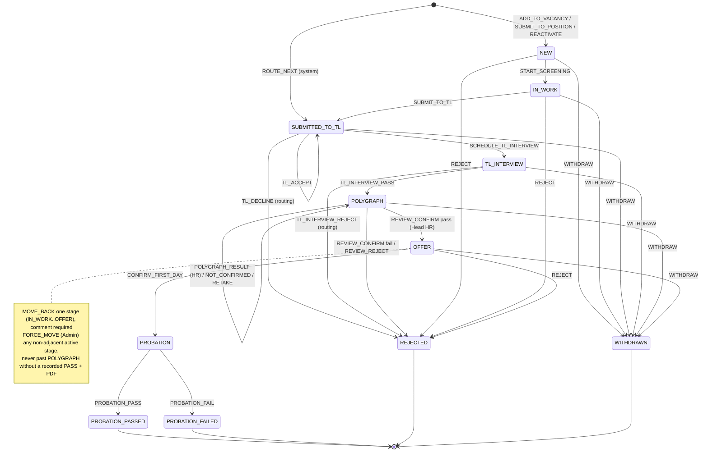
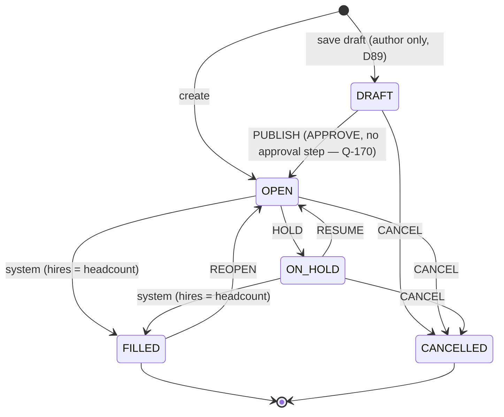
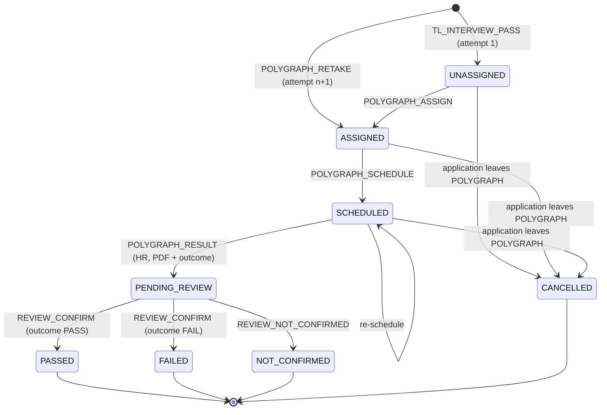
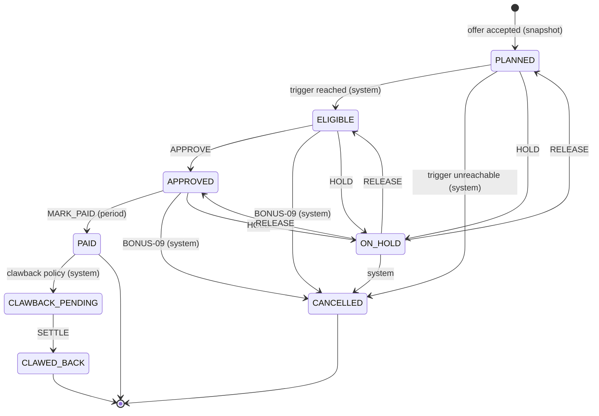

# Pipeline state machine (application) + vacancy, sub-object and bonus-tranche machines

Owner decisions 2026-10-31 applied: mandatory Head HR polygraph review with retakes (POLY-05), no vertical deactivation, CAND-06, actor ≠ beneficiary for bonuses.
Source: PRD §6 (PIPE-01..06, RESCH-01..04), §7 (ROUTE-xx), §8 (POLY, OFFER, PROB), VAC-02, §9.3–9.5. Module: `server/domain/pipeline/` (pure, clock injected). Permission codes: `docs/authz-matrix.md` §2.3.
**One table drives everything:** `availableActions()` generates UI buttons / allowed kanban drops; `transition()` validates the same table; invalid ⇒ 409.

## 1. Application stages



(`REJECT` also exists from SUBMITTED_TO_TL, TL_INTERVIEW, POLYGRAPH — omitted from the diagram for readability; see table.)

- Stage ordinal (for `max_stage_reached`, scopes, "up to"): NEW 1 · IN_WORK 2 · SUBMITTED_TO_TL 3 · TL_INTERVIEW 4 · POLYGRAPH 5 · OFFER 6 · PROBATION 7 · PROBATION_PASSED 8. Terminal ✖ stages keep the previous ordinal in `max_stage_reached`.
- Active stages: NEW…PROBATION. Terminal: PROBATION_PASSED, REJECTED, WITHDRAWN, PROBATION_FAILED (go to Rejected archive except PROBATION_PASSED, ARCH-01).
- Sub-state on SUBMITTED_TO_TL: `tl_decision ∈ PENDING | ACCEPTED`.

## 2. Guards applied to every action (in order)

| #   | Guard                                                                      | Failure                                                       |
| --- | -------------------------------------------------------------------------- | ------------------------------------------------------------- |
| G1  | Application visible to actor (scoped fetch, `FOR UPDATE`)                  | 404 `NOT_FOUND`                                               |
| G2  | Actor holds the action's permission on this application (`permissionsFor`) | 403 `FORBIDDEN`                                               |
| G3  | `expectedStage == stage` and `expectedVersion == version`                  | 409 `STALE_STATE`                                             |
| G4  | Action defined for current stage (table §3)                                | 409 `INVALID_TRANSITION`                                      |
| G5  | Action-specific guards (table §3)                                          | 409 with specific code                                        |
| G6  | Zod payload                                                                | 400 `VALIDATION_FAILED` (runs before G1 in the route wrapper) |

Shared field rules: `meetUrl` matches `^https://meet\.google\.com/[a-z]{3}-[a-z]{4}-[a-z]{3}$` (PIPE-04); `scheduledAt` ≥ now; `reasonCode` ∈ active `rejection_reason`; `comment` required when `reasonCode = OTHER` (§6.4) ⚠ OPEN (§6.1 says "reason code + comment" for every rejection); free text goes to `entity_event_pii` (ADR-003).
Every successful action: `application.version + 1`, `stage_entered_at`/`last_activity_at`, `vacancy_stage_count` deltas, `stats.record` deltas, `audit_log`, `change_feed` (ADR-007/008).

## 3. Transition table

Roles in brackets = built-in roles holding the permission (scope per authz matrix). Events listed without the always-present `application.stage_changed {from,to}` when stage changes. Notification codes → §6.

| ID   | Action                                             | From → To                                                            | Permission [roles]                                                          | Required data                                                                                                                                                         | Guards (G5)                                                                                                                                                                                                                                                                                                                                                                   | Side effects                                                                                                                                                                                                                                                                                                                                                                                          | Events                                                                                    | Notifications                                                                                                   |
| ---- | -------------------------------------------------- | -------------------------------------------------------------------- | --------------------------------------------------------------------------- | --------------------------------------------------------------------------------------------------------------------------------------------------------------------- | ----------------------------------------------------------------------------------------------------------------------------------------------------------------------------------------------------------------------------------------------------------------------------------------------------------------------------------------------------------------------------- | ----------------------------------------------------------------------------------------------------------------------------------------------------------------------------------------------------------------------------------------------------------------------------------------------------------------------------------------------------------------------------------------------------- | ----------------------------------------------------------------------------------------- | --------------------------------------------------------------------------------------------------------------- |
| T01  | `ADD_TO_VACANCY`                                   | ∅ → NEW                                                              | `application.create` [ADM, HREC, REC]                                       | candidateId, vacancyId                                                                                                                                                | vacancy `OPEN`, not deleted, has position; candidate not deleted; vacancy vertical = `candidate.vertical_id` (CAND-06, `CANDIDATE_VERTICAL_MISMATCH`); ROUTE-06 no active application in the routing group (`ACTIVE_APPLICATION_IN_GROUP`)                                                                                                                                    | create application `source_type=DIRECT`, owner = actor, sourcer per BONUS-05 (§7)                                                                                                                                                                                                                                                                                                                     | `application.created`                                                                     | —                                                                                                               |
| T02  | `SUBMIT_TO_POSITION`                               | ∅ → NEW                                                              | `application.create` [ADM, HREC, REC]                                       | candidateId, positionId                                                                                                                                               | as T01; `routing.nextVacancy` returns a vacancy (`NO_OPEN_VACANCY_IN_GROUP`)                                                                                                                                                                                                                                                                                                  | create application on routed vacancy, `source_type=POSITION` ⚠ OPEN (routing at creation vs at submit)                                                                                                                                                                                                                                                                                                | `application.created {routedBy:'PRIORITY'}`                                               | —                                                                                                               |
| T03  | `REACTIVATE`                                       | terminal (REJECTED/WITHDRAWN/PROBATION_FAILED) → new application NEW | `application.reactivate` [ADM, HREC, REC own ⚠]                             | vacancyId or positionId                                                                                                                                               | as T01/T02                                                                                                                                                                                                                                                                                                                                                                    | new application, `reactivated_from_application_id`; old untouched                                                                                                                                                                                                                                                                                                                                     | `application.reactivated` (both)                                                          | —                                                                                                               |
| T04  | `START_SCREENING`                                  | NEW → IN_WORK                                                        | `application.move.in_work` [ADM, HREC, REC]                                 | meetUrl, scheduledAt                                                                                                                                                  | —                                                                                                                                                                                                                                                                                                                                                                             | `interview(kind=SCREENING, SCHEDULED)`                                                                                                                                                                                                                                                                                                                                                                | `interview.scheduled`                                                                     | reminders via cron ⚠ OPEN (PIPE-05 for screening?)                                                              |
| T05  | `SUBMIT_TO_TL`                                     | IN_WORK → SUBMITTED_TO_TL                                            | `application.move.submitted_to_tl` [ADM, HREC, REC]                         | screeningNotes, tlSummary                                                                                                                                             | vacancy has TL (`VACANCY_HAS_NO_TEAM_LEAD`); vacancy `OPEN` (`VACANCY_NOT_OPEN`) ⚠                                                                                                                                                                                                                                                                                            | screening interview → COMPLETED; `submitted_at`; `tl_decision=PENDING`                                                                                                                                                                                                                                                                                                                                | `interview.completed`                                                                     | `tl.candidate_submitted` → TL                                                                                   |
| T06  | `TL_ACCEPT`                                        | SUBMITTED_TO_TL (stay)                                               | `application.tl_decision` [ADM, TL]                                         | —                                                                                                                                                                     | `tl_decision=PENDING`                                                                                                                                                                                                                                                                                                                                                         | `tl_decision=ACCEPTED`, `tl_decided_at` (STAT-05 response time)                                                                                                                                                                                                                                                                                                                                       | `application.tl_accepted`                                                                 | `tl.decision` → owner                                                                                           |
| T07  | `TL_DECLINE`                                       | SUBMITTED_TO_TL → REJECTED                                           | `application.tl_decision` [ADM, TL]                                         | reasonCode (default `TL_DECLINED_PROFILE`), comment                                                                                                                   | `tl_decision=PENDING`                                                                                                                                                                                                                                                                                                                                                         | close; **routing §5**                                                                                                                                                                                                                                                                                                                                                                                 | `application.tl_declined`, `application.routed` (if routed)                               | `tl.decision` → owner; `application.routed` → owner + next TL                                                   |
| T08  | `SCHEDULE_TL_INTERVIEW`                            | SUBMITTED_TO_TL → TL_INTERVIEW                                       | `application.move.tl_interview` [ADM, HREC, REC]                            | meetUrl, scheduledAt, interviewerId (default vacancy TL)                                                                                                              | `tl_decision=ACCEPTED` (`TL_NOT_ACCEPTED`)                                                                                                                                                                                                                                                                                                                                    | `interview(kind=TL_INTERVIEW, SCHEDULED)`                                                                                                                                                                                                                                                                                                                                                             | `interview.scheduled`                                                                     | `interview.scheduled` → TL; reminders 24 h/1 h → owner, TL, candidate email (PIPE-05, D7)                       |
| T09  | `TL_INTERVIEW_PASS`                                | TL_INTERVIEW → POLYGRAPH                                             | `application.move.polygraph` [ADM, HREC, REC, TL]                           | feedback                                                                                                                                                              | interview `SCHEDULED`, `scheduled_at ≤ now`, no pending reschedule (`INTERVIEW_NOT_HELD`)                                                                                                                                                                                                                                                                                     | interview → COMPLETED(PASS); `polygraph(UNASSIGNED)`                                                                                                                                                                                                                                                                                                                                                  | `interview.completed`                                                                     | `polygraph.to_schedule` → HHR + HR in vertical; `stage_changed` → owner                                         |
| T10  | `TL_INTERVIEW_REJECT`                              | TL_INTERVIEW → REJECTED                                              | `application.interview.reject` [ADM, HREC, REC, TL]                         | reasonCode (default `TL_INTERVIEW_FAILED`), feedback                                                                                                                  | as T09                                                                                                                                                                                                                                                                                                                                                                        | interview → COMPLETED(REJECT); close; **routing §5**                                                                                                                                                                                                                                                                                                                                                  | `interview.completed`, `application.routed`                                               | as T07                                                                                                          |
| T11  | `POLYGRAPH_ASSIGN`                                 | POLYGRAPH (stay)                                                     | `polygraph.assign` [ADM, HHR] / `polygraph.assign.self` [HR]                | hrUserId (self for HR)                                                                                                                                                | polygraph not COMPLETED; assignee holds HR/HHR in vertical                                                                                                                                                                                                                                                                                                                    | polygraph → ASSIGNED                                                                                                                                                                                                                                                                                                                                                                                  | `polygraph.assigned`                                                                      | `polygraph.assigned` → assignee                                                                                 |
| T12  | `POLYGRAPH_SCHEDULE`                               | POLYGRAPH (stay)                                                     | `polygraph.schedule` [ADM, HHR, HR]                                         | locationId **or** address, scheduledAt (both mandatory)                                                                                                               | polygraph ASSIGNED or SCHEDULED                                                                                                                                                                                                                                                                                                                                               | polygraph → SCHEDULED (re-schedule = same action)                                                                                                                                                                                                                                                                                                                                                     | `polygraph.scheduled`                                                                     | candidate email (POLY-02); `polygraph.scheduled` → owner                                                        |
| T13  | `POLYGRAPH_RESULT`                                 | POLYGRAPH (stay); attempt SCHEDULED → PENDING_REVIEW                 | `polygraph.result.record` [ADM, HHR, HR]                                    | pdfFileId (READY, PDF), outcome PASS/FAIL, comment                                                                                                                    | attempt SCHEDULED, `scheduled_at ≤ now`; PDF present (`POLYGRAPH_PDF_REQUIRED`, POLY-03)                                                                                                                                                                                                                                                                                      | attempt stores PDF + `hr_outcome`, status PENDING_REVIEW, `review_status = PENDING` (review is mandatory, POLY-05 owner 2026-10-31)                                                                                                                                                                                                                                                                   | `polygraph.result_recorded {attemptNo, outcome}`                                          | `polygraph.to_review` → HHR in vertical                                                                         |
| T14  | `POLYGRAPH_REVIEW_CONFIRM` «Підтвердити»           | POLYGRAPH → OFFER (outcome PASS) / REJECTED (outcome FAIL)           | `polygraph.review` [ADM, HHR]                                               | comment (optional)                                                                                                                                                    | attempt PENDING_REVIEW (`POLYGRAPH_REVIEW_PENDING_REQUIRED`)                                                                                                                                                                                                                                                                                                                  | `review_status = CONFIRMED`; PASS: attempt → PASSED; FAIL: attempt → FAILED, close with reason `POLYGRAPH_FAILED`, **no routing** (ROUTE-05)                                                                                                                                                                                                                                                          | `polygraph.reviewed {attemptNo, decision:'CONFIRMED'}`                                    | `polygraph.result` → owner, TL (outcome only), HR; pass → `offer.to_create` → HHR                               |
| T14b | `POLYGRAPH_REVIEW_NOT_CONFIRMED` «Не підтверджено» | POLYGRAPH (stay); attempt PENDING_REVIEW → NOT_CONFIRMED             | `polygraph.review` [ADM, HHR]                                               | comment (required)                                                                                                                                                    | attempt PENDING_REVIEW                                                                                                                                                                                                                                                                                                                                                        | `review_status = NOT_CONFIRMED` (Head HR then picks T14c or T14d; the UI may show both in the same dialog)                                                                                                                                                                                                                                                                                            | `polygraph.reviewed {attemptNo, decision:'NOT_CONFIRMED'}`                                | `polygraph.not_confirmed` → HR of the attempt, owner                                                            |
| T14c | `POLYGRAPH_RETAKE` «Перепройти»                    | POLYGRAPH (stay); new attempt                                        | `polygraph.review` [ADM, HHR]                                               | hrUserId (default: previous HR), comment                                                                                                                              | latest attempt NOT_CONFIRMED; retake count unlimited (⚠ OWNER: pending confirmation)                                                                                                                                                                                                                                                                                          | new `polygraph` row `attempt_no + 1`, status ASSIGNED → back to scheduling (T12); previous attempts + PDFs kept read-only                                                                                                                                                                                                                                                                             | `polygraph.retake_requested {attemptNo}`                                                  | `polygraph.assigned` → HR; `polygraph.retake` → owner                                                           |
| T14d | `POLYGRAPH_REVIEW_REJECT` «Відмовити»              | POLYGRAPH → REJECTED                                                 | `polygraph.review` [ADM, HHR]                                               | reasonCode (default `POLYGRAPH_FAILED`), comment                                                                                                                      | latest attempt NOT_CONFIRMED                                                                                                                                                                                                                                                                                                                                                  | close; **no routing** (ROUTE-05)                                                                                                                                                                                                                                                                                                                                                                      | `polygraph.reviewed {decision:'REJECTED'}`                                                | `application.rejected` → owner, TL                                                                              |
| T15  | `OFFER_DRAFT`                                      | OFFER (stay)                                                         | `offer.draft` [ADM, HHR, HR]                                                | salary {amountMinor, currency, grossNet, period}, startDate, probationDays (prefilled from vacancy; change needs `probation.length.set`), additionalTerms, templateId | probationDays ≤ vacancy.probation_days ≤ 90                                                                                                                                                                                                                                                                                                                                   | new offer version DRAFT; previous non-final version → SUPERSEDED (OFFER-04)                                                                                                                                                                                                                                                                                                                           | `offer.drafted`                                                                           | —                                                                                                               |
| T16  | `OFFER_SEND`                                       | OFFER (stay)                                                         | `offer.send` [ADM, HHR]                                                     | offerId                                                                                                                                                               | version DRAFT; candidate has email (`CANDIDATE_EMAIL_REQUIRED`)                                                                                                                                                                                                                                                                                                               | render PDF → `file_object`; email to candidate (delivery row); `sent_at`, `valid_until = sent_at + app_setting.offer_validity_days` (global, D11 = 5)                                                                                                                                                                                                                                                 | `offer.sent`                                                                              | `offer.sent` → owner, TL                                                                                        |
| T17  | `OFFER_ACCEPTED`                                   | OFFER (stay)                                                         | `offer.outcome.record` [ADM, HHR, HR]                                       | offerId, confirmedStartDate                                                                                                                                           | version SENT, not expired                                                                                                                                                                                                                                                                                                                                                     | offer → ACCEPTED; **bonus snapshot** `bonus.compute` (BONUS-02) reading the vacancy row (BONUS-16 amount, scheme) `FOR UPDATE` in this transaction, so a concurrent reward change is either fully before or fully after (DG-19); `bonus_snapshot` is insert-only (`app_rw` may only `UPDATE (voided_at, voided_by)` for T25b/T26 voiding): `bonus_snapshot` + `bonus_tranche` PLANNED (or blocked §7) | `offer.accepted`, `bonus.snapshot_created`                                                | `offer.accepted` → owner, TL, HHR                                                                               |
| T18  | `OFFER_DECLINED`                                   | OFFER (stay)                                                         | `offer.outcome.record` [ADM, HHR, HR]                                       | offerId, reasonCode                                                                                                                                                   | version SENT                                                                                                                                                                                                                                                                                                                                                                  | offer → DECLINED; Head HR then revises (T15) or rejects (T23) ⚠ OPEN (PIPE-06 example "offer declined → renegotiate")                                                                                                                                                                                                                                                                                 | `offer.declined`                                                                          | `offer.declined` → owner, TL, HHR                                                                               |
| T19  | `OFFER_EXPIRE` (system, cron)                      | OFFER (stay)                                                         | system                                                                      | —                                                                                                                                                                     | version SENT, `valid_until < now`                                                                                                                                                                                                                                                                                                                                             | offer → EXPIRED                                                                                                                                                                                                                                                                                                                                                                                       | `offer.expired`                                                                           | `offer.expired` → HHR, owner. ⚠ OPEN auto vs manual                                                             |
| T20  | `CONFIRM_FIRST_DAY`                                | OFFER → PROBATION                                                    | `application.move.probation` [ADM, HHR, HR]                                 | actualStartDate (≤ today, Kyiv)                                                                                                                                       | latest offer ACCEPTED (`OFFER_NOT_ACCEPTED`)                                                                                                                                                                                                                                                                                                                                  | `probation(ACTIVE)`: `start_date`, `probation_days`, `planned_end_date = start + days`; `vacancy.hires_count+1` → if `= headcount` vacancy → FILLED (VAC-02); bonus: `evaluateTriggers` (PROBATION_STARTED → ELIGIBLE; DAYS_AFTER_START due dates); ROUTE-06 slot stays occupied                                                                                                                      | `probation.started`, `vacancy.status_changed` (if filled), `bonus.tranche_status_changed` | `probation.started` → owner, TL; `vacancy.filled` → HREC, assigned recruiters, TL; `bonus.eligible` → recipient |
| T21  | `PROBATION_PASS`                                   | PROBATION → PROBATION_PASSED                                         | `probation.pass` [ADM, HHR, TL] **or** `probation.pass.override` [ADM, HHR] | comment (required with override)                                                                                                                                      | `probation.pass` alone: elapsed ≥ 30 days (`PROBATION_MIN_30_DAYS`, PROB-03)                                                                                                                                                                                                                                                                                                  | probation → PASSED, `actual_end_date = min(today, planned_end_date)` (PROB-05/BONUS-10); tranche-2 recipient fixed = current owner (BONUS-04); `evaluateTriggers` (PROBATION_PASSED → ELIGIBLE, BONUS-06)                                                                                                                                                                                             | `probation.passed {early:boolean, override:boolean}`                                      | `probation.passed` → owner, TL, HHR; `bonus.eligible` → recipient; `bonus.to_approve` → HREC                    |
| T22  | `PROBATION_FAIL`                                   | PROBATION → PROBATION_FAILED                                         | `probation.fail` [ADM, HHR, TL]                                             | reason (required) ⚠ OPEN coded list vs free text, comment                                                                                                             | today ≥ start_date (day 1, PROB-04)                                                                                                                                                                                                                                                                                                                                           | probation → FAILED, `actual_end_date = min(today, planned_end_date)` (an overdue fail never records an end later than planned, PROB-05; ⚠ OPEN Q-59); `evaluateTriggers(PROBATION_FAILED)`: tranche 2 → CANCELLED (BONUS-07); tranche 1 → BONUS-08/09                                                                                                                                                 | `probation.failed`                                                                        | `probation.failed` → owner, TL, HREC                                                                            |
| T23  | `REJECT`                                           | NEW, IN_WORK, SUBMITTED_TO_TL, TL_INTERVIEW → REJECTED               | `application.reject.recruiting` [ADM, HREC, REC]                            | reasonCode, comment                                                                                                                                                   | —                                                                                                                                                                                                                                                                                                                                                                             | close; cancel open interview; **no auto-routing** (ROUTE-03 covers TL decisions only)                                                                                                                                                                                                                                                                                                                 | —                                                                                         | `application.rejected` → owner (if not actor)                                                                   |
| T23b | `REJECT`                                           | POLYGRAPH, OFFER → REJECTED                                          | `application.reject.hr` [ADM, HHR, HR, HREC ⚠]                              | reasonCode, comment                                                                                                                                                   | —                                                                                                                                                                                                                                                                                                                                                                             | close; polygraph → CANCELLED if no result; offers → SUPERSEDED; PLANNED tranches → CANCELLED                                                                                                                                                                                                                                                                                                          | —                                                                                         | `application.rejected` → owner, TL                                                                              |
| T24  | `WITHDRAW`                                         | NEW…OFFER → WITHDRAWN                                                | `application.withdraw` [ADM, HREC, REC]                                     | comment                                                                                                                                                               | —                                                                                                                                                                                                                                                                                                                                                                             | as T23/T23b clean-up                                                                                                                                                                                                                                                                                                                                                                                  | —                                                                                         | `application.withdrawn` → TL (if ≥ SUBMITTED_TO_TL), HHR (if ≥ POLYGRAPH)                                       |
| T25  | `MOVE_BACK`                                        | stage _n_ → _n−1_, from IN_WORK, SUBMITTED_TO_TL, TL_INTERVIEW       | `application.move_back.recruiting` [ADM, HREC]                              | comment                                                                                                                                                               | —                                                                                                                                                                                                                                                                                                                                                                             | compensation §4                                                                                                                                                                                                                                                                                                                                                                                       | `application.moved_back`                                                                  | `stage_changed` → owner, TL (if involved)                                                                       |
| T25b | `MOVE_BACK`                                        | from POLYGRAPH, OFFER                                                | `application.move_back.hr` [ADM, HHR, HREC ⚠]                               | comment                                                                                                                                                               | —                                                                                                                                                                                                                                                                                                                                                                             | compensation §4                                                                                                                                                                                                                                                                                                                                                                                       | `application.moved_back`                                                                  | as T25                                                                                                          |
| T26  | `FORCE_MOVE`                                       | any active → any other active stage                                  | `application.force_move` [ADM]                                              | targetStage, comment (required), entry data of target stage                                                                                                           | PIPE-03: target ≥ OFFER requires a Head HR-**confirmed** PASSED polygraph attempt with PDF on this application (`POLYGRAPH_MANDATORY`); target ≠ PROBATION and source ≠ PROBATION (`PROBATION_IMMUTABLE`, DG-18 — PROBATION is entered only by T20 and left only by T21/T22); not from terminal (use T03) ⚠ OPEN scope of force; ⚠ OWNER: the PROBATION block narrows PIPE-02 | entry side effects of target + compensation §4 for skipped/left stages; `stat_dirty_day` mark                                                                                                                                                                                                                                                                                                         | `application.force_moved {from,to}` with `actor_kind=ADMIN_FORCE` (flagged in timeline)   | `stage_changed` → owner, TL                                                                                     |
| T27  | `REASSIGN_OWNER`                                   | any active (stay)                                                    | `application.reassign_owner` [ADM, HREC]                                    | newOwnerId, reason                                                                                                                                                    | new owner holds REC/HREC in vertical, active; actor ≠ beneficiary (DG-19, owner-confirmed): reassigning to yourself needs another HREC or Admin                                                                                                                                                                                                                               | `owner_id` changes, sourcer never (BONUS-05); PLANNED tranche-2 provisional recipient follows owner                                                                                                                                                                                                                                                                                                   | `application.owner_reassigned`                                                            | `assignment` → new + old owner                                                                                  |
| T28  | `SET_BONUS_SPLIT`                                  | OFFER/PROBATION (stay)                                               | `application.bonus_split.set` [ADM, HREC]                                   | recipients [{userId, percent}] (sum 100), reason                                                                                                                      | tranches not PAID; recipients must be recruiters of the vertical; recipients may be REC or HREC; actor ≠ beneficiary (DG-19, owner-confirmed): the actor can't be a recipient                                                                                                                                                                                                 | recipients of non-paid tranches rewritten ⚠ OPEN split semantics                                                                                                                                                                                                                                                                                                                                      | `application.bonus_split_set`                                                             | `bonus.split_changed` → affected recruiters                                                                     |

Interview sub-actions (no stage change), permission `application.interview.manage` unless noted:

| Action                                                                | From → To (interview / reschedule_request)                            | Data                      | Notes                                                                                         |
| --------------------------------------------------------------------- | --------------------------------------------------------------------- | ------------------------- | --------------------------------------------------------------------------------------------- |
| `INTERVIEW_UPDATE`                                                    | SCHEDULED (stay)                                                      | meetUrl?, scheduledAt?    | recruiter-initiated change; `interview.updated {field, old, new}`                             |
| `REQUEST_RESCHEDULE` [`application.interview.reschedule_request`: TL] | interview SCHEDULED → RESCHEDULE_PENDING; request → PENDING_RECRUITER | 1–3 future slots, comment | RESCH-01; 2nd request for the same application → notify HREC (RESCH-03) ⚠ OPEN interpretation |
| `CONFIRM_RESCHEDULE`                                                  | RESCHEDULE_PENDING → SCHEDULED; request → CONFIRMED                   | slotIndex, meetUrl?       | RESCH-02                                                                                      |
| `COUNTER_PROPOSE`                                                     | request PENDING_RECRUITER → PENDING_TL                                | 1–3 slots, comment        | RESCH-02                                                                                      |
| `TL_CONFIRM_COUNTER` [TL]                                             | request PENDING_TL → CONFIRMED; interview → SCHEDULED                 | slotIndex                 |                                                                                               |
| `MARK_NO_SHOW`                                                        | SCHEDULED → NO_SHOW_CANDIDATE \| NO_SHOW_TL                           | who                       | RESCH-04; stats; then reschedule (INTERVIEW_UPDATE back to SCHEDULED) or reject               |

## 4. Compensation when leaving a stage backwards (T25/T26)

| Leaving                                   | Compensation                                                                                                                                                                                                                     |
| ----------------------------------------- | -------------------------------------------------------------------------------------------------------------------------------------------------------------------------------------------------------------------------------- |
| IN_WORK → NEW                             | screening interview → CANCELLED                                                                                                                                                                                                  |
| SUBMITTED_TO_TL → IN_WORK                 | `tl_decision` reset to null                                                                                                                                                                                                      |
| TL_INTERVIEW → SUBMITTED_TO_TL            | TL interview → CANCELLED; `tl_decision` stays ACCEPTED                                                                                                                                                                           |
| POLYGRAPH → TL_INTERVIEW                  | open polygraph attempt → CANCELLED (finished attempts kept in history)                                                                                                                                                           |
| OFFER → POLYGRAPH                         | offer versions → SUPERSEDED; if accepted: snapshot voided, tranches PLANNED/ELIGIBLE → CANCELLED (new snapshot on next acceptance); the PASSED attempt stays in history and a new attempt (ASSIGNED) is created for a new result |
| PROBATION ⇄ anything (force or move-back) | blocked: 409 `PROBATION_IMMUTABLE` (DG-18); close with T21/T22 only. Reactivation after PROBATION_FAILED (T03) is a new application and a new hire cycle, flagged in the timeline                                                |

- `max_stage_reached` is recomputed (may decrease) only on these compensations; visibility for HR therefore can shrink after a move-back below POLYGRAPH.

## 5. Routing on TL decline / TL interview reject (ROUTE-02..09)

| Application `source_type` | Vertical auto-routing (ROUTE-09) | Behaviour                                                                                                                                                                                                                                                                                                                   |
| ------------------------- | -------------------------------- | --------------------------------------------------------------------------------------------------------------------------------------------------------------------------------------------------------------------------------------------------------------------------------------------------------------------------- |
| POSITION or ROUTED        | ON                               | `routing.nextVacancy()` → vacancy found: close current as REJECTED with `routed=true` and create new application **at SUBMITTED_TO_TL** (`source_type=ROUTED`, `routed_from_application_id`, same owner/sourcer, tlSummary copied) ⚠ OPEN (vs. NEW); none: close as REJECTED → Rejected archive with last reason (ROUTE-04) |
| DIRECT                    | ON                               | close as REJECTED; response contains `routingSuggestion` (next vacancy) — recruiter may accept via T02-like `ROUTE_TO` (ROUTE-08: offered, not forced)                                                                                                                                                                      |
| any                       | OFF                              | close as REJECTED; UI offers ranked list for manual pick (ROUTE-09)                                                                                                                                                                                                                                                         |

- Both writes (close + create) in one transaction; partial unique index (ROUTE-06) guarantees no parallel active application in the group.
- Polygraph/offer/probation rejections never route (ROUTE-05).

## 6. Notification codes used above

`tl.candidate_submitted`, `tl.decision`, `application.routed`, `interview.scheduled`, `interview.reminder` (24 h/1 h), `interview.reschedule_requested`, `interview.reschedule_answered`, `interview.reschedule_escalated`, `polygraph.to_schedule`, `polygraph.assigned`, `polygraph.scheduled`, `polygraph.result`, `polygraph.to_review`, `polygraph.not_confirmed`, `polygraph.retake`, `offer.to_create`, `offer.sent`, `offer.accepted`, `offer.declined`, `offer.expired`, `probation.started`, `probation.reminder` (14/7/1), `probation.overdue` (daily), `probation.first_day_unconfirmed`, `probation.passed`, `probation.failed`, `vacancy.filled`, `application.rejected`, `application.withdrawn`, `assignment`, `bonus.eligible`, `bonus.to_approve`, `bonus.approved`, `bonus.paid`, `bonus.split_changed`, `mention`. Candidate-facing emails: `candidate.interview_reminder`, `candidate.polygraph_details`, `candidate.offer`.

## 7. Probation rules (PROB-01..07, BONUS-06/10)

| Rule                   | Definition                                                                                                                                                                                                                                                                                                                                                                                                                                                                                                                                                                                                                                         |
| ---------------------- | -------------------------------------------------------------------------------------------------------------------------------------------------------------------------------------------------------------------------------------------------------------------------------------------------------------------------------------------------------------------------------------------------------------------------------------------------------------------------------------------------------------------------------------------------------------------------------------------------------------------------------------------------- |
| Dates                  | Kyiv calendar dates. `planned_end_date = start_date + probation_days`; `probation_days ≤ 90` (default 90)                                                                                                                                                                                                                                                                                                                                                                                                                                                                                                                                          |
| Before start           | `probation_days` set on vacancy and/or offer by ADM/HHR (`vacancy.probation_length.set`, `probation.length.set`), 1..90                                                                                                                                                                                                                                                                                                                                                                                                                                                                                                                            |
| Elapsed                | `elapsed = today − start_date` (days). "Day N" shown = `elapsed + 1`                                                                                                                                                                                                                                                                                                                                                                                                                                                                                                                                                                               |
| Early pass (PROB-03)   | TL: `elapsed ≥ 30`; else button disabled with tooltip (`availableActions` returns `disabledReason: 'PROBATION_MIN_30_DAYS'`). HHR/ADM: any time, comment required when `elapsed < 30`                                                                                                                                                                                                                                                                                                                                                                                                                                                              |
| Fail (PROB-04)         | TL/HHR/ADM from day 1 (`today ≥ start_date`), reason required; `actual_end_date = min(today, planned_end_date)`                                                                                                                                                                                                                                                                                                                                                                                                                                                                                                                                    |
| No extension (PROB-05) | `planned_end_date` never changes after start; `actual_end_date ≤ planned_end_date`. API: any payload that would move the end later → 409 `PROBATION_EXTENSION_FORBIDDEN`. DB: trigger rejects `UPDATE` with `NEW.planned_end_date > OLD.planned_end_date` or `actual_end_date > planned_end_date`; CHECK `planned_end_date <= start_date + 90`. DG-18: the same trigger also rejects **any** change of `start_date` or `probation_days` once the row is ACTIVE (or closed), and `UNIQUE (application_id)` on `probation` means a second probation row for the same application cannot exist. No endpoint other than T20/T21/T22 writes `probation` |
| End date reached       | No auto-pass. `probation-daily` job creates "close probation" task + daily `probation.overdue` reminders to owner and TL until closed (PROB-06). Closing late records `actual_end_date = planned_end_date`                                                                                                                                                                                                                                                                                                                                                                                                                                         |
| Start (PROB-01)        | Only by CONFIRM_FIRST_DAY ⚠ OPEN (§6.1 says "start date reached **or** HR confirms"); reminder `probation.first_day_unconfirmed` when confirmed start date + 3 days passed                                                                                                                                                                                                                                                                                                                                                                                                                                                                         |

## 8. Vacancy status machine (VAC-02/03)



| Action                      | From → To                      | Permission [roles]                            | Data / guards                                                                                                                                                                                                                                                          | Side effects                                                                                                                                                                                                                                            | Event / notification                                                                              |
| --------------------------- | ------------------------------ | --------------------------------------------- | ---------------------------------------------------------------------------------------------------------------------------------------------------------------------------------------------------------------------------------------------------------------------- | ------------------------------------------------------------------------------------------------------------------------------------------------------------------------------------------------------------------------------------------------------- | ------------------------------------------------------------------------------------------------- |
| CREATE                      | ∅ → OPEN \| DRAFT              | `vacancy.create` [ADM, HREC, REC, TL]         | VAC-01 fields; TL request → always OPEN (D87); D2 approval superseded by D89, DRAFT = author's draft only                                                                                                                                                              | REC-created: `team_lead_id=null`, creator assigned                                                                                                                                                                                                      | `vacancy.created` / `assignment`                                                                  |
| APPROVE                     | DRAFT → OPEN                   | `vacancy.approve` [ADM, HREC ⚠]               | —                                                                                                                                                                                                                                                                      | —                                                                                                                                                                                                                                                       | `vacancy.status_changed` / TL                                                                     |
| HOLD / RESUME               | OPEN ⇄ ON_HOLD                 | `vacancy.hold`/`resume` [ADM, HREC, TL own ⚠] | comment                                                                                                                                                                                                                                                                | routing skips ON_HOLD (ROUTE-07)                                                                                                                                                                                                                        | event / assigned recruiters, TL                                                                   |
| auto FILL                   | OPEN/ON_HOLD → FILLED          | system (in T20 tx)                            | `hires_count = headcount`                                                                                                                                                                                                                                              | routing skips; active applications continue ⚠ OPEN                                                                                                                                                                                                      | event / HREC, recruiters, TL                                                                      |
| REOPEN                      | FILLED → OPEN                  | `vacancy.reopen` [ADM, HREC]                  | if `hires_count ≥ headcount` the request must raise headcount                                                                                                                                                                                                          | —                                                                                                                                                                                                                                                       | event / recruiters, TL                                                                            |
| CANCEL                      | DRAFT/OPEN/ON_HOLD → CANCELLED | `vacancy.cancel` [ADM, HREC, TL own ⚠]        | reason; active applications must be resolved first (same choices as ARCH-03) ⚠ OPEN                                                                                                                                                                                    | —                                                                                                                                                                                                                                                       | event / recruiters, TL                                                                            |
| Headcount edit              | any non-terminal               | `vacancy.update`                              | headcount ≥ 1; if ≤ `hires_count` → FILLED                                                                                                                                                                                                                             | —                                                                                                                                                                                                                                                       | `vacancy.updated`                                                                                 |
| SET_BONUS_AMOUNT (BONUS-16) | any status (not deleted)       | `vacancy.bonus.update` [ADM]                  | `{ amountMinor, currency }` (or null to clear ⚠ OPEN), reason (required); service guard `vacancyRewardChangeAllowed` → 409 `VACANCY_BONUS_CHANGE_TOO_SOON` (≤ 1 change per 2 months per vacancy; ⚠ OPEN: first set counts?, calendar months vs 60 days, 24 h typo fix) | `vacancy.bonus_amount_*` columns updated under `FOR UPDATE`; existing snapshots untouched (BONUS-02). Clone (VAC-05) must not let anyone bypass the limit (DG-19): either the clone doesn't copy the reward or it inherits the change history — ⚠ OWNER | `vacancy.bonus_amount_changed {old, new}` (`sensitivity=BONUS`, reason in `entity_event_pii`) / — |

- Soft delete (ARCH-03) is orthogonal to status (`deleted_at`), requires resolving active applications (talent pool / other vacancy / reject).

## 9. Sub-object machines

| Object                                                   | States                                                                                                            | Notes                                                                                                                                                                                               |
| -------------------------------------------------------- | ----------------------------------------------------------------------------------------------------------------- | --------------------------------------------------------------------------------------------------------------------------------------------------------------------------------------------------- |
| `interview`                                              | SCHEDULED → RESCHEDULE_PENDING → SCHEDULED; SCHEDULED → COMPLETED \| NO_SHOW_CANDIDATE \| NO_SHOW_TL \| CANCELLED | `kind = SCREENING \| TL_INTERVIEW`; result PASS/REJECT on TL_INTERVIEW                                                                                                                              |
| `reschedule_request`                                     | PENDING_RECRUITER → PENDING_TL → CONFIRMED; any → CANCELLED                                                       | slots jsonb (1–3)                                                                                                                                                                                   |
| `polygraph` (one row per **attempt**, `attempt_no` 1..n) | UNASSIGNED → ASSIGNED → SCHEDULED → PENDING_REVIEW → PASSED \| FAILED \| NOT_CONFIRMED; open attempt → CANCELLED  | result requires a READY PDF; review is mandatory; NOT_CONFIRMED → retake (new attempt) or reject; at most one non-final attempt per application (partial unique); all attempts and PDFs kept (§9.1) |
| `offer` (versioned)                                      | DRAFT → SENT → ACCEPTED \| DECLINED \| EXPIRED; DRAFT/SENT/DECLINED/EXPIRED → SUPERSEDED                          | one ACCEPTED max per application (partial unique)                                                                                                                                                   |
| `probation`                                              | ACTIVE → PASSED \| FAILED                                                                                         | §7                                                                                                                                                                                                  |

### 9.1 Polygraph attempt (POLY-01..05, owner 2026-10-31)



- NOT_CONFIRMED is final for that attempt; the application then gets a new attempt (T14c) or is rejected (T14d).
- PDF visibility (POLY-04) is the same for every attempt; HR can't edit an attempt once it reaches PENDING_REVIEW.

## 10. Bonus tranche lifecycle (§9.3–9.5)

**Effective bonus at snapshot (T17, BONUS-01 as amended by BONUS-16):**

| What                                                       | Precedence                                                                                                                            |
| ---------------------------------------------------------- | ------------------------------------------------------------------------------------------------------------------------------------- |
| Amount (base)                                              | vacancy reward amount (BONUS-16, fixed amount + currency) → vacancy scheme override → vertical default scheme → global default scheme |
| Tranche split, triggers, clawback, `min_days_for_tranche1` | always from the scheme resolved as vacancy scheme override → vertical default → global default                                        |

- With a vacancy reward amount, the scheme's `base_type/base_value` are ignored and no FX is needed (amount already in its currency). ⚠ OPEN: does `urgent_multiplier` apply on top of a vacancy reward amount?
- Snapshot freezes the amount source (`VACANCY_AMOUNT` \| `SCHEME`) and values; later BONUS-16 changes never alter existing snapshots (BONUS-02).



| Transition                          | Actor [permission]                            | Condition / data                                                                                                                                                         | Event · notification                                                                     |
| ----------------------------------- | --------------------------------------------- | ------------------------------------------------------------------------------------------------------------------------------------------------------------------------ | ---------------------------------------------------------------------------------------- |
| ∅ → PLANNED                         | system (T17)                                  | one row per (tranche, recipient); tranche-2 recipient provisional = owner                                                                                                | `bonus.snapshot_created`                                                                 |
| PLANNED → ELIGIBLE                  | system (T20/T21 in tx; `bonus-triggers` cron) | trigger: PROBATION_STARTED, PROBATION_PASSED (early pass ⇒ earlier, BONUS-06), DAYS_AFTER_START(n) when `today ≥ start + n` and probation not failed                     | `bonus.tranche_status_changed` · `bonus.eligible` → recipient, `bonus.to_approve` → HREC |
| ELIGIBLE → APPROVED                 | `bonus.approve` [ADM, HREC]                   | actor ≠ recipient (DG-19, owner-confirmed): another HREC of the vertical or an Admin approves; service + DB CHECK `approved_by <> recipient_id`                          | · `bonus.approved` → recipient                                                           |
| APPROVED → PAID                     | `bonus.mark_paid` [ADM]                       | payoutPeriod `YYYY-MM`; bulk allowed; actor ≠ recipient (DG-19, owner-confirmed; CHECK `paid_by <> recipient_id`) — rows of the actor are skipped in bulk                | · `bonus.paid` → recipient                                                               |
| PLANNED/ELIGIBLE/APPROVED → ON_HOLD | `bonus.hold` [ADM, HREC ⚠]                    | actor ≠ recipient for hold/release (DG-19); reason; `status_before_hold` stored; system triggers while on hold update `status_before_hold`                               |                                                                                          |
| ON_HOLD → previous                  | `bonus.release` [ADM, HREC ⚠]                 | —                                                                                                                                                                        |                                                                                          |
| → CANCELLED                         | system                                        | BONUS-07 (tranche 2 on probation failed); BONUS-09 (tranche 1 unpaid and left within `min_days_for_tranche1`); application closed before trigger; snapshot voided (T25b) | · recipient                                                                              |
| PAID → CLAWBACK_PENDING             | system                                        | BONUS-08: `FULL_IF_LEFT_WITHIN_N_DAYS` (worked < N ⇒ full) or `PRORATED` (`amount × unworked / probation_days`); `NONE` (D9) ⇒ nothing                                   | · ADM                                                                                    |
| CLAWBACK_PENDING → CLAWED_BACK      | `bonus.clawback.settle` [ADM ⚠]               | deducted in payout period                                                                                                                                                |                                                                                          |

- Self-referral (BONUS-05, [DEFAULT] blocked): affected tranche rows created as ON_HOLD with reason `SELF_REFERRAL`; `bonus.self_referral.approve` [ADM] releases.
- Rehire (BONUS-11): snapshot stored with `blocked_reason = REHIRE_WITHIN_12_MONTHS`, no tranches.
- Manual adjustment (BONUS-12): separate `bonus_tranche` row `kind = ADJUSTMENT` (signed amount, reason), created ELIGIBLE by ADM; actor ≠ recipient (DG-19, owner-confirmed). Self-referral approval also actor ≠ recipient.
- ⚠ OPEN: clawback policy effect on an **unpaid** tranche 1 when probation fails after `min_days_for_tranche1`.

## 11. Interfaces (types/signatures only)

```ts
// server/domain/pipeline/types.ts
import type { Stage, PermissionCode, UserId } from '@/server/authz/types';

export type ActiveStage = Exclude<
  Stage,
  'PROBATION_PASSED' | 'REJECTED' | 'WITHDRAWN' | 'PROBATION_FAILED'
>;
export type TerminalStage = Exclude<Stage, ActiveStage>;

export interface Clock {
  now(): Date;
}
export type KyivDate = string & { readonly __brand: 'KyivDate' }; // YYYY-MM-DD

export type PipelineAction =
  | 'START_SCREENING'
  | 'SUBMIT_TO_TL'
  | 'TL_ACCEPT'
  | 'TL_DECLINE'
  | 'SCHEDULE_TL_INTERVIEW'
  | 'TL_INTERVIEW_PASS'
  | 'TL_INTERVIEW_REJECT'
  | 'POLYGRAPH_ASSIGN'
  | 'POLYGRAPH_SCHEDULE'
  | 'POLYGRAPH_RESULT'
  | 'POLYGRAPH_REVIEW_CONFIRM'
  | 'POLYGRAPH_REVIEW_NOT_CONFIRMED'
  | 'POLYGRAPH_RETAKE'
  | 'POLYGRAPH_REVIEW_REJECT'
  | 'OFFER_DRAFT'
  | 'OFFER_SEND'
  | 'OFFER_ACCEPTED'
  | 'OFFER_DECLINED'
  | 'OFFER_EXPIRE'
  | 'CONFIRM_FIRST_DAY'
  | 'PROBATION_PASS'
  | 'PROBATION_FAIL'
  | 'REJECT'
  | 'WITHDRAW'
  | 'MOVE_BACK'
  | 'FORCE_MOVE'
  | 'REASSIGN_OWNER'
  | 'SET_BONUS_SPLIT'
  | 'INTERVIEW_UPDATE'
  | 'REQUEST_RESCHEDULE'
  | 'CONFIRM_RESCHEDULE'
  | 'COUNTER_PROPOSE'
  | 'TL_CONFIRM_COUNTER'
  | 'MARK_NO_SHOW';

export interface Slot {
  readonly startsAt: Date;
}
export interface Money {
  readonly amountMinor: bigint;
  readonly currency: string;
}

export type ActionInput =
  | { action: 'START_SCREENING'; meetUrl: string; scheduledAt: Date }
  | { action: 'SUBMIT_TO_TL'; screeningNotes: string; tlSummary: string }
  | { action: 'TL_ACCEPT' }
  | { action: 'TL_DECLINE'; reasonCode: string; comment: string }
  | {
      action: 'SCHEDULE_TL_INTERVIEW';
      meetUrl: string;
      scheduledAt: Date;
      interviewerId: UserId;
    }
  | { action: 'TL_INTERVIEW_PASS'; feedback: string }
  | { action: 'TL_INTERVIEW_REJECT'; reasonCode: string; feedback: string }
  | { action: 'POLYGRAPH_ASSIGN'; hrUserId: UserId }
  | {
      action: 'POLYGRAPH_SCHEDULE';
      scheduledAt: Date;
      locationId: string | null;
      address: string | null;
    }
  | {
      action: 'POLYGRAPH_RESULT';
      pdfFileId: string;
      hrOutcome: 'PASS' | 'FAIL';
      comment: string;
    }
  | { action: 'POLYGRAPH_REVIEW_CONFIRM'; comment: string | null }
  | { action: 'POLYGRAPH_REVIEW_NOT_CONFIRMED'; comment: string }
  | { action: 'POLYGRAPH_RETAKE'; hrUserId: UserId; comment: string }
  | { action: 'POLYGRAPH_REVIEW_REJECT'; reasonCode: string; comment: string }
  | {
      action: 'OFFER_DRAFT';
      salary: Money;
      grossNet: 'GROSS' | 'NET';
      payPeriod: 'MONTH' | 'YEAR';
      startDate: KyivDate;
      probationDays: number;
      additionalTerms: string;
      templateId: string;
    }
  | { action: 'OFFER_SEND'; offerId: string }
  | { action: 'OFFER_ACCEPTED'; offerId: string; confirmedStartDate: KyivDate }
  | {
      action: 'OFFER_DECLINED';
      offerId: string;
      reasonCode: string;
      comment: string;
    }
  | { action: 'OFFER_EXPIRE'; offerId: string }
  | { action: 'CONFIRM_FIRST_DAY'; actualStartDate: KyivDate }
  | { action: 'PROBATION_PASS'; comment: string | null }
  | { action: 'PROBATION_FAIL'; reason: string; comment: string }
  | { action: 'REJECT'; reasonCode: string; comment: string }
  | { action: 'WITHDRAW'; comment: string }
  | { action: 'MOVE_BACK'; comment: string }
  | {
      action: 'FORCE_MOVE';
      targetStage: ActiveStage;
      comment: string;
      entryData: ActionInput | null;
    }
  | { action: 'REASSIGN_OWNER'; newOwnerId: UserId; reason: string }
  | {
      action: 'SET_BONUS_SPLIT';
      recipients: readonly { userId: UserId; percent: number }[];
      reason: string;
    }
  | {
      action: 'INTERVIEW_UPDATE';
      meetUrl: string | null;
      scheduledAt: Date | null;
    }
  | { action: 'REQUEST_RESCHEDULE'; slots: readonly Slot[]; comment: string }
  | { action: 'CONFIRM_RESCHEDULE'; slotIndex: number; meetUrl: string | null }
  | { action: 'COUNTER_PROPOSE'; slots: readonly Slot[]; comment: string }
  | { action: 'TL_CONFIRM_COUNTER'; slotIndex: number }
  | { action: 'MARK_NO_SHOW'; who: 'CANDIDATE' | 'TL' };

/** Everything the pure machine needs, loaded by the service in one query (+ FOR UPDATE). */
export interface ApplicationState {
  readonly id: string;
  readonly version: number;
  readonly stage: Stage;
  readonly maxStageReached: Stage;
  readonly sourceType: 'DIRECT' | 'POSITION' | 'ROUTED';
  readonly tlDecision: 'PENDING' | 'ACCEPTED' | null;
  readonly ownerId: UserId;
  readonly sourcerId: UserId;
  readonly vacancy: {
    readonly id: string;
    readonly status: 'DRAFT' | 'OPEN' | 'ON_HOLD' | 'FILLED' | 'CANCELLED';
    readonly teamLeadId: UserId | null;
    readonly headcount: number;
    readonly hiresCount: number;
    readonly probationDays: number;
  };
  readonly vertical: { readonly id: string; readonly autoRouting: boolean };
  readonly settings: { readonly offerValidityDays: number }; // global app_setting (D11), not per vertical
  readonly candidateVerticalId: string;
  readonly openInterview: {
    readonly id: string;
    readonly kind: 'SCREENING' | 'TL_INTERVIEW';
    readonly status: 'SCHEDULED' | 'RESCHEDULE_PENDING';
    readonly scheduledAt: Date;
    readonly rescheduleRequestsByTl: number;
  } | null;
  readonly polygraph: {
    readonly attemptNo: number; // latest attempt
    readonly status:
      | 'UNASSIGNED'
      | 'ASSIGNED'
      | 'SCHEDULED'
      | 'PENDING_REVIEW'
      | 'PASSED'
      | 'FAILED'
      | 'NOT_CONFIRMED'
      | 'CANCELLED';
    readonly hrOutcome: 'PASS' | 'FAIL' | null;
    readonly reviewStatus: 'PENDING' | 'CONFIRMED' | 'NOT_CONFIRMED' | null;
    readonly scheduledAt: Date | null;
    readonly hasPdf: boolean;
  } | null;
  readonly latestOffer: {
    readonly id: string;
    readonly status:
      'DRAFT' | 'SENT' | 'ACCEPTED' | 'DECLINED' | 'EXPIRED' | 'SUPERSEDED';
    readonly validUntil: Date | null;
    readonly confirmedStartDate: KyivDate | null;
    readonly probationDays: number;
  } | null;
  readonly probation: {
    readonly status: 'ACTIVE' | 'PASSED' | 'FAILED';
    readonly startDate: KyivDate;
    readonly plannedEndDate: KyivDate;
  } | null;
  readonly candidateHasEmail: boolean;
}

export interface MachineContext {
  readonly actorId: UserId | null; // null = system
  readonly permissions: ReadonlySet<PermissionCode>; // from authz.permissionsFor()
  readonly now: Date; // from injected Clock
  readonly today: KyivDate; // Europe/Kyiv calendar date of `now`
}

export type Effect =
  | {
      kind: 'CREATE_INTERVIEW';
      interviewKind: 'SCREENING' | 'TL_INTERVIEW';
      meetUrl: string;
      scheduledAt: Date;
      interviewerId: UserId | null;
    }
  | {
      kind: 'UPDATE_INTERVIEW';
      status: string;
      result: 'PASS' | 'REJECT' | null;
    }
  | {
      kind: 'CREATE_POLYGRAPH_ATTEMPT';
      attemptNo: number;
      hrUserId: UserId | null;
    }
  | { kind: 'UPDATE_POLYGRAPH'; status: string }
  | { kind: 'CREATE_OFFER_VERSION' }
  | { kind: 'UPDATE_OFFER'; offerId: string; status: string }
  | { kind: 'RENDER_AND_SEND_OFFER'; offerId: string }
  | { kind: 'SNAPSHOT_BONUS'; offerId: string }
  | { kind: 'VOID_BONUS_SNAPSHOT' }
  | { kind: 'START_PROBATION'; startDate: KyivDate; plannedEndDate: KyivDate }
  | {
      kind: 'CLOSE_PROBATION';
      status: 'PASSED' | 'FAILED';
      actualEndDate: KyivDate;
    }
  | { kind: 'INCREMENT_HIRES'; fillVacancy: boolean }
  | {
      kind: 'EVALUATE_BONUS_TRIGGERS';
      trigger: 'PROBATION_STARTED' | 'PROBATION_PASSED' | 'PROBATION_FAILED';
    }
  | { kind: 'ROUTE_NEXT' }
  | { kind: 'SUGGEST_ROUTING' }
  | {
      kind: 'CLOSE_APPLICATION';
      stage: TerminalStage;
      reasonCode: string | null;
      routed: boolean;
    }
  | { kind: 'SET_OWNER'; ownerId: UserId }
  | { kind: 'SET_BONUS_SPLIT' }
  | { kind: 'MARK_STATS_DIRTY' };

export interface EventDraft {
  readonly type: string;
  readonly payload: Readonly<Record<string, unknown>>;
  readonly pii: Readonly<Record<string, string>> | null;
  readonly sensitivity: 'GENERAL' | 'SALARY' | 'POLYGRAPH' | 'BONUS';
  readonly actorKind: 'USER' | 'SYSTEM' | 'ADMIN_FORCE';
}
export interface NotificationIntent {
  readonly type: string;
  readonly recipients:
    | 'OWNER'
    | 'TEAM_LEAD'
    | 'HEAD_HR_AND_HR'
    | 'HEAD_RECRUITER'
    | 'CANDIDATE'
    | { userId: UserId };
  readonly entityId: string;
}

export interface TransitionPlan {
  readonly from: Stage;
  readonly to: Stage;
  readonly forced: boolean;
  readonly effects: readonly Effect[];
  readonly events: readonly EventDraft[];
  readonly notifications: readonly NotificationIntent[];
}

export type PipelineErrorCode =
  | 'FORBIDDEN'
  | 'INVALID_TRANSITION'
  | 'STALE_STATE'
  | 'CANDIDATE_VERTICAL_MISMATCH'
  | 'POLYGRAPH_REVIEW_PENDING_REQUIRED'
  | 'VACANCY_HAS_NO_TEAM_LEAD'
  | 'VACANCY_NOT_OPEN'
  | 'TL_NOT_ACCEPTED'
  | 'INTERVIEW_NOT_HELD'
  | 'POLYGRAPH_PDF_REQUIRED'
  | 'POLYGRAPH_MANDATORY'
  | 'OFFER_NOT_ACCEPTED'
  | 'CANDIDATE_EMAIL_REQUIRED'
  | 'PROBATION_MIN_30_DAYS'
  | 'PROBATION_EXTENSION_FORBIDDEN'
  | 'PROBATION_IMMUTABLE'
  | 'ACTIVE_APPLICATION_IN_GROUP'
  | 'NO_OPEN_VACANCY_IN_GROUP'
  | 'VACANCY_BONUS_CHANGE_TOO_SOON'
  | 'SELF_BENEFIT_FORBIDDEN';
export type PipelineError = {
  readonly code: PipelineErrorCode;
  readonly detail?: Readonly<Record<string, string | number>>;
};

export type Result<T, E> =
  | { readonly ok: true; readonly value: T }
  | { readonly ok: false; readonly error: E };

export interface AvailableAction {
  readonly action: PipelineAction;
  readonly to: Stage | null;
  readonly enabled: boolean;
  readonly disabledReason: PipelineErrorCode | null; // e.g. PROBATION_MIN_30_DAYS tooltip
}

// server/domain/pipeline/machine.ts — pure
export declare function plan(
  state: ApplicationState,
  input: ActionInput,
  mctx: MachineContext,
): Result<TransitionPlan, PipelineError>;
export declare function availableActions(
  state: ApplicationState,
  mctx: MachineContext,
): readonly AvailableAction[];
```

```ts
// server/services/pipeline.ts — side effects, one transaction
import type { RequestContext } from '@/server/http/context';

export interface TransitionCommand {
  readonly applicationId: string;
  readonly expectedStage: Stage;
  readonly expectedVersion: number;
  readonly input: ActionInput;
}
export interface TransitionResult {
  readonly application: {
    readonly id: string;
    readonly stage: Stage;
    readonly version: number;
  };
  readonly createdApplicationId: string | null; // routed (ROUTE-03) or reactivated
  readonly routingSuggestion: { readonly vacancyId: string } | null; // ROUTE-08
  readonly eventIds: readonly string[];
}
export interface PipelineService {
  /** 404 not visible · 403 no permission · 409 invalid/stale/guard · 400 validation (before call). */
  transition(
    ctx: RequestContext,
    cmd: TransitionCommand,
  ): Promise<TransitionResult>;
  availableActions(
    ctx: RequestContext,
    applicationId: string,
  ): Promise<readonly AvailableAction[]>;
  createApplication(
    ctx: RequestContext,
    input:
      | { kind: 'ADD_TO_VACANCY'; candidateId: string; vacancyId: string }
      | { kind: 'SUBMIT_TO_POSITION'; candidateId: string; positionId: string }
      | {
          kind: 'REACTIVATE';
          fromApplicationId: string;
          vacancyId: string | null;
          positionId: string | null;
        },
  ): Promise<{ readonly applicationId: string }>;
}
```
