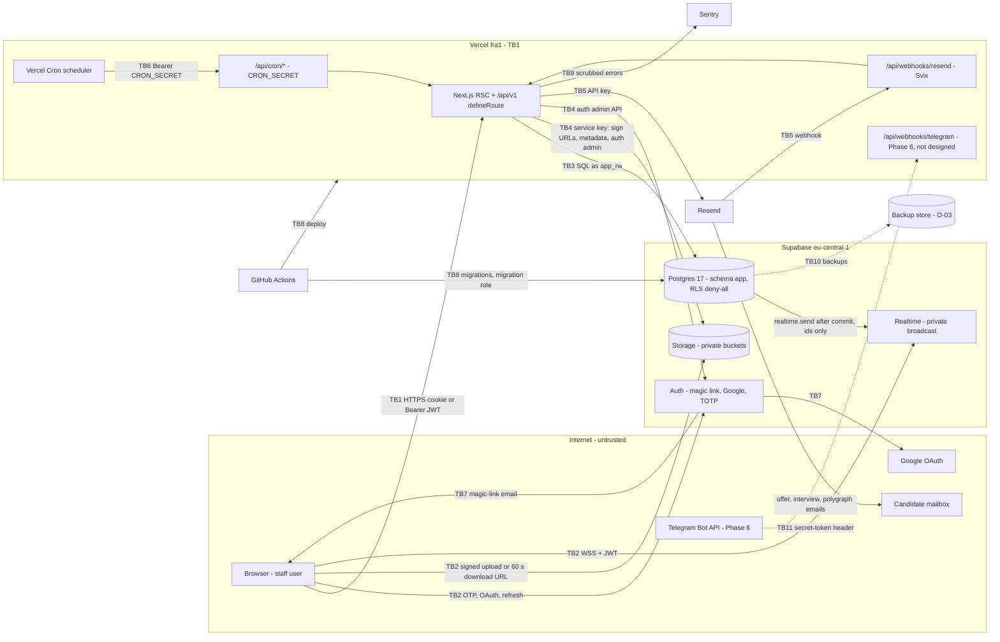

# Threat model — HRIS Recruiting App

- **Owner:** security-engineer · **Status:** Phase 0 baseline, revised 2026-10-31 for T3/T4 · **Date:** 2026-10-30
- **Revision 2026-10-31:** D22 = second TOTP + Admin reset (no recovery codes); D63 = aal1 keeps nonprivileged grants. T-A09 without Supabase Pro → app-level 12 h idle / 7 d absolute limits (`docs/security/t4-auth-requirements.md` §B). New design hazards: self-benefit on `candidate.bonus_flags.update` (T-D06), D13 `OWN_EARLY` mismatch (T-Z04), generic unique-violation existence oracle (T-Z07), denylist PII split (T-D11), custom roles skipping aal2 (T-Z05). See `docs/security/review-phase-1-core.md`.
- **Standard:** OWASP ASVS 4.0 L2, GDPR (Art. 5, 17, 25, 32, 33)
- **Inputs:** PRD v1.1 (§2.3, §8, §9, §12, §13 SEC), `docs/architecture.md`, `docs/authz-matrix.md`, ADR-001…009, `docs/perf/plan.md` §8.2, `docs/stories/phase-1.md`, `docs/OPEN_QUESTIONS.md`
- **Method:** STRIDE per component and flow. L = likelihood, I = impact (H/M/L). Residual = risk once the listed mitigation is in place.
- **Update rule:** revised at the end of every phase, and whenever an ADR changes a trust boundary. Required design changes are `DG-xx` (§7). Owner decisions are `O-xx` (§6, marked ⚠ OWNER).

---

## 1. Assets and sensitivity

| ID | Asset | Where | Class | Why it matters |
|---|---|---|---|---|
| AS-01 | CV files (versions) | Storage `cv`, `file_object` | **Restricted PII** | Full career history and contacts; GDPR Art. 6 basis = consent (CAND-01) |
| AS-02 | Polygraph result PDFs + outcome | Storage `polygraph`, `polygraph` | **Highly restricted** | Psychophysiological data, possibly special category; POLY-04 limits it to Admin/HHR/HR in vertical |
| AS-03 | Offer salaries, offer letters, expected salary | `offer`, Storage `offer`, `candidate` | **Restricted (financial)** | Compensation is confidential, and it drives the bonus base (BONUS-03) |
| AS-04 | Bonuses: snapshots, tranches, splits, adjustments, payouts, vacancy reward (BONUS-16) | `bonus_*`, `vacancy.bonus_amount_*` | **Restricted (money)** | Fraud target; payout reports go to Finance |
| AS-05 | Candidate PII: name, email, phone, Telegram, URLs, location, notes, feedback, comments | `candidate`, `comment`, `interview`, `entity_event_pii` | **Restricted PII** | Data-subject rights, purge (ARCH-04) |
| AS-06 | Staff identities and roles × verticals | `app_user`, `user_role`, `auth.users` | Confidential | Basis of every authz decision |
| AS-06a | Verified-TOTP bridge view `app.auth_mfa_totp` (`id`, `user_id` only; owner rights over `auth.mfa_factors`, `security_barrier`, SELECT for `app_rw` only) | migration `0007` | Confidential | Admin users list shows 2FA state; secrets stay unreachable (exact ACL/visibility test in `database.test.ts`). Users-list search `q` is in page/API URLs by design (wireframe); the paging cursor is an id only. When Sentry lands, strip query strings from `/api/v1/users` and `/settings/users` breadcrumbs |
| AS-06b | User timeline (`GET /api/v1/users/{id}/events`, HIST-03) | `entity_event` subject `app_user` (+ legacy `user` profile rows read, never relabelled) | Confidential | Returns only allowlisted fields re-validated against `EVENT_PAYLOADS` (fails closed to null); never joins `entity_event_pii`, no IP/UA. New user event types need a schema + mapper. The future user-purge job must clear PII for events of both subject keys. Append-only trigger protects against `app_rw`/`app_purge`; the schema owner `app_migrator` could bypass it — control = custody of `DATABASE_MIGRATION_URL` + migration review (no migration may disable `*_append_only` / `*_no_truncate`) |
| AS-07 | Audit log, login history (IP, UA, before/after diffs) | `audit_log` | **Restricted PII + integrity-critical** | Holds full row diffs (PII and salaries); evidence for disputes |
| AS-08 | Timeline events | `entity_event` | Integrity-critical | Append-only (HIST-03); statistics are replayed from it |
| AS-09 | Session material: Supabase access/refresh tokens, invite tokens, magic links, TOTP secrets | browser cookies, `user_invite`, Supabase Auth | **Secret** | Account takeover |
| AS-10 | Service secrets: Supabase service-role key, DB URLs (`app_rw`, migration, `app_purge`), `CRON_SECRET`, Resend API key and webhook secret, Telegram bot token (Phase 6), perf signing key | Vercel env, GitHub env secrets | **Secret (crown jewels)** | The service-role key bypasses all app authz and Storage privacy |
| AS-11 | Aggregated statistics and exports | `stat_*`, CSV/XLSX | Confidential | Finance sees all verticals; exports leave the system |
| AS-12 | Backups | Supabase backups, optional `pg_dump` (O-03) | **Restricted** (copy of everything) | Keep purged data for up to 30 days |

---

## 2. Actors and trust boundaries

### 2.1 Actors
| Actor | Trust | Notes |
|---|---|---|
| Admin (aal2) | High, still audited | Can purge, force-move, set rewards, mark paid |
| Head Recruiter / Recruiter / Head HR / HR / Team Lead | Authenticated, scoped | **Insider threat:** a legitimate user exfiltrating data or gaming bonuses |
| Finance | Authenticated, Statistics only | Must not reach any other route or API |
| Multi-role user (ROLE-01/02) | Union of scoped grants | Escalation risk across verticals |
| Candidate | Untrusted, external | Sends files (CVs) through recruiters; receives emails |
| Anonymous Internet attacker | Untrusted | Holds the public anon key and Supabase URL (they ship in the client bundle) |
| Compromised dependency / CI action | Untrusted code inside the boundary | Supply chain |
| Vercel Cron, Resend webhook, Telegram (Phase 6) | Machine callers | Authenticated by shared secret or signature |
| Developer / agent | Trusted for dev environments only | Must never hold prod secrets locally |

### 2.2 Trust boundaries
| TB | Boundary | Crossing data | Primary control |
|---|---|---|---|
| TB1 | Browser ↔ Vercel fra1 (`/api/v1`, RSC) | Session cookie or Bearer JWT, all business data | JWT local verify, `defineRoute` (Zod, CSRF, authz), CSP |
| TB2 | Browser ↔ Supabase **directly** (Auth, Storage signed URLs, Realtime WSS) | Anon key, user JWT, file bytes, broadcast | Auth config, private buckets **with no `storage.objects` policies**, Realtime private channels + RLS on `realtime.messages` |
| TB3 | Vercel ↔ Supabase Postgres (Supavisor) | SQL as `app_rw` | Least-privilege DB roles, schema `app` not exposed, RLS deny-all for anon/authenticated |
| TB4 | Vercel ↔ Supabase Auth admin / Storage (service-role key) | User creation, signed URL minting, MFA reset | Key stays server-side only (`server-only`), never `NEXT_PUBLIC_` |
| TB5 | Vercel ↔ Resend (out) / Resend → `/api/webhooks/resend` (in) | Candidate emails, offer PDFs, delivery events | API key; Svix signature + timestamp |
| TB6 | Vercel Cron → `/api/cron/*` | Trigger only | `Authorization: Bearer CRON_SECRET`, constant-time compare, 404 |
| TB7 | Supabase Auth ↔ Google OAuth / SMTP | Identity assertions, magic-link emails | `email_verified`, invite-email binding, optional domain (O-04) |
| TB8 | GitHub Actions ↔ Vercel / Supabase (deploy, migrations, perf, Newman) | Build artifacts, migration role, test tokens | Environment-scoped secrets, perf signer isolation (DG-01) |
| TB9 | App ↔ Sentry, Vercel logs | Errors, traces | Scrubbing (DG-16) |
| TB10 | Supabase ↔ backup store | Full DB copy | Encryption, separate credentials (O-03) |
| TB11 | Telegram Bot API → `/api/webhooks/telegram` (**Phase 6, boundary only, not designed**) | Bot updates, vacancy fields (VAC-06) | Secret-token header, account linking — designed only after the owner answers the Phase 6 questions |

### 2.3 Data-flow diagram

---

## 3. STRIDE threats

### 3.1 Authentication and sessions (TB1, TB2, TB7, TB8)
| ID | STRIDE | Threat | L | I | Mitigation (source) | Residual |
|---|---|---|---|---|---|---|
| T-A01 | S | **Perf/CI test-token signer leaks into prod.** The verifier trusts `AUTH_JWT_PUBLIC_JWK` from env (`perf/plan.md` §2.1, §8.2), and perf runs a `NODE_ENV=production` build. If the perf private key is committed or the env var is set in prod, anyone can mint a JWT for any user, including `aal2` Admin | M | **H** | **DG-01**: override compiled in only when a build-time `PERF_BUILD=1` is set; boot fails if the override exists while `VERCEL_ENV=production`; key pair generated per CI job and never committed or stored; prod accepts only `kid`s from the Supabase JWKS; CI greps the prod build for the perf `kid` | L |
| T-A02 | S | **JWT validation flaws:** alg confusion or `none`, missing `iss`/`aud`/`exp` checks, roles trusted from `user_metadata`/claims | L | H | ADR-001 asymmetric keys + `jose`; **DG-02**: alg allowlist (ES256/RS256), `iss` = project URL, `aud=authenticated`, `exp`/`nbf`, ≤ 30 s skew; roles only from DB (ADR-002 §4); `user_metadata` never read for authz | L |
| T-A03 | S, E | **Self-signup / direct Supabase Auth use** with the public anon key creates `auth.users` rows or Google identities outside the invite flow | M | M | ADR-002 §11 (no `app_user` ⇒ 401); **DG-07**: prod `enable_signup=false`; user created server-side at invite acceptance (admin API, `email_confirm=true`); auth-config drift check (P1-03) | L |
| T-A04 | I | **Account enumeration** through the magic-link form, or by calling Supabase `/otp` directly (unknown users return an error when signups are disabled) | H | L | STORY-SEC-AUTH-1 neutral message; our endpoint rate-limits; Supabase Auth CAPTCHA (Turnstile, O-13) blocks scripted direct calls | M (the direct-API oracle stays until CAPTCHA is on) |
| T-A05 | S, R | **Invite token** guessed, replayed, reused, forwarded; token leaks via URL path (`/invite/[token]` → Vercel access logs, Referer, history); mail scanners pre-fetch it | M | H | ADR-001 hashed single-use 72 h `user_invite`; STORY-ROLE-05-2/3 (resend invalidates, revoke, expiry checked at acceptance); **DG-07**: 256-bit random, SHA-256 at rest, atomic consume `UPDATE … WHERE status = 'PENDING' AND expires_at > now RETURNING` after `SELECT … FOR UPDATE` by hash; resend rotates the hash in place on the one `PENDING` row (old link dead at commit; old-token acceptance must still match the current hash/status), re-invite after revoke (D70) inserts a new row under an `app_user` row lock, email change before activation (D69) locks invite → user (acceptance's order), revokes the old row and inserts a new hash for the new address in one transaction, `user_invite_pending_uq` keeps ≤ 1 pending invite per user, CHECK pins `expires_at = sent_at + 72 h`; resend/revoke/re-invite are Admin aal2 only, audited without token, email or name; token in URL fragment or exchanged by POST, then clean redirect; `Referrer-Policy: no-referrer`; acceptance needs a button (POST); the signing identity's email must equal the invite email | L |
| T-A06 | S | **Magic link** intercepted or forwarded; consumed by mail scanners; PKCE breaks the cross-device edge case in STORY-SEC-AUTH-1 | M | H | Q-31 default: 15 min, single use, latest only; **DG-07**: `token_hash` confirm page with a POST button (scanner-safe); custom SMTP with DKIM (O-02) | M (the link is a bearer credential for 15 min) |
| T-A07 | S | **Google SSO linking:** a personal Google account matching an invite email; ex-employees keep Gmail access; Supabase auto-links identities by email | M | H | STORY-SEC-AUTH-2 exact email match, `email_verified=true`, no auto-provision; **O-04**: domain allowlist enforced server-side in the auth callback (the `hd` claim, not only the hint); offboarding = deactivate (ADR-002 §11) | M if personal accounts stay allowed |
| T-A08 | E | **Admin without MFA.** Weak TOTP recovery; brute force of codes | M | H | ADR-002 §10 Admin grants only when `aal=aal2`; STORY-SEC-AUTH-3 (5 fails → lock, reset by another Admin with reason and email); **DG-08**: Supabase has no native recovery codes, so allow a second TOTP factor plus Admin reset through the auth admin API instead of home-grown codes; ≥ 2 Admins. Residual (re-check 2026-11-01, SEC-AUTH-R02): a stolen aal1 session can verify TOTP directly at GoTrue, outside the app lockout; fix = bind aal2 to an app-recorded verification per session | M until R02 fixed, then L |
| T-A09 | S, R | **Session continues after logout, "end other sessions" or idle.** A locally verified JWT is valid until `exp`. The 12 h idle timeout needs Supabase Pro | H | M | ADR-002 §11 per-request `is_active`; **DG-05**: the context query also joins `auth.sessions` on JWT `session_id` (revocation takes effect immediately, no extra round-trip); access-token TTL ≤ 15 min; refresh rotation + reuse detection; 12 h idle = Supabase Pro inactivity timeout (O-02) **or** app-level `last_activity_at` + client idle timer; 7 d absolute (Q-31) | M |
| T-A10 | E | **Dev-login route** reachable in prod or preview, or its TOTP bypass leaking into prod authz | L | **H** | ADR-006 / arch §1: `NODE_ENV=development` only; STORY-DEV-1; **DG-12b**: the route and the aal bypass live in one dev-only module behind an inlined `process.env.NODE_ENV` (dead-code-eliminated); the route also refuses unless `SUPABASE_URL` is local; CI asserts the route is absent from the prod `.next` manifest and returns 404 on preview | L |
| T-A11 | S | **Newman password grant / seeded users leak into prod**: password provider on in prod, `@demo` users with known passwords; an XSS-stolen session sets a password (`updateUser`) for persistence | M | H | ADR-006 password sign-in in local/CI config only; STORY-ENV negative (seed refuses a non-local DB); **DG-07**: nightly prod check (no `@demo` users, no `auth.users.encrypted_password` set, password provider state via Management API); "secure password change" (reauth) on. Phase 1: verify whether the Supabase email provider can disable passwords separately from magic links | M |
| T-A12 | D | **Credential / OTP flooding**, no rate-limit store (no Redis) | H | M | Supabase built-in auth limits; O-01 Vercel WAF; **DG-09** Postgres fixed-window limiter for our auth endpoints | M until O-01 |
| T-A13 | T | **Open redirect** via `next`/`redirectTo` after login or invite | M | M | **DG-15**: only same-origin relative paths (`/` and not `//`), checked again after dot-segment normalisation (SEC-AUTH-R01, fixed 2026-11-01); Supabase redirect allowlist = exact URLs | L |
| T-A14 | I | **Orphan auth identities**: `ensureUser` creates a confirmed `auth.users` row before the locked acceptance re-check; when acceptance then loses to an email change (D69), revoke or roles removal, or a Google start is abandoned, the row stays for an address with no `app_user` link — often a stranger's typo address; outside purge reach; factors/identities enrolled on it carry over if the address is invited later | M | L | No `app_user` link ⇒ 401 (T-A03); schema `app` unexposed, RLS deny, no `storage.objects` policies; failed Google callback ends the session; email change/revoke kill the old token. **Gap (SEC-EML-01):** nightly `/api/cron/auth-orphans` deletes unlinked `auth.users` older than 24 h whose email isn't held by a pending invitee; optional best-effort delete of a just-created user on failed acceptance | L (M privacy until the cron ships) |

### 3.2 Authorization and visibility (TB1, TB2)
| ID | STRIDE | Threat | L | I | Mitigation (source) | Residual |
|---|---|---|---|---|---|---|
| T-Z01 | I, E | **IDOR on detail and mutation endpoints** (guessing or reusing UUIDs from Realtime, notifications, URLs) | H | H | ADR-002 §5 scoped fetch → 404, then `can()` → 403; arch §2.1 `FOR UPDATE` with scope; lint: repository methods require `scope`; matrix-generated allowed/denied tests (authz §6) | M (logic bugs; per-phase review) |
| T-Z02 | I | **Leaks through lists, search, autocomplete, counts, mini-funnels, calendar, timeline, notifications, exports** (VIS-02) | M | H | ADR-002 §6 `scopeWhere` in SQL, no post-filter; authz §4 per surface; ADR-008 counters only for `G`/`V`, otherwise scoped live counts; search has no total; contract test: list ⊆ `can(read)` | L |
| T-Z03 | E | **Multi-role vertical bleed**: `HEAD_RECRUITER@Gambling + RECRUITER@Crypto` acts as Head in Crypto; merged grants union their vertical lists across roles | M | H | ADR-002 §2 vertical-bound `ResolvedGrant`; **DG-10**: grant merge keyed by (permission, scope, producing assignment), `can()` matches scope **and** vertical in the same grant; mixed-role fixture in every matrix test (authz §6, perf §3) | L |
| T-Z04 | E | **Reference IDOR**: a body references ids outside scope (`vacancyId`, `candidateId`, `teamLeadId`, `hrUserId`, split recipients, mention ids, `templateId`, `locationId`, `reasonCode`, `entityId` in upload intents); mass assignment of `ownerId`/`sourcerId`/`stage`/`verticalId`; moving an object into another vertical | H | H | authz §2.3 note ⁴; **DG-10**: every referenced id resolved by scoped fetch or a role-in-vertical check; Zod `.strict()`; vertical change needs write rights in both verticals; user pickers limited to users holding the required role in that vertical | M |
| T-Z05 | E, I | **Vertical escalation recruiter → admin**: settings/users/roles/audit APIs, granting yourself roles, inviting an Admin | M | **H** | ADR-002 §5 route gating 404; Admin-only `settings.*` with `aal2`; **DG-10**: role-assignment and invite endpoints reject `ADMIN`/`FINANCE` unless the actor is aal2 Admin; no self role change; audited (AUD) | L |
| T-Z06 | E, I | **Finance confinement**: Finance reaches cards, files, settings, user directory, Realtime, or drills down from stats to cards | M | H | PRD STAT-08; ADR-002 §5 (404 pages + API); ADR-007 (Finance subscribes to nothing); authz §2.6 (`user.directory.read` excludes FIN); stats DTOs have no card links for FIN; route-gating test for every route × FIN (authz §6) | L (PII in payout reports = O-08) |
| T-Z07 | I | **Dedupe existence oracle (CAND-02)**: a recruiter probes "does person X (email/phone) exist anywhere?", for example whether a colleague is job-hunting | H | M | authz §4 `{match:'HIDDEN'}` without id/fields (PRD-mandated); **DG-11**: exact normalised match only, only on submit (no per-keystroke check); the response never says which field matched; per-user limit (e.g. 20 hidden matches/day) + security event in `audit_log`; Head Recruiter alert on bursts | M (accepted by PRD) |
| T-Z08 | I, S | **Realtime leaks or spoofing**: subscribing to foreign vertical/user topics, public channels, clients broadcasting fake events, metadata (`actorId`, activity volume) | M | M | ADR-007 private channels, RLS on `realtime.messages`, ids-only payload; **DG-11**: Realtime "private only" setting; no INSERT policy for clients; policy helper `SECURITY DEFINER` with fixed `search_path`; drop `actorId` (echo a per-tab mutation id instead) | L (vertical-wide activity volume visible) |
| T-Z09 | I | **Timeline redaction failure**: salary/polygraph/bonus values in events; HR/TL see earlier free text (screening notes, previous TL's feedback) | M | M | ADR-003 `sensitivity` + PII side table + `can()` on applications; ⚠ ADR-003 OPEN (O-14) | M until O-14 |
| T-Z10 | I | **Field-level DTO leaks**: salary to roles without `offer.salary.read`, `polygraph.result_file_id` to REC/TL, BONUS-16 reward to TL/HR (Q-113), bonus info on candidate cards | M | H | ADR-002 §7 mappers drop fields; **DG-10**: per-role response-snapshot tests; the client never receives a field just to hide it in the UI | L |
| T-Z11 | I | **Shared caching of user data** (Next Data Cache, Vercel CDN, `unstable_cache` reference data) | L | H | ADR-007 no Data Cache for user data; **DG-15**: `Cache-Control: private, no-store` on `/api/v1`, exports and RSC payloads with PII; reference cache holds only non-sensitive fields (no bonus amounts) | L |
| T-Z12 | I | **Error oracles**: 409 `ACTIVE_APPLICATION_IN_GROUP` or a 403 vs 404 difference reveals invisible objects | M | L | arch §5 (bodies never carry other objects' data; reads never 403) | L |
| T-Z13 | E | **Writes in an inactive vertical; deactivated users** | L | M | ADR-002 §9 (409 `VERTICAL_READ_ONLY`), §11 (401) | L |

### 3.3 Files (TB2, TB4)
| ID | STRIDE | Threat | L | I | Mitigation (source) | Residual |
|---|---|---|---|---|---|---|
| T-F01 | I | **Direct Storage access bypasses app authz**: a user's own JWT + anon key calls the Storage API (list/download) because of a permissive `storage.objects` policy or a public bucket | M | **H** | ADR-005 private buckets; **DG-03**: **zero** policies on `storage.objects` for `anon`/`authenticated` (service role only); migration test: a user JWT cannot list or download in any bucket | L |
| T-F02 | I | **Polygraph PDF beyond POLY-04** (REC/TL, other vertical, through timeline/DTO/file id) | M | H | ADR-005 `polygraph.file.read` (ADM, HHR, HR `V≥P`) → 404; authz §2.3; ADR-003 `POLYGRAPH` redaction; audited on every URL issue; DTO drops the file id | L |
| T-F03 | I | **Signed URL lifetime and sharing**: forwarded, logged, cached, in Sentry breadcrumbs or browser history | M | M | ADR-005 60 s, never logged; perf R12 minted on click only; **DG-16** breadcrumb and URL scrubbing; `no-store`; pdf.js loads bytes in memory | M (an authorised user can forward within 60 s or save the file: insider) |
| T-F04 | T, E | **Malicious upload**: spoofed MIME, PDF/HTML polyglot, macro DOC/DOCM renamed to DOCX, zip bomb, pdf.js exploit; **no AV until Phase 7**; HR staff are prime phishing targets | **H** | **H** | ADR-005 bucket MIME/size allowlist, magic bytes, real size from metadata; **DG-12**: DOCX structure check via ranged read of the zip central directory (needs `[Content_Types].xml` + `word/document.xml`, rejects `vbaProject.bin`); PNG/JPEG signatures for `attachment`; inline preview **PDF only**, pdf.js ≥ 4.2.67 (CVE-2024-4367), `isEvalSupported:false`, `enableScripting:false`; DOC/DOCX always `attachment` with an "not virus-scanned" warning; Storage on a separate origin; O-06 | **H until Phase 7 AV** |
| T-F05 | T | **Object overwrite after validation** (the signed upload URL lives about 2 h); `complete` replayed or called by another user | M | M | ADR-005 random key, `complete` validates; **DG-12**: `upsert:false`; `complete` only for `PENDING` rows created by the same user; etag/size recorded and re-checked when a URL is issued | L |
| T-F06 | T | **User-controlled paths / filenames** | L | M | ADR-005 key = `{bucket}/{vertical_id}/{file_object.id}`; the filename is metadata only and is sanitised in `Content-Disposition` (RFC 6266 `filename*`) | L |
| T-F07 | D | **Storage abuse** (mass upload intents, junk `PENDING` rows) | M | L | ADR-004 `files-cleanup`; **DG-09** per-user limit on upload intents | L |

### 3.4 Input/output (TB1, TB5)
| ID | STRIDE | Threat | L | I | Mitigation (source) | Residual |
|---|---|---|---|---|---|---|
| T-X01 | T, E | **Stored XSS** via Tiptap rich text, comments, names, LinkedIn/portfolio URLs (`javascript:`), filenames, Meet links, email templates; it steals Supabase tokens, which are in **JS-readable cookies** because Realtime needs the JWT client-side | M | **H** | ADR-009 "sanitized"; **DG-13**: store ProseMirror JSON validated by a strict Zod schema (allowlisted nodes/marks); render through React only (lint bans `dangerouslySetInnerHTML`); URL scheme allowlist `https:`/`mailto:`; PIPE-04 anchored regex; React Email/react-pdf escaping; nonce CSP (DG-15) | L |
| T-X02 | T | **CSV/XLSX formula injection** in exports (names, comments, reasons) | M | M | ADR-008 `'` prefix for `= + - @`; **DG-14**: also TAB and CR; numbers written as numeric cells (negative clawbacks are not strings); XLSX text cells typed as string | L |
| T-X03 | T | **Invalid or oversized input**, mass assignment | M | M | ADR-006 Zod on every route; **DG-10** `.strict()`, integer money with max, length/array caps, 1 MB JSON body cap | L |
| T-X04 | T | **SQL injection**, `ILIKE` wildcard abuse | L | H | Drizzle parameterised; **DG-13**: lint ban on `sql.raw` with input; escape `% _ \` in search | L |
| T-X05 | D | **Expensive search / ReDoS** (1-char trigram scans, crafted regex) | M | L | perf §4.6; **DG-09** search rate limit, minimum 2 characters; linear-time regexes only | L |
| T-X06 | S | **Email spoofing / phishing** in the company's name (offers, invites) | M | M | **DG-15**: SPF, DKIM, DMARC `p=reject` on the sending domain; Resend custom domain | M |

### 3.5 Machine endpoints and platform (TB1, TB5, TB6, TB11)
| ID | STRIDE | Threat | L | I | Mitigation (source) | Residual |
|---|---|---|---|---|---|---|
| T-E01 | S, E | **Cron endpoints invoked by outsiders**; manual re-run exposes `CRON_SECRET` to the browser; arbitrary `runKey` replays old dates | M | M | ADR-004 Bearer `CRON_SECRET`, constant-time compare, 404, idempotent; **DG-04**: Admin re-run goes through `/api/v1/admin/jobs/{job}/runs` (aal2, audited), which calls the job module server-side; `runKey` format + ≤ 7 days back; secret ≥ 32 random bytes, different per environment | L |
| T-E02 | S | **Resend webhook forged or replayed** | M | L | ADR-006 Svix signature; **DG-04**: 5 min timestamp tolerance, `svix-id` dedupe, status-only updates | L |
| T-E03 | S, E, I | **Telegram webhook (Phase 6, boundary only)**: forged updates, account-link hijack, vacancy creation as another user, PII stored in Telegram cloud | — | H | Not designed. Minimum controls: `X-Telegram-Bot-Api-Secret-Token` constant-time compare → 404; `update_id` dedupe; one-time in-app linking code; bot actions run as the linked user through the same services and authz; no candidate PII, salary or polygraph data in messages without owner approval (O-15) | Phase 6 |
| T-E04 | T | **CSRF** on cookie-authenticated `/api/v1` | M | H | ADR-006 Origin check (non-GET, cookie) + SameSite=Lax; **DG-06**: a missing `Origin` on a cookie request is rejected (`Sec-Fetch-Site` fallback); require `application/json`; no CORS headers; no state change on GET (except audit rows); logout and invite acceptance are POST | L |
| T-E05 | T, I | **Script injection / clickjacking / mixed content** | M | H | PRD SEC strict CSP; **DG-15**: nonce + `strict-dynamic`, `object-src 'none'`, `base-uri 'none'`, `frame-ancestors 'none'`, `form-action 'self'` + Supabase/Google OAuth hosts, `connect-src` self + project `https`/`wss` + Sentry ingest, `worker-src 'self' blob:` (pdf.js), no `frame-src` to storage; HSTS preload, `nosniff`, `Referrer-Policy: strict-origin-when-cross-origin` (`no-referrer` on auth/invite pages), COOP `same-origin`, Permissions-Policy | L |
| T-E06 | D | **API scraping / abuse**; no WAF on Hobby | M | M | O-01 Vercel WAF; **DG-09** per-user Postgres limiter on sensitive routes (search, dedupe, file URLs, exports, upload intents) | M |
| T-E07 | E | **Framework CVEs**: Next middleware bypass (CVE-2025-29927); React Server Components RCE (CVE-2025-55182 / CVE-2025-66478) | M | **H** | Authz in `defineRoute` and pages, never only in middleware (arch §2); **DG-17**: pin patched Next/React versions; Renovate security PRs within 48 h | M |

### 3.6 Data integrity, money, privacy (TB3, TB9, TB10)
| ID | STRIDE | Threat | L | I | Mitigation (source) | Residual |
|---|---|---|---|---|---|---|
| T-D01 | I | **PII or salaries in logs / Sentry / Vercel logs**: raw query strings (`q`), DB driver errors carrying parameters, breadcrumbs with signed URLs, request bodies | H | M | ADR-006 step 7; perf §8.5 (route template only, no params); Sentry `sendDefaultPii:false`; **DG-16**: `beforeSend`/`beforeBreadcrumb` scrub (bodies, query, cookies, `Authorization`, storage URLs, emails/phones regex), no Session Replay, DB errors logged by code/constraint only, `job_run.stats` counts only, Sentry EU region; log-scan test | M |
| T-D02 | T, R | **Append-only bypass** on `entity_event` / `audit_log` (UPDATE/DELETE/TRUNCATE, triggers disabled, the purge role misused by the app) | L | H | ADR-003 REVOKE + trigger; **DG-17**: same for `audit_log` (column-level UPDATE of `before`/`after` for `app_purge` only); purge = `SECURITY DEFINER` function owned by `app_purge`, EXECUTE granted to `app_rw`, so the app holds no `app_purge` credentials; `app_rw` is not a member of `app_purge` or the owner | L |
| T-D03 | T | **PROB-05 bypass**: moving `start_date` later, changing `probation_days` after start, a second probation row, force move OFFER⇄PROBATION, restore/reactivate, PATCH through another endpoint | M | H | State machine §7 + DB trigger + CHECK ≤ 90 + 409 `PROBATION_EXTENSION_FORBIDDEN`; **DG-18**: the trigger also rejects any change of `start_date`/`probation_days` after ACTIVE; unique `probation(application_id)`; `PROBATION_IMMUTABLE` for force moves into or out of PROBATION once a probation exists; reactivation after `PROBATION_FAILED` is a new hire cycle (flagged in the timeline) | L |
| T-D04 | E, T | **Bonus self-approval / self-payment / self-adjustment**: HREC (who can create candidates and become sourcer) approves their own tranche; Admin marks their own tranche paid | M | H | §9.3 roles; **DG-19 / O-07**: actor ≠ recipient for approve, hold/release, mark_paid, adjust, self-referral approval; enforced in the service + DB CHECK on approver/payer columns | L after O-07 |
| T-D05 | E | **Manual split / owner reassignment to self**: HREC splits 50 % to themselves or reassigns the owner to themselves before PROBATION_PASSED | M | H | BONUS-05 reason + audit; **DG-19 / O-07**: split recipients = recruiters of the vertical, actor excluded unless Admin; reassign-to-self needs another HREC or Admin; Admin notification | L after O-07 |
| T-D06 | T | **Rehire / referral gaming**: a recruiter clears the former-employee flag (CAND-05, `candidate.update` own) or omits the referrer to collect a blocked bonus | M | M | BONUS-05/11; **DG-19**: former-employee flag and `referrer_user_id` editable only by HREC/HHR/Admin (authz CAND-01 ⚠); every change audited and shown on the approval screen | M (an omitted referral can't be detected) |
| T-D07 | T | **Sourcing-credit gaming**: concurrent duplicate creation, artificial "activity" to keep or steal the 180-day window | M | M | BONUS-05; **DG-19**: unique partial indexes on normalised email/phone/Telegram/LinkedIn (race-proof); only pipeline actions count toward `last_activity_at` (not comments or views) | L |
| T-D08 | T | **BONUS-16 limit bypass**: two concurrent changes, clone/recreate the vacancy, a race between a reward change and offer acceptance | L | M | arch §8.2 `FOR UPDATE` + domain rule; **DG-19**: clone does not copy the reward (or inherits change history); the snapshot reads the vacancy row under lock in the acceptance transaction; Admin aal2 | L |
| T-D09 | T | **Double processing / races**: double approve or pay, cron vs user transaction on the same tranche, bulk mark-paid replay | M | M | ADR-004 guarded updates `WHERE status=…`; ADR-006 `expectedVersion`; `payout_period` unique per tranche | L |
| T-D10 | T | **Amount tampering**: client-sent amounts, FX rate edits, salary inflation to raise a %-bonus | L | H | Amounts computed server-side (BONUS-15), client amounts only for BONUS-12/16 (Admin, reason, bounds); `fx_rate` writes audited; snapshot immutable: **DG-19** REVOKE UPDATE on `bonus_snapshot` from `app_rw` | M (Head HR × recruiter collusion) |
| T-D11 | I | **Purge incomplete (ARCH-04)**: PII stays in `audit_log` before/after (all related entities, not only the candidate row), `comment`, `interview`/`reschedule_request` notes, `offer.additional_terms`, normalised dedupe keys, `search_text`, `entity_event_pii`, Storage (CV, polygraph, offer PDFs, attachments), Resend logs, Sentry | M | **H** | ADR-003 (side table + audit nulling), ADR-005 (objects deleted, stub); **DG-20**: one purge procedure with a table checklist generated from schema metadata (every column tagged `pii`); `audit_log.candidate_id` correlation column; purge ledger (`purge_log`, no PII); test "no seeded PII string remains in any table/bucket" | L |
| T-D12 | I | **Backups keep purged PII; backup theft; untested restore; files not in DB backups** | M | H | PRD SEC daily/30 d/tested restore; **O-03**; **DG-20**: re-apply `purge_log` after any restore; encrypted off-site dump (age/GPG public key on the runner, never an Actions artifact, write-only credentials); separate plan for Storage objects | M |
| T-D13 | I | **Over-retention** (audit IP/UA, login history, Resend logs, Vercel logs) | M | M | Q-39 default 3 years; O-10 processor DPAs and retention settings | M |
| T-D14 | I | **Insider bulk exfiltration** by legitimate users (HREC/HR mass CV downloads, Finance exports, dedupe probing) | M | H | Audit of CV/polygraph URL issuance (ADR-005), exports audited (**DG-21**); **DG-21**: volume alerts (e.g. > 50 file URLs per hour per user, > 5 exports per day) to Admin | M |
| T-D15 | R | **Missing audit for sensitive reads/actions**: salary views, exports, MFA reset, role changes, restore, purge, force move, bonus approvals/payouts | M | M | AUD all writes; ADR-005 file URLs; **DG-21**: audit salary-bearing offer detail reads (async `after()` insert), exports, security events (refused Admin calls, hidden dedupe matches); O-12 | L |

### 3.7 Secrets, environments, supply chain (TB4, TB8)
| ID | STRIDE | Threat | L | I | Mitigation (source) | Residual |
|---|---|---|---|---|---|---|
| T-S01 | I | **Secrets leak**: service-role key or DB URLs in the client bundle (`NEXT_PUBLIC_`), git, logs, `.env.example` | M | **H** | CLAUDE §3.9; ADR-005 (service key server only); **DG-22**: `server-only` on integration modules; CI fails if a server secret name is `NEXT_PUBLIC_*` or appears in `.next/static`; gitleaks on every push; `.env.example` keys only; rotation runbook | L |
| T-S02 | I | **Preview deployments** use prod DB/keys or are publicly reachable with real data | M | H | **DG-22**: Vercel env scoping (Preview → staging project only); Vercel Deployment Protection on previews; prod secrets only in Production scope | L |
| T-S03 | T, E | **Malicious dependency / compromised GitHub Action** (npm worm style) | M | **H** | **DG-17**: frozen pnpm lockfile, pnpm 10 lifecycle scripts blocked except `onlyBuiltDependencies` allowlist, `minimumReleaseAge` ≥ 1 day, Renovate with review, `pnpm audit --audit-level high` gate, Actions pinned by SHA, default `permissions: read-all`, no `pull_request_target`, SBOM in Phase 7 | M |
| T-S04 | E | **CI secret misuse**: prod migrations or deploy from PR branches; fork PRs reading secrets | L | H | **DG-22**: GitHub Environments with required reviewers; prod migrations only from `main`; migration role separate from `app_rw`; perf/Newman jobs use only local Supabase (no prod secrets) | L |
| T-S05 | D | **Availability**: Supabase free tier pauses; Hobby cron limits | M | M | ADR-001 P1/P2 (O-01, O-02) | M |

---

## 4. Security requirements checklist per phase (testable)

| ID | Phase | Requirement (pass criterion) | PRD |
|---|---|---|---|
| P1-01 | 1 | JWT: alg allowlist, `iss`/`aud`/`exp`/`nbf`; prod trusts only Supabase JWKS `kid`s; perf key override absent from the prod build, and boot fails if the override is present (DG-01/02) | SEC |
| P1-02 | 1 | Roles, `is_active` and session validity (`auth.sessions` via `session_id`) loaded from DB per request; nothing from `user_metadata` (DG-05) | ROLE-01/05, SEC |
| P1-03 | 1 | Prod Supabase Auth: signups off, OTP 15 min, secure email/password change, refresh rotation, JWT ≤ 15 min, TOTP on, custom SMTP, redirect URL allowlist; drift-check script green; no `@demo` users and no passwords set in prod | ROLE-05, SEC |
| P1-04 | 1 | Invites: 256-bit token, SHA-256 at rest, atomic single use, 72 h checked at acceptance, resend invalidates, revoke works, email binding, token not in path or logs, POST confirm | ROLE-05 |
| P1-05 | 1 | Admin grants only with `aal2`; 5 failed TOTP → lock; reset by another Admin (audited + email); second factor allowed (DG-08) | SEC |
| P1-06 | 1 | 12 h idle and 7 d absolute logout; "end other sessions" effective on the next request; deactivation effective ≤ 1 min | SEC, ROLE-05 |
| P1-07 | 1 | Dev login: 404 in prod/preview builds; absent from the prod route manifest; refuses a non-local Supabase; seed scripts refuse non-local DBs | CLAUDE §8 |
| P1-08 | 1 | Authz module: every matrix cell has an allowed and a denied test incl. a mixed-role fixture; `can()`/`scopeWhere()` contract tests; every route × role → expected 2xx/403/404 (Finance 404 outside Statistics) | VIS-01..03, ROLE-01/02/04, STAT-08 |
| P1-09 | 1 | `defineRoute` on all `/api/v1` (lint); Zod `.strict()`; 1 MB body cap; CSRF Origin + JSON content type; problem+json without foreign data | SEC, API |
| P1-10 | 1 | CSP (nonce) + security headers per DG-15 on every response; injected inline script blocked (E2E) | SEC |
| P1-11 | 1 | Rate limits on magic link, invite accept, MFA verify, API per user; 429 neutral message | SEC |
| P1-12 | 1 | Logs and Sentry: a seeded request with email/phone in query/body leaves no PII in pino output or the Sentry event (test transport) | SEC |
| P1-13 | 1 | Audit for every write + login history + security events; `audit_log`/`entity_event` UPDATE/DELETE/TRUNCATE fail as `app_rw` | AUD, HIST-03 |
| P1-14 | 1 | DB roles `app_rw`/migration/`app_purge` separated; schema `app` not exposed; RLS deny-all; **no `storage.objects` policies**; Realtime private-only; no client INSERT on `realtime.messages` | SEC, VIS-01 |
| P1-15 | 1 | Secrets: env only, `.env.example` without values, gitleaks, `NEXT_PUBLIC_` check, Vercel env scoping, preview protection, GitHub Environments | SEC |
| P1-16 | 1 | Supply chain gates (DG-17) in CI | SEC |
| P1-17 | 1 | Open-redirect guard on `next`/`redirectTo` | SEC |
| P2-01 | 2 | Lists, kanban, search, autocomplete, counts and mini-funnels return only `can(read)` objects for each role fixture; search has no total | VIS-02, UI-03 |
| P2-02 | 2 | Dedupe: HIDDEN has no id/fields/field name; exact match on submit only; per-user limit; security event | CAND-02 |
| P2-03 | 2 | Upload: intent authz, ext + MIME + size, magic bytes, DOCX structure/macro check, `upsert:false`, `complete` only by its creator, server-generated keys, PENDING cleanup | CAND-01, SEC |
| P2-04 | 2 | File URL: authz before minting, 60 s, audited, never in list/card DTOs, `no-store`; a user JWT cannot read Storage directly | CAND-04, SEC |
| P2-05 | 2 | Preview: PDF only, pdf.js patched with scripting off; DOC/DOCX download-only with an unscanned warning | SEC |
| P2-06 | 2 | Rich text stored as validated JSON, rendered without raw HTML; URL scheme allowlist on LinkedIn/portfolio | CAND-01, VAC-01 |
| P2-07 | 2 | Reference ids (vertical, position, TL, recruiters, candidate on application create) validated in scope; vertical move needs both verticals | VAC-01, CAND-03 |
| P2-08 | 2 | Merge requires read on both candidates; merged history keeps redaction | CAND-02 |
| P2-09 | 2 | Delete rules (`own<I`), soft delete; deleted objects 404 outside the archive | §2.3, D13, ARCH-05 |
| P2-10 | 2 | Realtime: foreign vertical/user topic subscribe denied; payload ids only | VIS-02 |
| P2-11 | 2 | Former-employee and referrer fields editable only by HREC/HHR/Admin; changes audited | CAND-05, BONUS-05/11 |
| P2-12 | 2 | Mention picker and notification recipients limited to users who can read the entity | CAND-04, NOTIF |
| P3-01 | 3 | All stage changes through the state machine; denied role → 403, invalid → 409; force move Admin aal2 + comment + flagged | PIPE-01/02 |
| P3-02 | 3 | Meet link anchored regex `^https://meet\.google\.com/[a-z]{3}-[a-z]{4}-[a-z]{3}$` | PIPE-04 |
| P3-03 | 3 | Polygraph: PDF ≤ 15 MB only; outcome needs the PDF; file reachable only by Admin/HHR/HR in vertical, 404 otherwise; events redacted; URL audited | POLY-03/04 |
| P3-04 | 3 | Salary only to `offer.salary.read`; SALARY events redacted; no salary in logs, notifications or user emails | OFFER-01, §2.3 |
| P3-05 | 3 | Offer send Head HR only; PDF generated server-side with escaped merge fields; recipient resolved at send; SPF/DKIM/DMARC pass | OFFER-01/02 |
| P3-06 | 3 | PROB-05: every endpoint and the DB trigger reject a later end date, start-date shift, length change after start, second probation, force in/out | PROB-05, BONUS-10 |
| P3-07 | 3 | PROB-03: TL < 30 days → 409; override HHR/Admin with comment only | PROB-03 |
| P3-08 | 3 | Routing stays within the vertical routing group; next TL sees only what O-14 allows | ROUTE-03, HIST |
| P3-09 | 3 | Event payload schemas `.strict()`, PII only in `entity_event_pii`; events immutable | HIST-01..03 |
| P3-10 | 3 | Resend webhook: bad signature / stale timestamp / replay → rejected | OFFER-02 |
| P3-11 | 3 | Cron: missing/wrong secret → 404; `runKey` validated; re-run idempotent; Admin re-run via `/api/v1` aal2 | PIPE-05, PROB-06 |
| P3-12 | 3 | Concurrency: `expectedVersion` → 409; no double transition under parallel requests | PIPE-01 |
| P3-13 | 3 | Calendar returns only readable interviews/polygraphs | VIS-02 |
| P4-01 | 4 | Separation of duties per O-07: actor ≠ beneficiary for approve/hold/pay/adjust/split/reassign | BONUS-05, §9.3 |
| P4-02 | 4 | Tranche transitions guarded; parallel approve/pay produce exactly one change | §9.3 |
| P4-03 | 4 | BONUS-16: Admin aal2 only, reason mandatory, ≤ 1 per 2 months under row lock, clone doesn't reset it, event + audit | BONUS-16 |
| P4-04 | 4 | `bonus_snapshot` immutable (no UPDATE grant); scheme edits don't change existing bonuses | BONUS-02 |
| P4-05 | 4 | Manual split/adjust: reason, bounds, audit, Admin-visible | BONUS-05/12 |
| P4-06 | 4 | Self-referral blocked unless Admin (≠ recipient) approves | BONUS-05 |
| P4-07 | 4 | Rehire rule can't be bypassed by the recruiter editing flags | BONUS-11 |
| P4-08 | 4 | Statistics scope per role; Finance global read-only and Statistics only; exports same scope, audited, formula-safe, `no-store` | STAT-07/08, BONUS-13 |
| P4-09 | 4 | Payout report PII limited per O-08 | BONUS-13, STAT-08 |
| P4-10 | 4 | `bonus-triggers` secret-protected and idempotent | BONUS-15 |
| P4-11 | 4 | Audit for approvals, payouts, adjustments, splits, reward changes, FX edits, salary views (O-12) | AUD |
| P5-01 | 5 | Restore by Admin/HREC in vertical only; audited; stats day marked dirty | ARCH-01 |
| P5-02 | 5 | Purge: Admin aal2, Deleted archive only, typed confirmation, `SECURITY DEFINER` procedure; checklist complete (DG-20); stub kept; files deleted; `purge_log`; "no PII string left" test | ARCH-04/05 |
| P5-03 | 5 | Retention job only proposes; nothing deleted without an Admin action | ARCH-04 |
| P5-04 | 5 | Notifications: recipients via `can()`; rows hold ids only; user emails without candidate PII/salary; candidate emails only the required details | NOTIF |
| P5-05 | 5 | Archive tabs scoped; reactivation permissions per matrix | ARCH-01/02 |
| P6-01 | 6 | The owner question list includes security items (O-15) before any code | VAC-06 |
| P6-02 | 6 | Telegram webhook secret token, constant time, 404 otherwise; `update_id` dedupe | VAC-06 |
| P6-03 | 6 | Account linking by one-time in-app code (≤ 10 min); unlink; deactivation unlinks | VAC-06 |
| P6-04 | 6 | Bot vacancy creation through the same services/authz/Zod, `source=TELEGRAM_BOT` | VAC-01/06 |
| P6-05 | 6 | No PII, salary or polygraph data in Telegram messages unless the owner approves; private chats only | SEC, POLY-04 |
| P7-01 | 7 | Antivirus scan sets `scan_status`; non-CLEAN files not downloadable | SEC |
| P7-02 | 7 | ASVS L2 review + manual pentest of authz (horizontal + vertical) on staging | VIS-01..03 |
| P7-03 | 7 | Daily backups, 30-day retention, restore drill with `purge_log` re-applied | SEC, ARCH-04 |
| P7-04 | 7 | Prod config drift check, secret rotation, dev route absent, no demo users | SEC |
| P7-05 | 7 | Alerts: auth failure bursts, 404 bursts per user (IDOR probing), file-URL/export volume, cron failures | SEC |
| P7-06 | 7 | Dependency audit clean, SBOM published, Actions pinned | SEC |
| P7-07 | 7 | Incident response + GDPR 72 h breach runbook; processor list (RoPA); admin guide security section (Ukrainian) | SEC |

---

## 5. Security test cases for `docs/test-plan.md` (IDs for qa-engineer)

| ID | Covers |
|---|---|
| SEC-TC-01 | Forged JWT signed with the perf key against a prod build → 401 |
| SEC-TC-02 | JWT with `alg=none`/HS256, wrong `iss`/`aud`, expired → 401 |
| SEC-TC-03 | Valid JWT for a deactivated user / revoked session → 401 |
| SEC-TC-04 | Direct Supabase signup / OTP for an unknown email creates no usable account |
| SEC-TC-05 | Invite token reuse, expiry at 72 h + 1 s, revoked, resent old link → refused |
| SEC-TC-06 | Invite accepted with a Google account of a different email → refused |
| SEC-TC-07 | Magic link: second use, after 15 min, older link after a newer one → refused |
| SEC-TC-08 | Admin at `aal1` → 401 `MFA_REQUIRED` on every Admin API |
| SEC-TC-09 | 6th wrong TOTP → locked |
| SEC-TC-10 | Idle 12 h and absolute 7 d → session ended |
| SEC-TC-11 | Dev-login route → 404 on the prod build and preview |
| SEC-TC-12 | Prod config check: no `@demo` users, no passwords, signups off |
| SEC-TC-13 | IDOR matrix: every detail/mutation route with an out-of-scope id → 404 |
| SEC-TC-14 | Recruiter A → recruiter B candidate/application/bonus → 404 |
| SEC-TC-15 | Recruiter → Admin endpoints (settings, users, roles, audit, purge, force move) → 404 |
| SEC-TC-16 | Mixed-role user cannot use Head rights in the vertical where they are only a Recruiter |
| SEC-TC-17 | Finance → every non-Statistics page and API → 404; no Realtime subscription |
| SEC-TC-18 | Lists/search/autocomplete/count/calendar/timeline/notifications ⊆ readable set, per role |
| SEC-TC-19 | Reference IDOR: foreign-vertical `vacancyId`, `teamLeadId`, `hrUserId`, split recipient, mention id → 404/400 |
| SEC-TC-20 | Mass assignment of `ownerId`/`sourcerId`/`stage`/`verticalId` → 400 |
| SEC-TC-21 | Dedupe HIDDEN response contains no id/fields/field name; limit triggers 429 + security event |
| SEC-TC-22 | Realtime: subscribe to a foreign vertical/user topic denied; client broadcast denied |
| SEC-TC-23 | DTO field redaction per role: salary, polygraph file id, reward amount, bonus |
| SEC-TC-24 | Timeline redaction of SALARY/POLYGRAPH/BONUS events per role |
| SEC-TC-25 | User JWT direct Storage list/download in every bucket → denied |
| SEC-TC-26 | Polygraph PDF URL as REC/TL/HR of another vertical → 404 |
| SEC-TC-27 | Signed URL expires after 60 s; issuance audited |
| SEC-TC-28 | Upload: wrong magic bytes, renamed EXE, DOCM-as-DOCX, oversize, PDF/HTML polyglot → rejected |
| SEC-TC-29 | Overwrite object after `complete`; `complete` by another user → rejected |
| SEC-TC-30 | Stored XSS payloads in rich text, names, URLs, filenames, comments → inert |
| SEC-TC-31 | CSP blocks an injected inline script; security headers present |
| SEC-TC-32 | CSRF: cross-origin POST, missing Origin, `text/plain` body → rejected |
| SEC-TC-33 | Open redirect via `next` → refused |
| SEC-TC-34 | Export formula injection (`= + - @`, TAB, CR) neutralised; numbers numeric |
| SEC-TC-35 | Cron without or with a wrong secret → 404; invalid `runKey` → 400 |
| SEC-TC-36 | Resend webhook bad signature / replay → rejected |
| SEC-TC-37 | Rate limits: auth, API, search, file URL, export → 429 |
| SEC-TC-38 | Logs/Sentry contain no seeded email, phone, salary, signed URL |
| SEC-TC-39 | UPDATE/DELETE/TRUNCATE on `entity_event`/`audit_log` as `app_rw` → error |
| SEC-TC-40 | PROB-05 vectors: later end date, start shift, length change, second probation, force in/out → 409 |
| SEC-TC-41 | Bonus SoD: self-approve, self-pay, self-adjust, self-split, reassign-to-self → 403 |
| SEC-TC-42 | Former-employee/referrer flag edit by a recruiter → 403 |
| SEC-TC-43 | BONUS-16: second change inside the window (parallel requests) → one succeeds, one 409; clone doesn't reset |
| SEC-TC-44 | Parallel approve/pay of one tranche → exactly one transition |
| SEC-TC-45 | Purge completeness: no seeded PII string in any table, bucket or audit diff; stub intact |
| SEC-TC-46 | Restore drill re-applies `purge_log` |
| SEC-TC-47 | Prod build bundle contains no server secret names or perf `kid` |
| SEC-TC-48 | Telegram webhook without or with a wrong secret token → 404 (Phase 6) |

---

## 6. Items that need an owner decision (⚠ OWNER)

| ID | ⚠ OWNER | Why it matters for security | Options (not decided) | Ref |
|---|---|---|---|---|
| O-01 | ⚠ OWNER **Vercel Pro** | WAF rate limiting and DDoS rules, commercial use, 5-min crons | Pro / stay Hobby + Postgres limiter only (DG-09) | ADR-001 P1/P4 |
| O-02 | ⚠ OWNER **Supabase Pro** | 12 h inactivity timeout + absolute session time-box (SEC), custom SMTP, no pausing, daily backups | Pro / free + app-level idle timeout (DG-05) | ADR-001 P2, Q-31 |
| O-03 | ⚠ OWNER **30-day backups + file backups** | PRD needs 30 days and a tested restore; Pro keeps 7 days; Storage files (CVs, polygraph) are **not** in DB backups | PITR add-on / nightly encrypted `pg_dump` + separate storage (cost) / accept 7 days | ADR-001 P3, SEC |
| O-04 | ⚠ OWNER **Restrict Google SSO to a company domain** | With personal Gmail allowed, ex-employees keep a login path until deactivated | Domain-only / any account matching the invite email | Q-29 |
| O-05 | ⚠ OWNER **MFA beyond Admin** | Head HR, HR, Head Recruiter and Finance see salaries, polygraph data, bonuses, all-vertical exports | Mandatory for these roles / optional | SEC, Q-30 |
| O-06 | ⚠ OWNER **DOC/DOCX without antivirus until Phase 7** | Weaponised CVs aimed at HR staff are a top real-world vector | Accept with download-only + warning / PDF-only until AV / bring AV forward (cost or infra) | SEC, CAND-01 |
| O-07 | ⚠ OWNER **Bonus separation of duties** | PRD lets HREC approve and also be sourcer; Admin can pay their own bonus | Actor ≠ beneficiary for approve/pay/adjust/split/reassign (second approver) / allow with audit | §9.3, BONUS-05 |
| O-08 | ⚠ OWNER **Candidate PII in Finance reports** | Finance is "Statistics only"; names in payout / who-brought-whom spread PII to all verticals | Names / ids + vacancy only / pseudonymised | Q-23, STAT-08 |
| O-09 | ⚠ OWNER **Magic link cross-device + lifetimes** | Cross-device makes the link a pure bearer token; scanner-safe confirm adds a click | 15 min single-use cross-device / same-device PKCE; absolute 7 d | Q-31 |
| O-10 | ⚠ OWNER **Processors and DPAs** | Vercel, Supabase, Resend, Sentry (EU region), GitHub process PII; Resend keeps email content (offers with salary) | Sign DPAs, set retention, choose Sentry EU | SEC, GDPR Art. 28 |
| O-11 | ⚠ OWNER **GitHub secret scanning push protection** (paid for private repos) | Prevents committing keys | Paid / free gitleaks only (DG-22) | SEC |
| O-12 | ⚠ OWNER **Audit of sensitive reads + retention** | Salary views and file downloads as audit events; 3-year retention of IP/UA | Audit salary views (async) / writes + files only; retention period | Q-39, AUD |
| O-13 | ⚠ OWNER **CAPTCHA (Cloudflare Turnstile, free) on Supabase Auth** | Stops scripted enumeration and OTP flooding via the public anon key; adds a processor | Enable / skip | SEC, T-A04 |
| O-14 | ⚠ OWNER **Earlier events visible to HR/next TL** | Screening notes and previous TL feedback are need-to-know data | Full history / from own stage only / previous TL feedback hidden | ADR-003 OPEN |
| O-15 | ⚠ OWNER **Telegram security scope (Phase 6)** | Telegram cloud is outside the EU; group chats spread PII | Questions added to the Phase 6 list: private only? which data in messages? linking method? | VAC-06, §15 |
| O-16 | ⚠ OWNER **Retention period + consent renewal** | Auto-proposal after 24 months; lawful basis for the talent pool | Period, renewal email | ARCH-04 |

---

## 7. Required design changes (DG-xx) — inputs for architect / engineers

| ID | Change | Fixes | Doc to update | Phase |
|---|---|---|---|---|
| DG-01 | Perf JWT override: build-time `PERF_BUILD` flag only, prod boot guard, ephemeral per-job key pair, prod accepts Supabase JWKS `kid`s only, bundle grep | T-A01 | `perf/plan.md` §2.1/§8.2, ADR-001 | 1 |
| DG-02 | JWT verification contract (alg/iss/aud/exp/skew), roles never from claims | T-A02 | ADR-002 §4 | 1 |
| DG-03 | No `storage.objects` policies; test with a user JWT | T-F01 | ADR-005 | 1 |
| DG-04 | Cron manual re-run via an Admin `/api/v1` route; `runKey` validation; per-env secret; Svix tolerance + dedupe | T-E01/02 | ADR-004, ADR-006 | 1/3 |
| DG-05 | Context query validates `session_id` in `auth.sessions`; JWT TTL ≤ 15 min; idle timeout plan | T-A09 | ADR-002 §4, arch §3 | 1 |
| DG-06 | CSRF: reject a missing Origin, require JSON content type, no GET side effects | T-E04 | ADR-006 | 1 |
| DG-07 | Auth hardening: signups off, invite token handling (fragment/POST, no-referrer, atomic consume), scanner-safe confirm pages, prod auth drift check | T-A03/05/06/11 | ADR-001, stories | 1 |
| DG-08 | MFA recovery = second TOTP factor + Admin reset via admin API (no home-grown codes) | T-A08 | ADR-002 §10, STORY-SEC-AUTH-3 | 1 |
| DG-09 | Postgres fixed-window limiter for auth/search/dedupe/file-URL/export/upload | T-A12, T-E06 | ADR-001 P4 | 1 |
| DG-10 | Grant merge per assignment; reference-id scoping; Zod `.strict()`; admin-role grant guard; per-role DTO snapshots | T-Z03/04/05/10 | ADR-002, authz-matrix | 1–2 |
| DG-11 | Dedupe limits + audit; Realtime private-only, no client INSERT, drop `actorId` | T-Z07/08 | authz §4, ADR-007 | 2 |
| DG-12 | File checks: DOCX structure, PNG/JPEG signatures, `upsert:false`, `complete` ownership, PDF-only preview with patched pdf.js; dev-only module for the dev route + aal bypass (12b) | T-F04/05, T-A10 | ADR-005, ADR-006 | 1–2 |
| DG-13 | Rich text as validated ProseMirror JSON; URL scheme allowlist; ban `dangerouslySetInnerHTML` / `sql.raw` | T-X01/04 | ADR-009 | 2 |
| DG-14 | Formula-injection set incl. TAB/CR; numeric cells | T-X02 | ADR-008 | 4 |
| DG-15 | CSP/header set; `no-store` on PII responses; open-redirect guard; DMARC | T-E05, T-Z11, T-A13, T-X06 | ADR-006/007 | 1 |
| DG-16 | Sentry/pino scrubbing spec (breadcrumbs, DB errors, query strings), EU region | T-D01, T-F03 | ADR-006, perf §8.5 | 1 |
| DG-17 | Append-only for `audit_log`; purge via `SECURITY DEFINER`; supply-chain gates; patched Next/React | T-D02, T-S03, T-E07 | ADR-003, CI | 1 |
| DG-18 | PROB-05 trigger covers `start_date`/`probation_days`; unique probation per application; `PROBATION_IMMUTABLE` | T-D03 | state machine §7 | 3 |
| DG-19 | Bonus SoD (per O-07); restricted former-employee/referrer edits; unique dedupe indexes; immutable snapshot grant; BONUS-16 clone rule | T-D04..08, T-D10 | authz §2.4, arch §8.2 | 2–4 |
| DG-20 | Purge checklist from PII-tagged columns; `audit_log.candidate_id`; `purge_log` re-applied after restore; encrypted dumps | T-D11/12 | ADR-003/005, devops | 5/7 |
| DG-21 | Audit of exports, salary views (O-12), security events; exfiltration volume alerts | T-D14/15 | ADR-003 | 2–4 |
| DG-22 | Secret hygiene: `server-only`, `NEXT_PUBLIC_` check, gitleaks, Vercel env scoping, preview protection, GitHub Environments | T-S01/02/04 | devops | 1 |
