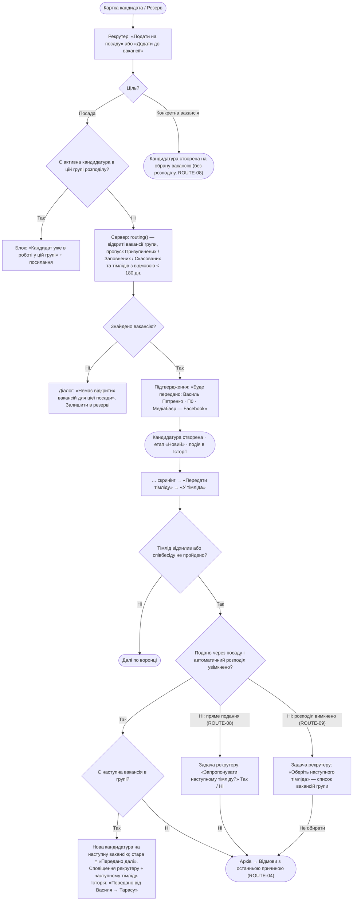
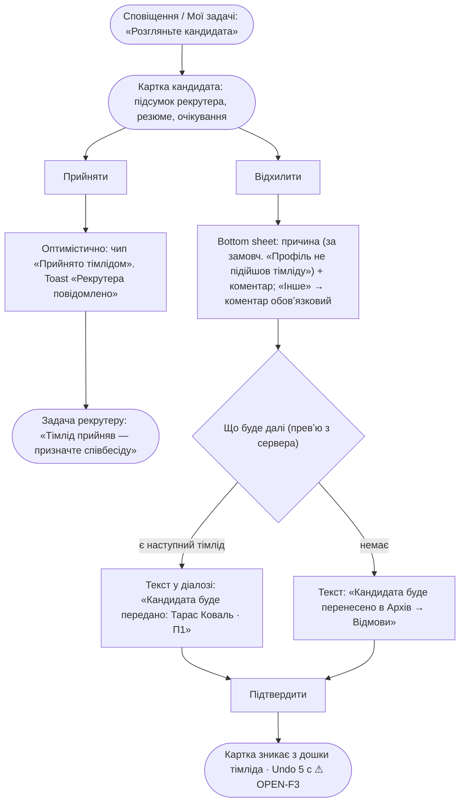
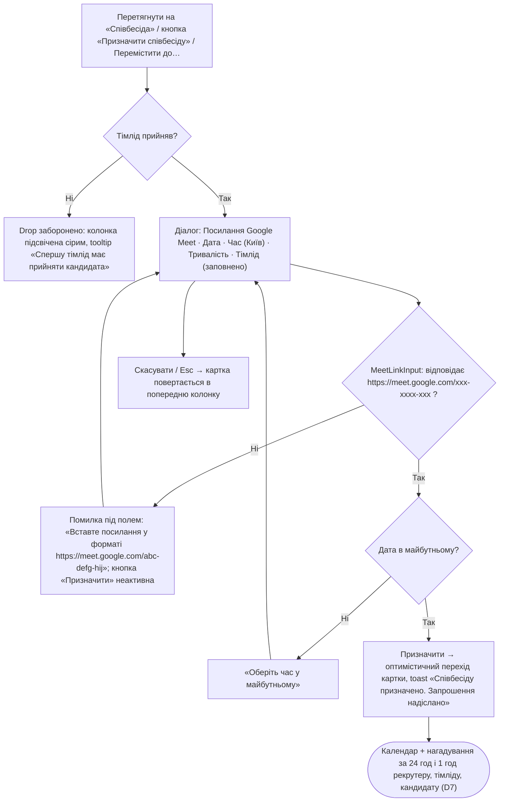
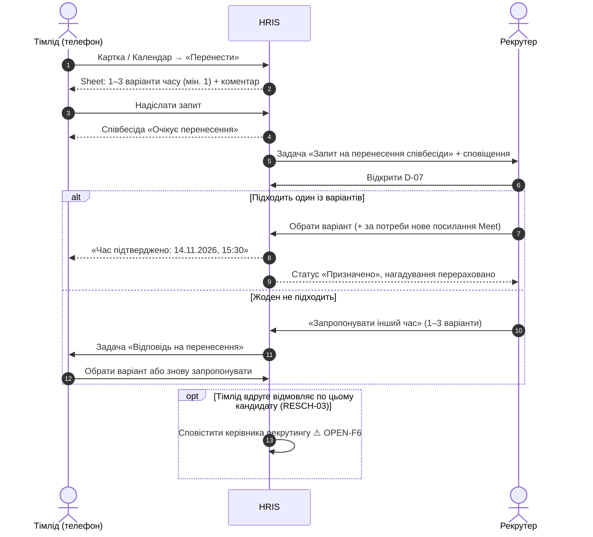
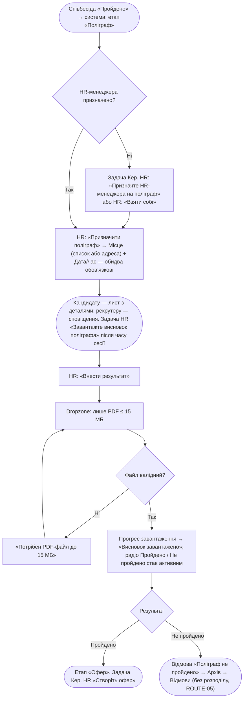
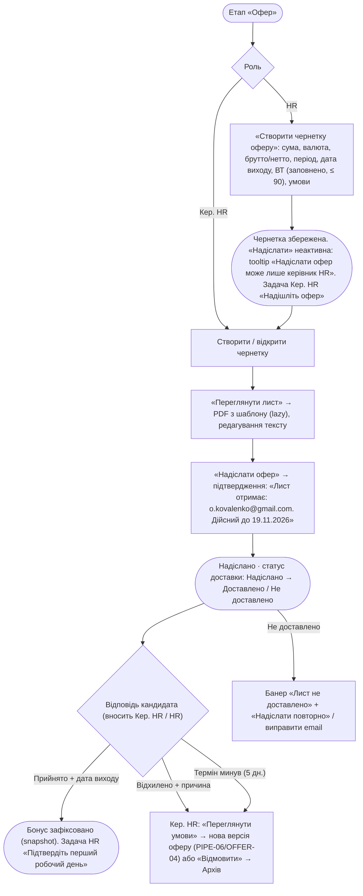
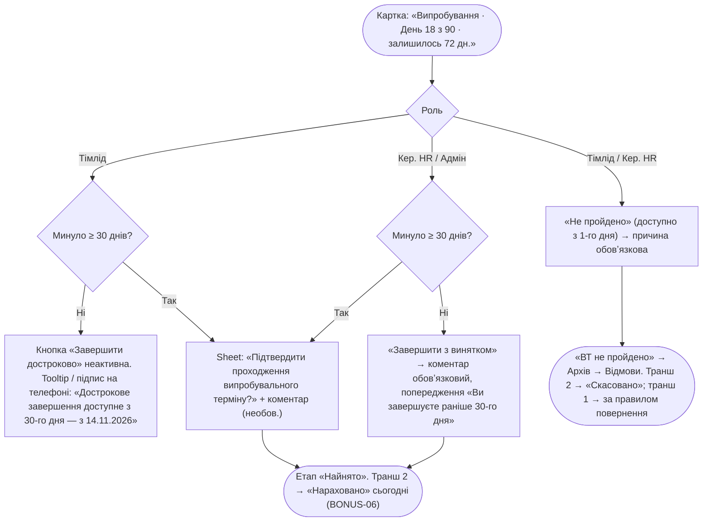
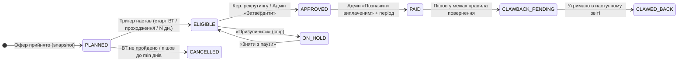
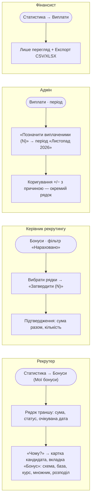
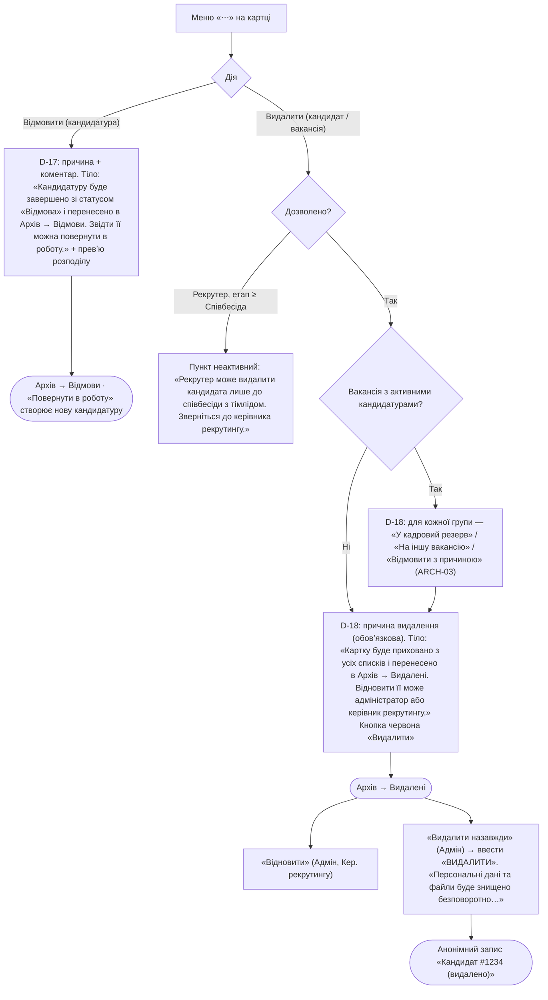

# User flows (Phase 0)

> Mermaid. Ukrainian strings in nodes are the actual UI copy (see `glossary.md`). Dialog IDs (D-xx) from `screens.md` §4.
> Legend: rounded = screen/state, rectangle = user action, rhombus = system/validation, `⚠` = OPEN.

## F-1 Submit candidate → routing [ROUTE-01..09, CAND-03]

- Routing preview in G and in reject dialog D-17 is rendered from the same server function (no client logic).
- ⚠ OPEN-F1: stage of the re-routed application (NEW / IN_WORK / SUBMITTED_TO_TL). Flow assumes **SUBMITTED_TO_TL** (screening already done; next TL is notified per ROUTE-03).
- ⚠ OPEN-F2: does routing apply when the candidate is added to a Position at NEW, or only at «Передати тімліду»? Flow assumes at creation (ROUTE-02 wording).

## F-2 TL accept / decline (mobile-first) [PIPE §6.1 st.3, ROUTE-03]

- Mobile: sticky bottom action bar `[Відхилити] [Прийняти]` (equal width, 48 px). Accept is one tap, no dialog.

## F-3 Schedule interview — Meet link mandatory [PIPE-04, D-01/D-04]

- Same MeetLinkInput for the screening call (D-01, NEW → IN_WORK).
- ⚠ OPEN-F4: interview duration field — not in PRD; proposal: default 45 хв, optional.
- ⚠ OPEN-F5: paste of a link with query (`?authuser=0`) — strip automatically or reject? Proposal: strip and show normalized value.

## F-4 TL reschedule → recruiter confirm [RESCH-01..04]

- Old slot stays visible struck-through until confirmation; Meet link stays valid unless replaced.
- ⚠ OPEN-F6: RESCH-03 "declining the interview request a second time" — means 2nd reschedule request or 2nd decline of the candidate? Copy and trigger depend on it.
- ⚠ OPEN-F7: can the recruiter initiate a reschedule (candidate asked)? Not in PRD; flow covers TL-initiated only.

## F-5 Polygraph schedule + PDF upload [POLY-01..05, PIPE-03]

- Before upload, «Зберегти результат» disabled with tooltip «Спершу завантажте висновок (PDF)» [POLY-03].
- Recruiter/TL see only «Поліграф · Пройдено/Не пройдено»; PDF row hidden (not disabled) [POLY-04].
- If POLY-05 enabled: after HR result → «Очікує перевірки керівником HR» before the stage changes.

## F-6 Head HR offer create / send [OFFER-01..04, BONUS-02]

- Version list «Версія 1 · надіслано 14.11», «Версія 2 · чернетка»; older versions read-only.
- ⚠ OPEN-F8: is a "Expired" offer auto-set by job at validity end, or recorded manually?

## F-7 Probation early close (locked before day 30) [PROB-01..05, BONUS-06]

- No UI anywhere allows a later end date: date pickers for end date have `max = current end` [PROB-05, D10].
- On a phone the disabled reason is shown as visible helper text under the button (tooltips do not work on touch).
- ⚠ OPEN-F9: day counting — is the start date day 1 or day 0? Defines when "≥ 30 days elapsed" unlocks. Copy always shows the exact unlock date computed server-side.
- ⚠ OPEN-F10: can HR (not Head HR) close probation as passed/failed? §2.3 lets HR move Probation; §6.1 lists TL / Head HR only. Flow assumes HR only confirms first day.

## F-8 Bonus lifecycle view [BONUS §9.3, BONUS-04..14]

UI labels: Заплановано → Нараховано → Затверджено → Виплачено; side: Скасовано, Призупинено, Очікує повернення, Повернено.

- Amount tooltip: «Зафіксовано 19.11.2026 за схемою «Стандартна 30/70»; курс 1 $ = 41,20 ₴».
- Expected date only moves earlier; if it moved, show «Раніше: 17.02.2027» struck-through.

## F-9 Delete vs reject → archives [ARCH-01..05, PIPE §6.1, D13]

- Destructive buttons: red, never default-focused; focus lands on «Скасувати».
- Archive screens and dialogs (Відновити, Видалити назавжди, Повернути в роботу, purged stub): `wireframes/archive.md`.
- ⚠ OPEN-F11: deleting a candidate who has active applications — are applications closed (how, which status) or hidden with the candidate?

## ⚠ OPEN (flows)

F1 re-routed application start stage · F2 routing moment (NEW vs submit) · F3 undo window for TL decline (UX proposal, needs ok since decline triggers routing + notifications) · F4 interview duration · F5 Meet link normalisation · F6 RESCH-03 meaning · F7 recruiter-initiated reschedule · F8 offer expiry auto vs manual · F9 probation day counting · F10 HR probation close rights · F11 deleting candidate with active applications.
